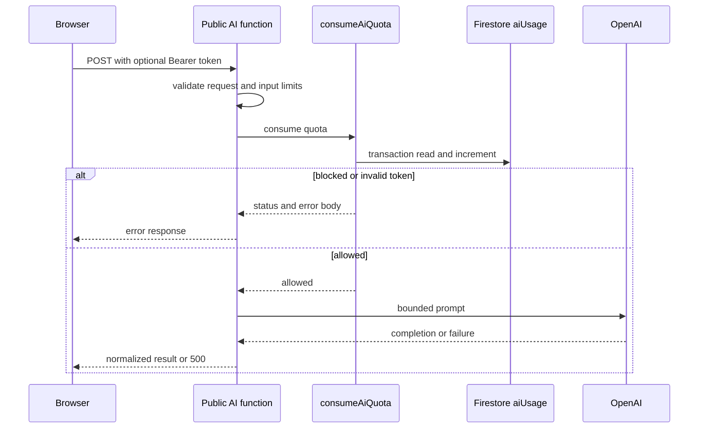

# 범위와 목적

`openaiChatCompletions`와 `translateFlashcards`는 랜딩 데모를 위해 CORS를 허용하고 `invoker: "public"`으로 배포되는 HTTP 함수다. 브라우저는 프로덕션에서 환경 변수 기반 Functions URL에 함수 이름을 붙여 호출하고, 로그인 상태이면 Firebase ID 토큰을 `Authorization` 헤더에 넣는다. URL은 브라우저 번들에서 알아낼 수 있으므로 주소를 감추는 것은 보호 수단이 아니다.

이 경계의 보호 수단은 `functions/src/ai-guard.ts`의 `consumeAiQuota`다. 두 함수는 요청 형식과 각자의 입력 크기를 먼저 확인한 뒤 모델 호출 전에 서버 소유 일일 카운터를 원자적으로 증가시킨다. 즉 공개 엔드포인트를 없애는 장치가 아니라, 공개 상태를 전제로 호출량과 입력량을 제한하는 장치다.

질문 재생성의 `regenerateCardQuestion`도 공개 HTTP 함수지만 이 공용 guard의 대상이 아니다. 이 함수는 `regenerateCounts`와 `demoRegenerateCounts`를 사용하는 별도 정책을 구현한다. 특히 재생성 카운터는 모델 응답을 파싱한 **뒤** 기록되므로, 이 문서의 선차감·실패 차감 규칙을 재생성 경로에 일반화해서는 안 된다.



*공개 호출부터 검증, 한도 차감, 모델 호출과 응답까지의 순서이며, 모델 호출 전 통과한 요청은 이미 차감되어 있다.*

## 호출자 구분과 일 경계

| 호출 상태 | 식별 키 | 일일 한도 | 추가 제한 |
| --- | --- | ---: | --- |
| 유효한 Firebase ID 토큰이 있는 Free 사용자 | 검증된 `uid` | 100 | 없음 |
| 유효한 Firebase ID 토큰이 있는 Pro 사용자 | 검증된 `uid` | 300 | 없음 |
| `Bearer ` 토큰이 없는 데모 호출 | 전달 헤더의 첫 주소 또는 `req.ip`에서 만든 SHA-256 해시 앞 32자 | 30 | 모든 비로그인 호출이 공유하는 500회 상한 |

`Authorization`이 정확히 `Bearer `로 시작하면 guard는 ID 토큰을 검증한다. 검증 실패는 익명으로 되돌아가지 않고 `401` 및 `UNAUTHENTICATED`로 끝나며 카운터를 차감하지 않는다. 해당 형식의 토큰이 없을 때만 익명 정책을 적용한다. 앱 API 클라이언트도 로그인 상태라면 토큰을 헤더에 실어 로그인 호출이 데모 버킷을 소모하지 않게 한다.

날짜 키는 현재 시각에 9시간을 더한 뒤 ISO 날짜 부분을 취한 `YYYY-MM-DD`이므로 KST 자정에 일일 집계가 바뀐다. 각 문서는 `date`, `count`, `updatedAt`을 저장하며, 문서의 날짜가 오늘과 다르면 기존 `count`는 0으로 간주한다. 별도 정리 작업 없이 다음 번 허용 차감이 새 날짜와 카운트로 문서를 덮어쓴다.

## 왜 익명 한도가 두 개인가

익명 호출자 문서 ID에는 원문 주소 대신 해시만 저장한다. 다만 `X-Forwarded-For`는 호출자가 채울 수 있으므로 호출자별 30회 제한만으로는 헤더 값을 바꾸는 우회를 막지 못한다. 익명 차감은 같은 Firestore 트랜잭션에서 호출자 문서와 `anonGlobal` 문서를 함께 읽고 둘 다 증가시킨다. 전역 카운터를 먼저 검사하므로, 호출자 키를 바꾼 요청도 공유 상한을 넘으면 `429` 및 `DEMO_BUDGET_EXCEEDED`가 된다.

로그인 호출에는 이 익명 전역 상한을 적용하지 않는다. 익명 트래픽이 전역 몫을 모두 써도 로그인 사용자의 생성·번역이 함께 중단되지 않게 하는 분리다. 더 강한 요청 출처 증명이 필요하면 이 코드만으로는 충분하지 않으며, App Check를 도입할 경우 콘솔 측 등록 및 enforcement 설정까지 함께 운영해야 한다.

## 카운터 소유권과 원자성

카운터는 `users/{uid}`가 아니라 `aiUsage` 컬렉션에 있다. Firestore 규칙은 이 컬렉션에 클라이언트 `match` 규칙을 두지 않아 기본 거부하며, Cloud Functions의 Admin SDK가 접근한다. 사용자가 쓰고 삭제할 수 있는 사용자 문서에 사용량을 저장하면 문서 삭제·재생성으로 한도를 초기화할 수 있기 때문이다. 이 저장소 경계의 상세는 [Firestore 데이터 경계](firestore-data-boundary.md)에서 다룬다.

- 로그인 호출은 `user__${uid}` 문서를 트랜잭션으로 읽고, 오늘의 카운트가 등급 한도 미만일 때만 1 증가시킨다.
- 익명 호출은 `anon__${ipHash}`와 `anonGlobal`을 **한 트랜잭션**에서 읽고 쓴다. 읽기와 쓰기를 분리하면 동시 요청이 같은 잔여 횟수를 보고 상한 이상으로 통과할 수 있다.
- 한도에 막힌 요청은 카운터를 바꾸지 않는다. 일반 한도 오류는 `429`, `LIMIT_EXCEEDED`, 적용 한도를 담고, 익명 전역 상한은 별도 오류 코드를 사용한다.

# 입력 크기 경계

호출 횟수 제한은 요청 하나가 매우 큰 프롬프트가 되는 문제를 해결하지 않는다. 두 공개 함수는 모델 호출 전에 다음 입력 경계를 적용한다.

| 경로 | 제한 | 처리 |
| --- | --- | --- |
| 카드 생성 `openaiChatCompletions` | `MAX_FLASHCARD_PROMPT_CHARS` 30,000자 | 공용 `requestFlashcardCompletion`이 본문 앞부분을 자르고 경고를 남긴 뒤 호출한다. |
| 카드 번역 `translateFlashcards` | `MAX_TRANSLATE_CARDS` 200장 | 초과 시 모델 호출과 quota 차감 전에 `413 PAYLOAD_TOO_LARGE`로 거부한다. |
| 카드 번역 `translateFlashcards` | `MAX_TRANSLATE_PROMPT_CHARS` 120,000자 | 질문·답변 쌍을 JSON 문자열로 만든 길이가 초과하면 같은 `413`으로 거부한다. |

번역은 결과 배열을 원본 카드 인덱스에 맞춰 다시 붙인다. 입력을 임의로 잘라 카드 수가 달라지면 이 대응이 깨질 수 있으므로, 생성 경로와 달리 잘라서 계속하지 않는다. 번역 결과 수가 실제 카드 수와 달라도 함수는 경고를 남기고, 없는 항목에는 원본 질문·답변을 유지한다.

# 차감 순서와 실패 의미

입력 검증의 위치가 비용 경계의 일부다.

1. `openaiChatCompletions`는 공급자 구성이 가능한지와 `text` 존재를 확인한 뒤 quota를 차감하고, 공용 생성 함수가 프롬프트를 자른 뒤 모델을 호출한다.
2. `translateFlashcards`는 HTTP 메서드, 요청 구조, 카드 수, 직렬화한 본문 길이를 먼저 확인한 뒤 quota를 차감하고 모델을 호출한다.
3. guard가 허용을 반환하는 시점에는 Firestore 트랜잭션의 증가가 이미 완료되어 있다. 그 뒤 모델이 오류를 반환하거나 네트워크 오류·응답 JSON 파싱 오류가 나도 차감은 되돌리지 않는다.

이 선차감은 동일한 허용량을 여러 동시 요청이 소비하는 일을 막는 대신, 모델 실패가 사용자 관점에서는 성공 결과 없이 한도를 소비할 수 있음을 뜻한다. 재시도나 환불을 추가하려면 오류 처리기에 단순 감소 연산을 붙이지 말고, 요청 식별자와 최종 상태를 포함하는 별도 예약·확정 설계를 도입해야 한다. 그렇지 않으면 중복 실패 처리나 재시도로 상한을 우회할 수 있다.

응답도 호출자가 관찰하는 계약이다. guard의 인증 실패·한도 초과는 각각 `401`·`429`와 구조화된 오류 본문을 그대로 반환한다. 번역 함수는 모델 비정상 응답의 상태 코드만 오류 메시지에 담지만, 카드 생성 함수의 `OpenAIRequestError` 처리는 공급자 오류 본문도 500 응답에 포함한다. 외부 오류 세부 정보를 노출하지 않는 정책으로 바꾸려면 두 경로를 함께 검토해야 한다.

## 별도 경로: 질문 재생성

`regenerateCardQuestion`은 `consumeAiQuota`를 호출하지 않는다. `Bearer ` 토큰이 있으면 검증된 사용자에 대해 `regenerateCounts`를, 없으면 필수 `demoDeviceId`의 해시를 키로 하는 `demoRegenerateCounts`를 사용한다. 로그인 Free·Pro와 데모의 한도도 공용 guard의 100·300·30/500 정책과 다르다.

이 경로는 한도를 확인하고 모델 호출 및 응답 파싱을 성공시킨 뒤 `set`으로 카운터를 기록한다. 따라서 모델 실패와 파싱 실패는 재생성 횟수를 소비하지 않는다. 또한 이 읽기·확인·쓰기 흐름은 공용 guard의 Firestore 트랜잭션이 아니다. 재생성을 공용 정책으로 통합하거나 동시성 보장을 추가할 때는, 선차감 여부와 원자성 모두를 의도적으로 재설계해야 한다.

# 변경 및 운영 점검

- 함수 이름이나 호출 URL을 바꾸면 앱의 `openaiApi.ts`와 `translateApi.ts`가 조합하는 URL, 그리고 개발 서버의 `/api` 프록시를 함께 확인한다. 프로덕션 URL은 빌드 시 환경 변수에서 정해지고, 개발 시 `/api`는 대상 URL로 프록시되며 접두사가 제거된다. 배포·로컬 연결 절차는 [로컬 개발 및 배포](../operations/local-development-and-deployment.md)를 참고한다.
- 등급 판정은 `users/{uid}.subscriptionTier === "pro"`만 Pro로 보고 그 외는 Free로 취급한다. 한도나 등급을 바꿀 때는 서버가 신뢰하는 이 필드의 쓰기 권한도 [Firestore 데이터 경계](firestore-data-boundary.md)와 함께 검토한다.
- `aiUsage`의 문서 ID 접두사와 `anonGlobal`은 정책 상태의 일부다. 이름을 바꾸거나 사용자 문서로 옮기면 기존 사용량 연속성과 클라이언트 비쓰기 불변식을 명시적으로 이전해야 한다.
- Functions는 배포 전에 TypeScript를 빌드한다. 변경 후 최소한 다음을 실행하고, Emulator에서 유효 토큰·없는 토큰·잘못된 Bearer 토큰, 각 413 입력, 한도 도달, 모델 실패 뒤 재호출을 확인한다.

```bash
pnpm --prefix functions run lint
pnpm --prefix functions run build
```

카드 생성의 공용 모델 호출 및 사전 생성 경로와의 관계는 [카드 생성 경로](../flashcard/generation-paths.md)에서 확인할 수 있다.
