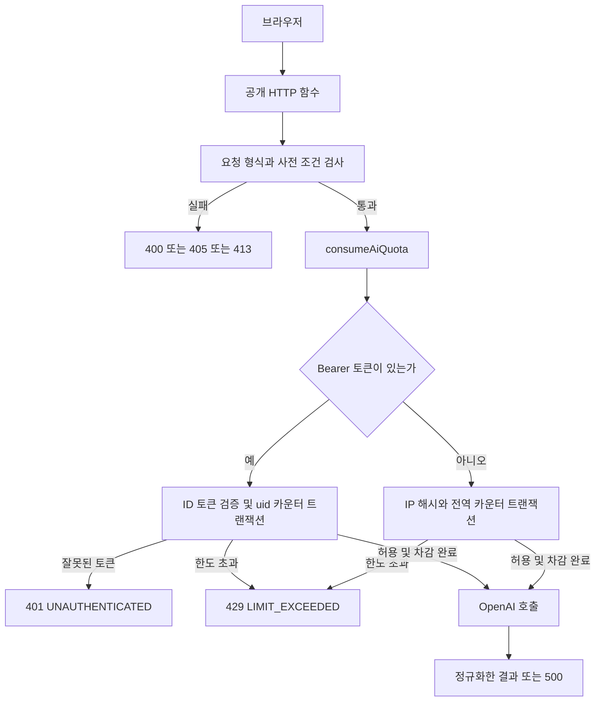

# 범위와 책임

`openaiChatCompletions`와 `translateFlashcards`는 비로그인 랜딩 데모를 위해 CORS를 허용하고 `invoker: "public"`으로 배포한 HTTP 함수다. 클라이언트는 프로덕션에서 `VITE_FUNCTIONS_URL_PROD`에 함수 이름을 붙여 `POST`하며, 로그인 상태면 Firebase ID 토큰을 `Authorization` 헤더에 보낸다. 개발 중에는 같은 클라이언트 코드가 `/api`를 사용하고 Vite 프록시가 이를 로컬 Functions URL로 전달한다.

따라서 함수 URL을 숨기는 것은 보안 경계가 될 수 없다. 주소는 클라이언트가 호출해야 하는 공개 진입점이며, 인증되지 않은 요청도 도달할 수 있다. 이 경계의 책임은 진입 자체를 감추는 것이 아니라, 모델 호출 전에 서버가 신뢰하는 식별자·일일 사용량·입력 크기를 검사해 호출량을 제한하는 것이다. 공용 정책의 소유자는 `functions/src/ai-guard.ts`의 `consumeAiQuota`다.



*공용 생성·번역 경로에서 요청 검증 뒤 quota를 원자적으로 차감하고, 허용된 요청만 모델로 진행하는 분기다.*

`openaiChatCompletions`는 API 키와 `text` 존재를 확인한 뒤 guard를 호출한다. `translateFlashcards`는 `POST` 여부, 카드 배열과 대상 언어, 아래의 카드 수·본문 길이를 먼저 검증한다. 따라서 번역의 `413`과 형식 오류는 quota를 소모하지 않는다. 반면 생성 프롬프트의 자르기는 guard 뒤 공용 모델 호출 안에서 일어난다.

## 인증별 버킷과 일 경계

| 호출 상태 | 식별 키 | 일일 한도 | 추가 제한 |
| --- | --- | ---: | --- |
| 유효한 Firebase ID 토큰의 Free 사용자 | 검증된 `uid` | 100회 | 없음 |
| 유효한 Firebase ID 토큰의 Pro 사용자 | 검증된 `uid` | 300회 | 없음 |
| `Authorization` 헤더가 없는 익명 호출 | `X-Forwarded-For` 첫 값 또는 `req.ip`의 SHA-256 앞 32자 | 30회 | 모든 익명 호출이 공유하는 500회 상한 |

`Authorization`이 `Bearer `로 시작하면 익명으로 폴백하지 않고 Firebase Admin SDK로 ID 토큰을 검증한다. 검증 실패는 카운터를 바꾸지 않고 `401 UNAUTHENTICATED`를 반환한다. 헤더가 없을 때만 익명 버킷을 사용한다. 앱의 `getAuthHeader`는 현재 로그인 사용자의 토큰을 가져오지 못하면 빈 헤더를 반환하므로, 이 경우 서버는 익명 정책으로 처리한다.

Pro 판정은 서버가 읽은 `users/{uid}.subscriptionTier === "pro"`이다. 클라이언트는 이 필드를 변경할 수 없도록 Firestore 규칙이 사용자 쓰기 필드를 제한한다. 일자 키는 현재 시각에 9시간을 더해 만든 KST `YYYY-MM-DD`다. 카운터 문서의 `date`가 오늘과 다르면 기존 `count`를 0으로 취급하고 다음 허용 요청이 새 날짜·카운트·`updatedAt`을 쓴다. 별도 정리 작업은 필요하지 않다.

## 익명 상한이 IP 은닉보다 중요한 이유

익명 호출자 문서에는 원본 IP가 아니라 해시만 저장한다. 이는 저장되는 식별 정보를 줄이는 조치이지 요청 출처를 증명하는 보안 경계는 아니다. 특히 `X-Forwarded-For`의 첫 값은 호출자가 넣을 수 있으므로, 요청자가 값을 바꾸면 IP별 30회 제한의 키를 계속 바꿀 수 있다. URL이나 클라이언트 주소를 숨겨도 공개 HTTP 요청의 헤더를 통제할 수 없으므로 같은 문제가 남는다.

이를 완화하는 비용 경계는 `anonGlobal`이다. 익명 요청은 호출자 문서와 전역 문서를 **하나의 Firestore 트랜잭션**에서 읽고, 전역 상한을 먼저 검사한 뒤 둘을 함께 1씩 증가시킨다. 이 서버 전용 공유 카운터는 위조 가능한 호출자 키와 독립적이므로, IP별 제한을 우회해도 하루 익명 호출 전체는 500회 뒤 `429 DEMO_BUDGET_EXCEEDED`로 멈춘다. 로그인 호출은 이 전역 버킷을 쓰지 않아 익명 트래픽이 로그인 사용자의 버킷을 소진시키지는 않는다.

더 강한 출처 증명은 현재 IP 해시만으로 제공되지 않는다. App Check를 추가하려면 코드 외에도 Firebase 콘솔에서 reCAPTCHA 등록과 enforcement를 함께 운영해야 한다. 이 변경은 전역 상한을 대체하기보다, 위조 요청이 함수까지 도달하는 것을 줄이는 별도 계층으로 검토한다.

## 서버가 소유하는 카운터와 원자성

`aiUsage`는 `users/{uid}`와 분리된 서버 전용 컬렉션이다. Firestore 규칙에 이 컬렉션의 클라이언트 `match` 규칙이 없으므로 기본 거부이며, Functions의 Admin SDK만 읽고 쓴다. 반대로 `users/{uid}`는 본인이 삭제할 수 있다. 사용량을 그 문서에 두면 삭제 후 재생성으로 한도를 초기화할 수 있으므로, 서버 전용 상태가 호출 한도의 필수 조건이다. 데이터 접근 경계의 전체 맥락은 [Firestore 데이터 경계](firestore-data-boundary.md)를 참고한다.

- 로그인 요청은 `user__${uid}`를 트랜잭션으로 읽고, 오늘의 수가 등급 한도 미만일 때만 증가시킨다.
- 익명 요청은 `anon__${ipHash}`와 `anonGlobal`을 같은 트랜잭션에서 읽고 쓴다. 읽기와 증가를 분리하면 동시 요청이 같은 잔여 횟수를 보고 상한 이상으로 통과할 수 있다.
- 한도에 막힌 요청은 `429`를 반환하고 증가시키지 않는다. 일반 한도 초과의 코드는 `LIMIT_EXCEEDED`이며 적용 한도를 포함한다.

## 입력 크기 경계

호출 횟수만 제한하면 하나의 요청이 과도하게 큰 프롬프트가 될 수 있다. 모델 호출 전후의 위치가 서로 다른 두 입력 정책이 이를 보완한다.

| 경로 | 제한 | 처리와 quota 관계 |
| --- | --- | --- |
| 카드 생성 `openaiChatCompletions` | `MAX_FLASHCARD_PROMPT_CHARS` 30,000자 | `requestFlashcardCompletion`이 본문 앞부분을 잘라 모델에 보낸다. 이 동작은 quota 차감 뒤이므로 허용된 생성 요청은 잘렸더라도 1회를 쓴다. |
| 카드 번역 `translateFlashcards` | `MAX_TRANSLATE_CARDS` 200장 | 초과하면 모델 호출과 quota 차감 전에 `413 PAYLOAD_TOO_LARGE`로 거부한다. |
| 카드 번역 `translateFlashcards` | `MAX_TRANSLATE_PROMPT_CHARS` 120,000자 | 질문·답변 쌍을 JSON으로 직렬화한 길이가 초과하면 같은 `413`으로 거부한다. |

번역은 모델 결과를 원본 카드의 인덱스에 다시 결합한다. 입력을 임의로 자르면 카드 수와 순서의 대응을 보장할 수 없으므로 생성과 달리 계속 진행하지 않는다. 응답 항목 수가 원본과 다르면 경고를 남기고, 없는 번역에는 원본 질문·답변을 유지한다.

## 차감 시점과 실패 계약

guard가 `allowed: true`를 반환할 때 Firestore 트랜잭션의 증가는 이미 끝났다. 이후 모델의 비정상 상태, 네트워크 오류, 또는 번역 응답 JSON 파싱 오류가 나도 `aiUsage`를 감소시키는 로직은 없다. 즉 모델 결과를 받지 못한 호출도 공용 생성·번역 버킷에서는 이미 한 번 사용한 것으로 남는다. 선차감은 동시 요청이 동일한 잔여 한도를 중복 소비하는 일을 막지만, 실패한 요청을 자동 환불하지는 않는다.

환불 또는 재시도를 도입하려면 오류 처리기에 단순 감소 연산을 추가해서는 안 된다. 중복 오류 처리·재시도와 경쟁하지 않도록 요청 식별자, 예약 상태, 최종 확정 상태를 갖는 별도 설계가 필요하다.

함수의 오류 응답도 외부 계약이다. guard의 인증 실패와 한도 초과는 각각 `401`·`429`와 구조화된 본문을 호출자에게 전달한다. 번역은 공급자 비정상 응답의 상태만 일반 오류 메시지에 넣지만, 카드 생성은 `OpenAIRequestError`의 공급자 상태와 본문을 500 응답에 포함한다. 공급자 오류의 노출 정책을 변경한다면 두 경로를 함께 검토해야 한다.

# 질문 재생성은 별도 정책이다

`regenerateCardQuestion`도 CORS와 `invoker: "public"`을 사용하는 공개 HTTP 함수지만 `consumeAiQuota`를 호출하지 않는다. 그러므로 위의 `aiUsage` 한도, 익명 전역 상한, 입력 자르기 및 선차감 규칙을 이 경로에 적용해 해석해서는 안 된다.

| 재생성 호출 상태 | 상태 컬렉션과 키 | 일일 한도 | 차감 시점 |
| --- | --- | ---: | --- |
| 로그인 Free | `regenerateCounts/{uid}` | 3회 | 모델 응답을 파싱한 뒤 성공 응답 직전 |
| 로그인 Pro | `regenerateCounts/{uid}` | 20회 | 모델 응답을 파싱한 뒤 성공 응답 직전 |
| 익명 데모 | 해시한 `demoDeviceId`의 `demoRegenerateCounts/{hash}` | 1회 | 모델 응답을 파싱한 뒤 성공 응답 직전 |

로그인 재생성은 Bearer 토큰이 있으면 이를 검증하고, 없으면 호출자가 보낸 `demoDeviceId`를 필수로 한다. 두 종류의 카운터 모두 KST 날짜가 달라지면 0부터 다시 센다. 이 카운터들은 `users/{uid}` 밖에 있어 클라이언트가 사용자 문서를 삭제해서 초기화할 수 없고, Firestore 규칙도 `regenerateCounts`에는 본인 읽기만 허용하며 `demoRegenerateCounts`에는 클라이언트 규칙을 두지 않는다.

공용 guard와 달리 재생성은 카운터를 읽어 한도를 검사한 후 모델을 호출하고, 성공 처리 끝에 `set`한다. 따라서 모델 오류와 파싱 오류는 재생성 카운터를 소모하지 않는다. 또한 이 읽기·호출·쓰기 흐름은 트랜잭션이 아니므로 동시에 여러 요청이 같은 잔여 횟수를 관찰하면 설정한 한도를 초과해 성공할 가능성이 있다. 재생성 한도를 공용 guard 수준으로 엄격히 적용하려면 모델 호출 전에 서버 전용 트랜잭션으로 예약·차감하는 방식과 실패 처리 정책을 명시해야 한다.

# 변경·운영·검증

- 공개 함수 이름 또는 기본 URL을 바꾸면 `openaiApi.ts`, `translateApi.ts`, 그리고 로컬 `/api` 프록시를 함께 변경·검증한다. 배포 진입점은 `functions/src/index.ts`의 export로 결정된다.
- 한도 또는 등급을 바꿀 때는 상수만 바꾸지 말고 `subscriptionTier`의 서버 전용 쓰기 불변식, KST 일 경계, 기존 `aiUsage` 문서 ID의 연속성을 함께 검토한다.
- `aiUsage`, `anonGlobal`, `regenerateCounts`, `demoRegenerateCounts`에 클라이언트 쓰기 규칙을 추가하지 않는다. 사용자가 카운터를 수정하거나 삭제할 수 있으면 호출 한도는 보안 경계가 아니다.
- 현재 이 경로를 직접 다루는 자동 테스트 파일은 없다. Emulator 또는 배포 전 환경에서 유효 토큰·토큰 없음·잘못된 Bearer 토큰, 사용자·익명 한도 도달, 번역의 두 `413` 사례, 모델 실패 뒤 공용 quota 재호출, 동시 재생성 요청을 확인한다.
- Functions 배포 전에는 TypeScript 빌드가 실행된다. 최소한 다음을 실행한다.

```bash
pnpm --prefix functions run lint
pnpm --prefix functions run build
```

카드 생성의 공용 모델 호출과 사전 생성 경로는 [카드 생성 경로](../flashcard/generation-paths.md), 덱 크기와 번역 입력의 관계는 [덱 크기 예산](../flashcard/deck-size-budget.md)에서 확인할 수 있다.
