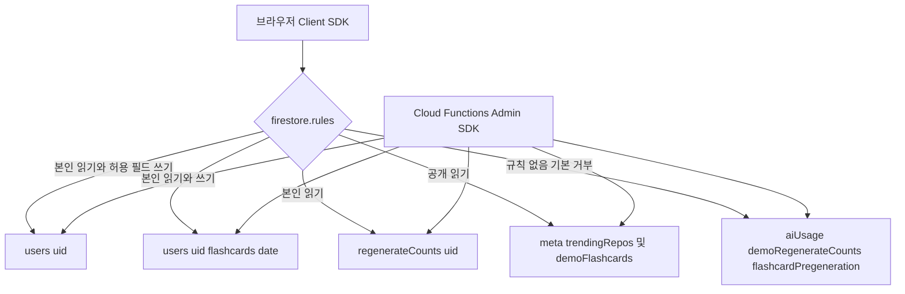
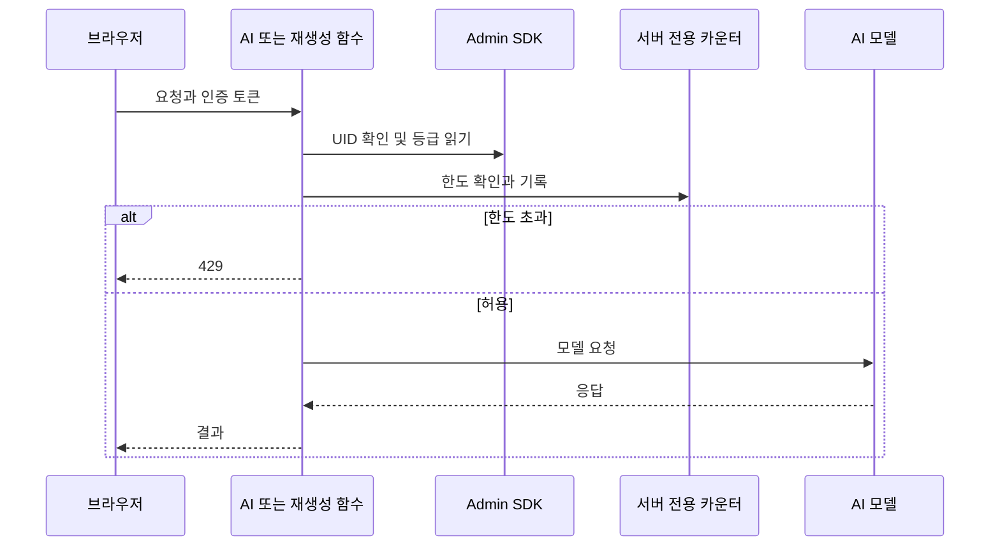

`firestore.rules`는 브라우저의 Firebase Client SDK가 소유할 문서와 Cloud Functions의 Admin SDK가 관리할 상태를 구분한다. Admin SDK는 규칙을 우회한다. 따라서 규칙에 클라이언트 허용을 추가하는 일은 단순한 UI 변경이 아니라, 신뢰하지 않는 클라이언트에 데이터 읽기·변경·삭제 능력을 부여하는 보안 경계 변경이다.

가장 중요한 원칙은 **사용자가 삭제할 수 있는 `users/{uid}`에 한도, 결제 권한의 원본, 중복 방지나 작업 완료 상태를 두지 않는 것**이다. 표시가 필요하면 `regenerateCounts/{uid}`처럼 최소 범위의 읽기 전용 투영을 별도로 둔다.

클라이언트 규칙과 Admin SDK가 같은 Firestore 경로를 다루되, 서버 전용 상태는 클라이언트 `match`를 만들지 않아 기본 거부로 남는 소유권 구조다.

## 경로별 소유자와 접근 계약

| 영역 | 경로와 Client SDK 권한 | 주 쓰기 주체와 용도 |
|---|---|---|
| 사용자 설정·프로필 | `users/{uid}`: 인증 UID가 문서 ID와 같은 본인만 읽기·생성·갱신·삭제 | 로그인과 설정 화면이 허용된 설정 필드를 병합한다. Stripe 웹훅은 같은 문서의 구독 필드를 Admin SDK로 병합한다. |
| 일별 덱 | `users/{uid}/flashcards/{YYYY-MM-DD}`: 본인 읽기·쓰기 | 앱은 생성, 번역, 브랜치 보강 결과를 언어별 `data_ko` 또는 `data_en`에 병합한다. 사전 생성 작업도 같은 문서에 쓴다. 규칙은 카드 본문의 형태를 검증하지 않으므로 이 경로의 모든 클라이언트 쓰기는 본인 데이터 범위에 한정된다. |
| 재생성 표시 카운터 | `regenerateCounts/{uid}`: 본인 읽기만 | `regenerateCardQuestion`이 Admin SDK로 기록하고, 앱은 실시간 구독으로 버튼 상태를 표시한다. |
| 공개 랜딩 캐시 | `meta/trendingRepos`, `demoFlashcards/{cacheId}`: 비로그인 공개 읽기, 클라이언트 쓰기 없음 | `refreshTrendingRepos`와 데모 사전 생성 작업이 Admin SDK로 갱신·정리한다. |
| 서버 전용 상태 | `aiUsage`, `demoRegenerateCounts`, `flashcardPregeneration`: 규칙 `match` 없음 | AI 호출 비용 한도, 데모 재생성 한도, 사용자별 사전 생성 완료 결과를 서버만 관리한다. |
| 탈퇴 당일 기록 | `deletedUsers/{uid}`: 본인 읽기·생성만 | 탈퇴 흐름이 Auth 삭제 전에 생성한다. 로그인과 KST 기준 정리 작업이 재가입 차단 기간을 처리한다. |

`notices/{noticeId}`는 인증된 사용자에게 읽기만 허용한다. 그러나 설정 화면은 다른 경로인 `config/notice`를 `onSnapshot`으로 구독한다. 현재 규칙에는 `config/notice`의 `match`가 없으므로 그 읽기는 기본 거부다. 공지를 고칠 때는 문서 경로를 `notices`로 맞추거나, 공개 범위와 인증 요구를 정한 전용 규칙을 추가해야 한다.

## `users/{uid}`: 설정은 허용 목록으로, 서버 필드는 보존으로

생성은 문서의 모든 키가 `userWritableFields()` 안에 있어야 하고, 갱신은 `request.resource.data.diff(resource.data).affectedKeys()`만 같은 목록 안에 있어야 한다. 그 결과 기존 문서에 서버가 추가한 `subscriptionTier`, `subscriptionPeriodEnd`, `stripeCustomerId`가 있어도 클라이언트는 설정만 갱신할 수 있다. 반대로 클라이언트가 그 서버 필드를 추가·수정·삭제하면 거부된다.

허용 필드는 `repositories`, 온보딩 상태, `githubToken`, 푸시 설정과 FCM 토큰, `timezone`, `language`, `updatedAt`이다. 규칙은 다음 계약도 강제한다.

- `repositories`는 최대 5개이고, 각 항목은 `fullName`과 HTTPS `url`을 가져야 하며 선택 `branch` 외 키는 가질 수 없다. 각 문자열 길이도 제한한다.
- 불리언, 토큰·타임존 문자열 길이, `language`의 `ko`/`en`, `preferredPushHour`의 0–23 범위를 검사한다. 후자는 캐시된 과거 번들과의 호환을 위해 `int`가 아닌 `number`를 받는다.
- `updatedAt`은 제한된 길이의 문자열 또는 Firestore `timestamp`다. 서비스 워커에 남은 과거 번들이 `Date`를 기록할 수 있으므로, 새 규칙이 타입을 즉시 하나로 좁히면 이미 배포된 클라이언트의 설정 저장이 실패한다.

설정 화면은 `setDoc(..., { merge: true })`와 `updateDoc`으로 자신이 소유한 필드만 쓴다. 로그인도 새 문서에는 토큰과 `updatedAt`만 만들고 기존 문서에는 둘만 갱신한다. 이 병합 단위는 Stripe 웹훅의 Admin SDK 병합과 공존하기 위한 계약이다. 문서 전체 교체로 바꾸면 규칙에서 서버 필드 변경으로 거부될 수 있고, 통과하도록 규칙을 넓히는 것은 구독 상태 변경 권한을 클라이언트에 주는 결과가 된다.

## 삭제 가능 문서와 삭제돼서는 안 되는 상태

설정 변경은 일별 덱을 모두 삭제한 뒤 다시 생성할 수 있고, 회원 탈퇴는 덱 하위 컬렉션을 먼저 삭제한 후 `users/{uid}`와 Auth 계정을 삭제한다. `users/{uid}`의 본인 삭제 허용은 이 흐름에 필요하지만, 그 문서만으로 비용·한도를 보호할 수 없음을 뜻한다.

로그인 AI 호출은 `aiUsage`에서 UID별로, 비로그인 호출은 IP 해시별 및 전역 문서로 트랜잭션 안에서 일일 카운터를 차감한다. 로그인 사용자의 한도는 `users`에서 읽은 구독 등급으로 선택하지만, 사용량 자체는 사용자가 읽거나 삭제할 수 없는 컬렉션에 있다. 호출 경계의 세부 한도와 실패 의미는 [AI 호출 경계](ai-call-guard.md)를 참고한다.

질문 재생성은 `regenerateCounts/{uid}`를 본인에게 읽기만 열어 둔다. `useRegenerateQuota`의 구독은 표시용이며, `regenerateCardQuestion`이 등급별 일일 한도를 최종 검사한다. 현재 구현은 모델 호출과 응답 JSON 파싱이 성공한 뒤에 카운터를 `set`하므로, 실패한 모델 호출은 카운터를 늘리지 않는다. 동시 요청을 하나의 트랜잭션으로 묶지 않는 경로이므로, 한도 정확도를 변경하거나 높은 동시성을 지원할 때는 검사와 증가를 원자화하는 설계를 함께 검토해야 한다.

사전 생성 완료 여부는 `flashcardPregeneration/{uid}`에 날짜와 `saved`·`exists`·`empty`·`unavailable` 결과로 남긴다. 덱 문서 부재만으로는 “아직 처리하지 않음”과 “해당 날짜에 만들 카드가 없음”을 구분할 수 없기 때문이다. 일시 오류로 카드가 전혀 만들어지지 않으면 완료 기록 없이 실패시켜 태스크 재시도와 다음 스케줄 시각의 재시도를 허용한다.

## 공유 덱, 공개 캐시, 그리고 쓰기 경쟁

`useTodayFlashcards`는 오늘 문서를 읽고, 현재 언어 덱이 없으면 다른 언어 덱을 번역하거나 즉석 생성한 결과를 `data_{lang}`만 병합한다. 앱을 열 때 `timezone`과 `language`도 기존 값과 다를 때만 `users/{uid}`에 기록한다. 이 값은 사전 생성 스케줄러가 사용자 로컬 날짜와 덱 언어를 선택하는 입력이다.

사전 생성 작업은 기존 덱이 있으면 건너뛰고, AI 생성 뒤에도 트랜잭션에서 덱 존재를 다시 확인한 후에만 저장한다. 따라서 자정 부근에 앱이 먼저 생성한 덱을 백그라운드 작업이 덮어쓰지 않는다. 다만 한 언어 덱이 있으면 두 언어 모두를 “덱 있음”으로 취급한다. 덱 필드 구조나 언어 추가를 바꿀 때는 앱의 읽기·번역 분기와 이 서버 측 존재 판정을 함께 변경해야 한다. 스케줄과 재시도는 [플래시카드 사전 생성](../flashcard/pregeneration.md), 문서 크기 제약은 [덱 크기 예산](../flashcard/deck-size-budget.md)을 참고한다.

공개 캐시는 민감한 사용자 데이터의 우회 통로가 될 수 없다. `refreshTrendingRepos`는 파싱 결과가 최소 개수에 미달하면 기존 `meta/trendingRepos`를 유지하며, 정상 목록을 저장한 뒤 데모 카드를 만들고 현재 목록에 없는 캐시를 삭제한다. 랜딩 클라이언트는 캐시가 없거나 읽기에 실패하면 `null`로 처리해 대체 생성 경로로 진행한다. 따라서 공개 문서에는 사용자별 덱, 토큰, 비공개 저장소 정보처럼 공개해선 안 되는 필드를 추가하지 않는다.

## 변경 시 함께 검토할 경로

1. **클라이언트 쓰기 필드를 바꿀 때**: `firestore.rules`의 생성 키 목록, 갱신 `affectedKeys()`, `isValidUserData`를 함께 바꾸고 `Login.tsx`, `Settings.tsx`, `useTodayFlashcards.ts`의 실제 쓰기 단위를 확인한다. 구버전 PWA 번들이 쓸 수 있는 표현도 검토한다.
2. **서버 소유 값을 추가할 때**: `users`에 넣기 전에 사용자 삭제로 초기화돼도 되는지 판단한다. 안 되면 규칙 없는 서버 전용 컬렉션에 두고, 필요한 UI에는 별도의 읽기 전용 투영을 만든다. 모든 Admin SDK 호출자는 규칙 우회 주체이므로 입력 검증과 문서 ID 선택을 함수 코드에서 수행해야 한다.
3. **공유 덱 또는 사전 생성을 바꿀 때**: `useTodayFlashcards`의 병합 쓰기와 `pregenerateUserFlashcards`의 사전 검사·트랜잭션 재검사를 한 단위로 검토한다. 경쟁 시 덮어쓰기 대신 어느 결과를 보존할지 명시한다.
4. **공개 캐시나 공지를 바꿀 때**: 비로그인 공개 범위, 캐시 누락 시 대체 동작, 규칙의 실제 문서 경로를 함께 확인한다. `config/notice`와 `notices/{noticeId}`의 현재 불일치를 해결하지 않고 읽기 범위를 넓히지 않는다.
5. **규칙을 배포할 때**: 에뮬레이터에서 타인 UID 접근, 비허용 키의 생성·변경·삭제, 서버 필드를 가진 문서의 정상 설정 병합, 사용자 삭제 뒤 서버 카운터 보존, 공개 캐시의 비로그인 읽기를 검증한다.

클라이언트 초기화는 `getFirestore(app)`만 호출하며 IndexedDB 영속성을 명시적으로 활성화하지 않는다. 여기서의 구버전 호환성은 Firestore 영속성 설정이 아니라 서비스 워커가 보존한 이전 JavaScript 번들과 새 규칙이 공존하는 배포 문제다. GitHub 접근 범위는 [GitHub 접근](../integrations/github-access.md), 푸시 필드의 서버 소비는 [푸시 알림 운영](../operations/push-notifications.md), 전체 구성은 [시스템 개요](system-overview.md)를 함께 확인한다.
