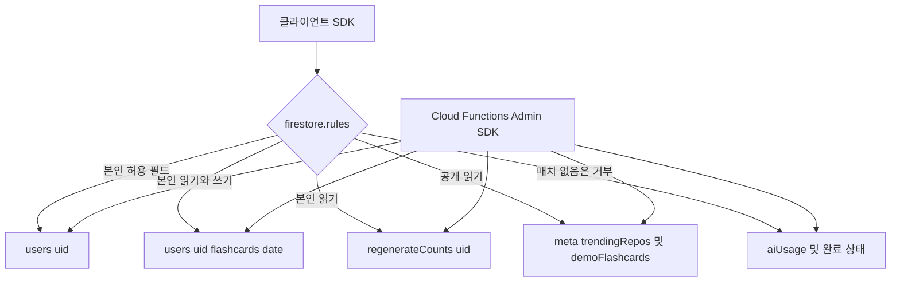

`firestore.rules`는 브라우저의 **클라이언트 SDK** 요청에 적용되는 데이터 계약이다. Cloud Functions는 `firebase-admin/firestore`의 Admin SDK로 같은 Firestore를 읽고 쓰며 이 규칙을 우회한다. 따라서 규칙에서 쓰기를 열지 않은 컬렉션은 클라이언트에는 기본 거부이고, 서버 작업의 상태·카운터 저장소가 될 수 있다. 반대로 Admin SDK가 쓴 데이터라고 해도 클라이언트 읽기를 허용한 경로에서는 규칙의 범위만큼 노출된다.

클라이언트 요청은 규칙으로 제한되지만, 서버 작업은 Admin SDK로 규칙이 열지 않은 상태까지 관리한다. 이 차이는 권한 상승 수단이 아니라, **클라이언트가 삭제하거나 위조해서는 안 되는 상태를 분리하는 소유권 경계**다.

## 소유권별 데이터 모델

| 영역 | 경로와 클라이언트 접근 | 책임과 수명 |
|---|---|---|
| 사용자 프로필·설정 | `users/{uid}`: 인증 UID와 문서 ID가 같은 본인만 읽기·생성·갱신·삭제 | 저장소 선택, 온보딩, GitHub 접근 자격 증명, 푸시 선호, 시간대·언어를 담는다. 구독 필드는 같은 문서에 있어도 서버가 소유한다. |
| 사용자 덱 | `users/{uid}/flashcards/{YYYY-MM-DD}`: 본인 읽기·쓰기 | 앱의 생성·번역·카드 편집 결과와 서버 사전 생성 결과가 공유하는 날짜별 덱이다. |
| 표시용 서버 카운터 | `regenerateCounts/{uid}`: 본인 읽기만 | 질문 재생성의 남은 횟수 UI에만 투영한다. 기록은 서버 함수만 한다. |
| 공개 캐시 | `meta/trendingRepos`, `demoFlashcards/{cacheId}`: 비로그인도 읽기 가능, 클라이언트 쓰기 불가 | 랜딩의 Trending 목록과 데모 카드다. 공개 데이터이므로 사용자별 데이터나 자격 증명을 넣지 않는다. |
| 서버 전용 상태 | `aiUsage`, `demoRegenerateCounts`, `flashcardPregeneration`: 클라이언트 접근 규칙 없음 | 호출 비용 한도, 데모 한도, 사전 생성 완료 상태를 서버가 관리한다. |
| 탈퇴 당일 기록 | `deletedUsers/{uid}`: 본인 읽기·생성만 | 탈퇴 전 클라이언트가 기록하며, 정리 작업은 KST 당일 기록만 남기고 이전 기록을 삭제한다. |

`notices/{noticeId}`는 인증 사용자 읽기만 허용한다. 그러나 설정 화면은 별도 경로인 `config/notice`를 구독한다. `config/notice`에는 `match`가 없으므로 현재 규칙에서는 기본 거부다. 공지 기능을 변경할 때는 문서 경로를 `notices`와 맞추거나, 필요한 범위의 별도 읽기 정책을 명시해야 한다.

## `users/{uid}`: 필드 소유권과 진화 가능한 검증

생성은 문서의 **모든** 키가 클라이언트 허용 목록 안에 있어야 하고, 갱신은 `request.resource.data.diff(resource.data).affectedKeys()`만 목록 안에 있어야 한다. `isValidUserData`도 변경된 키만 형식과 크기를 검사한다. 그 결과 서버가 병합해 둔 `subscriptionTier`, `subscriptionPeriodEnd`, `stripeCustomerId`는 보존한 채 클라이언트가 자신의 설정을 갱신할 수 있지만, 클라이언트는 이 서버 필드를 추가·수정·삭제할 수 없다. Stripe 웹훅은 Admin SDK 병합 쓰기로 이 구독 필드를 갱신한다.

허용 필드는 `repositories`, 온보딩 플래그, GitHub 접근 자격 증명, 푸시 설정, 시간대·언어, `updatedAt`이다. 주요 검증은 다음과 같다.

- `repositories`는 최대 5개이고, 각 원소에는 `fullName`과 HTTPS `url`이 필요하다. 선택 `branch` 외의 키, 빈 이름, 제한을 넘는 문자열은 허용되지 않는다.
- 불리언 플래그, 문자열 길이, `language`의 `ko`/`en`, `preferredPushHour`의 0–23 범위를 검사한다. 후자는 이전 번들 호환성을 위해 정수보다 넓은 `number`를 받는다.
- `updatedAt`은 길이가 제한된 문자열 또는 Firestore `timestamp`를 받는다. 서비스 워커에 남은 과거 번들이 `Date`를 기록할 수 있으므로, 새 규칙이 이를 곧바로 문자열로만 좁히면 배포 뒤에도 실행되는 구버전의 설정 저장이 실패한다.

변경된 키만 검사하는 방식은 과거 형식의 기존 값이 남아 있어도 무관한 설정 갱신을 막지 않고, 새로 쓰는 값에는 계속 계약을 적용한다. 이는 레거시 데이터의 읽기 호환성과 향후 쓰기 검증을 함께 유지하는 스키마 진화 정책이다.

설정 화면은 `setDoc(..., { merge: true })`와 `updateDoc`으로 자신이 소유한 필드만 쓴다. 문서 전체를 덮어쓰면 서버 필드 변경으로 판단되어 규칙에 거부될 수 있다. 같은 이유로 서버도 `users`에 구독 값을 병합한다.

## 삭제와 초기화되어서는 안 되는 상태

회원 탈퇴 흐름은 먼저 `deletedUsers/{uid}`를 만든 뒤 날짜별 덱을 삭제하고 `users/{uid}`와 Auth 계정을 삭제한다. 따라서 사용자 문서에 한도나 완료 플래그를 넣고 “클라이언트 필드 쓰기만 막으면 된다”고 판단해서는 안 된다. 문서 자체가 삭제되면 그 경계도 함께 사라진다.

- AI 호출 한도는 `aiUsage`에 둔다. 인증 호출은 UID별 문서를, 비로그인 호출은 IP 해시별 문서와 공용 문서를 **하나의 트랜잭션**에서 검사·차감한다. 통과한 호출은 AI 호출 전에 이미 차감되므로 동시 요청이 상한을 함께 넘지 않는다. 호출 경계의 상세는 [AI 호출 경계](ai-call-guard.md)를 참고한다.
- 질문 재생성 한도는 `regenerateCounts/{uid}`에 둔다. 클라이언트 구독은 오늘 날짜의 수치를 버튼 표시용으로만 사용하고, `regenerateCardQuestion`이 사용자 등급별 한도를 판정한다. 모델 응답을 성공적으로 파싱한 뒤에만 카운터를 쓴다.
- 이 재생성 카운터의 읽기·한도 검사·쓰기에는 트랜잭션이 없다. 동시에 들어온 요청은 같은 기존 수를 읽고 모두 통과할 수 있으므로, 이 구현은 서버 권한 경계는 보장하지만 동시성에서 엄격한 상한을 보장하지 않는다. 엄격한 상한이 필요하면 검사와 증가를 하나의 트랜잭션으로 묶고, 실패한 모델 호출의 차감 정책도 명시해야 한다.
- 사전 생성 완료 여부는 `flashcardPregeneration/{uid}`에 별도로 남긴다. 덱 문서가 없다는 사실만으로는 “아직 처리하지 않음”과 “커밋이 없어 결과가 없음”을 구별할 수 없기 때문이다. `saved`, `exists`, `empty`, `unavailable` 결과와 날짜는 이후 스케줄러의 중복 작업을 막는다.
- 비로그인 질문 재생성의 기기 식별자 해시 카운터도 `demoRegenerateCounts`에 둔다.

새 서버 상태의 설계 기준은 간단하다. 사용자가 읽고 써도 되는 **표시용 투영**만 최소 범위로 열고, 한도·중복 방지·결제 권한·작업 완료처럼 삭제로 초기화되면 안 되는 원본 상태에는 클라이언트 `match`를 추가하지 않는다.

## 사전 생성과 공개 캐시의 쓰기 주체

사용자 덱은 서로 다른 쓰기 주체가 만나는 공유 경로다. 사전 생성 작업은 이미 오늘 덱이 있으면 먼저 건너뛰고, 생성이 끝난 뒤에도 트랜잭션에서 존재를 다시 확인한다. 없을 때만 언어별 필드를 병합하므로 앱이 먼저 저장한 덱을 서버가 덮어쓰지 않는다. 확정된 결과는 완료 기록으로 남기지만 일시 오류는 기록하지 않고 태스크 재시도와 다음 스케줄 기회로 넘긴다. 흐름과 재시도 정책은 [플래시카드 사전 생성](../flashcard/pregeneration.md), 덱 문서 예산은 [덱 크기 예산](../flashcard/deck-size-budget.md)을 참고한다.

공개 캐시는 반대의 소유 모델을 사용한다. `refreshTrendingRepos`는 매일 결과를 수집하되 최소 개수에 미달하면 기존 `meta/trendingRepos`를 덮어쓰지 않는다. 목록 저장 뒤 데모 카드를 사전 생성하고, 현재 Trending에 없는 데모 문서를 정리한다. 랜딩 클라이언트는 캐시가 없거나 읽기에 실패하면 `null`을 반환해 대체 실시간 생성 또는 기본 목록 흐름으로 진행한다. 캐시가 공개 읽기라는 사실은 보안 속성이므로, 편의상 개인 덱이나 사용자별 정보를 이 경로에 넣어서는 안 된다.

## 안전한 변경 절차

1. **소유자와 삭제 의미를 먼저 정한다.** 사용자 설정이면 `users` 허용 목록과 타입 검증을 함께 바꾼다. 사용량·결제 권한·중복 방지·완료 상태면 서버 전용 컬렉션으로 분리한다.
2. **생성·갱신·삭제를 각각 검토한다.** 클라이언트 필드는 `create`의 `keys().hasOnly`, `update`의 `affectedKeys`, `isValidUserData` 세 조건을 모두 만족해야 한다. 서버 전용 필드는 사용자 문서 삭제 뒤에도 남아야 하는지 확인한다.
3. **롤링 배포를 설계한다.** 캐시된 PWA 번들과 새 규칙은 동시에 배포되지 않는다. 기존 유효 표현을 즉시 금지하지 말고, `updatedAt`처럼 구·신 형식을 제한적으로 병행한 뒤 전환 기간 후 정리한다.
4. **경쟁 쓰기는 원자적으로 처리한다.** 같은 덱처럼 선행 존재 여부에 따라 쓰기가 달라지면 검사와 저장을 트랜잭션으로 묶는다. 한도도 엄격해야 한다면 재생성 카운터처럼 읽기와 쓰기가 분리된 경로를 트랜잭션으로 바꾼다.
5. **규칙과 실패 경로를 검증한다.** 에뮬레이터 규칙 테스트로 타인 UID 접근, 허용되지 않은 키의 생성·갱신·삭제, 잘못된 저장소 항목, 기존 서버 필드가 있는 문서의 정상 설정 갱신을 확인한다. 함수 테스트에는 동시 한도 요청, 사전 생성과 앱 저장의 경합, 불완전한 Trending 결과에서 기존 캐시 보존을 포함한다.

클라이언트 Firebase 초기화는 `getFirestore(app)`만 호출하며 IndexedDB 영속성을 명시적으로 켜지 않는다. 여기서의 PWA 호환성은 Firestore 로컬 영속화 설정이 아니라, 서비스 워커가 보존한 이전 JavaScript 번들이 새 규칙과 공존할 수 있다는 배포 호환성 제약이다. GitHub 접근 범위는 [GitHub 접근](../integrations/github-access.md), 푸시 필드의 서버 소비는 [푸시 알림 운영](../operations/push-notifications.md)을 함께 확인한다.
