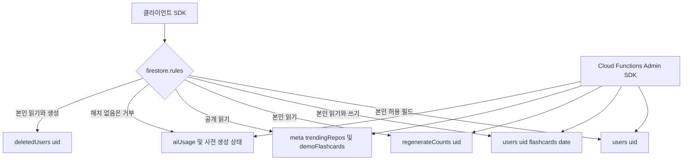

`firestore.rules`는 브라우저의 Firebase 클라이언트 SDK가 소유하는 데이터와 Cloud Functions의 Admin SDK가 관리하는 상태를 구분한다. 핵심은 **클라이언트가 삭제할 수 있는 `users/{uid}`에, 삭제로 초기화되어서는 안 되는 사용량·한도·완료 상태를 두지 않는 것**이다. Admin SDK의 쓰기는 Firestore 보안 규칙의 클라이언트 검사를 거치지 않으므로, 규칙에서 클라이언트 `allow`를 주지 않은 컬렉션이 서버 전용 경계가 된다.

클라이언트 요청은 규칙으로 제한되고, Cloud Functions는 Admin SDK를 통해 사용자 문서와 서버 전용 상태를 각각 관리한다.

## 소유권별 데이터 모델

| 영역 | 경로와 클라이언트 접근 | 책임과 수명 |
|---|---|---|
| 사용자 프로필·설정 | `users/{uid}`: 인증 UID와 문서 ID가 같은 본인만 읽기·생성·갱신·삭제 | 저장소 선택, 온보딩, GitHub 접근 토큰, 푸시 선호, 사전 생성에 필요한 `timezone`·`language`를 담는다. 같은 문서의 구독 필드는 서버가 소유한다. |
| 사용자 덱 | `users/{uid}/flashcards/{YYYY-MM-DD}`: 본인 읽기·쓰기 | 앱의 생성·번역·카드 편집 결과와 서버 사전 생성 결과가 만나는 날짜별 덱이다. 설정 변경 시 클라이언트가 기존 하위 문서를 삭제한다. |
| 표시용 서버 카운터 | `regenerateCounts/{uid}`: 본인 읽기만 | 질문 재생성의 남은 횟수 표시에만 공개한다. 실제 한도 판정과 쓰기는 HTTP 함수가 맡는다. |
| 공개 캐시 | `meta/trendingRepos`, `demoFlashcards/{cacheId}`: 비로그인도 읽기 가능, 클라이언트 쓰기 불가 | 랜딩 페이지의 Trending 목록과 사전 생성 데모 카드다. 스케줄러가 생성·교체·정리한다. |
| 서버 전용 상태 | `aiUsage`, `demoRegenerateCounts`, `flashcardPregeneration` | 규칙에 `match`가 없어 클라이언트 읽기·쓰기·삭제가 기본 거부된다. 비용 한도, 데모 재생성 횟수, 사전 생성 완료 여부를 서버만 관리한다. |
| 탈퇴 기록 | `deletedUsers/{uid}`: 본인 읽기·생성만 | 탈퇴 전에 클라이언트가 기록한다. 이 경로에는 클라이언트 삭제 허용이 없으므로, 삭제 수명은 별도 서버 운영 정책으로 다뤄야 한다. |

`notices/{noticeId}`는 인증 사용자에게 읽기만 허용한다. 그러나 설정 화면은 별도 경로인 `config/notice`를 구독한다. 이 경로에는 규칙 `match`가 없으므로 현재 규칙에서는 기본 거부된다. `notices` 규칙이 `config/notice`까지 포괄한다고 가정하지 말고, 읽는 경로를 맞추거나 `config/notice`에 필요한 최소 읽기 정책을 별도로 설계해야 한다.

## `users/{uid}`: 허용 목록, 서버 필드, 삭제의 관계

문서 ID와 Firebase Auth UID가 같을 때만 접근할 수 있다. 생성은 문서의 **모든** 키가 허용 목록 안에 있어야 하고, 갱신은 `request.resource.data.diff(resource.data).affectedKeys()`가 허용 목록 안에 있어야 한다. 즉, 서버가 이미 추가한 `subscriptionTier`, `subscriptionPeriodEnd`, `stripeCustomerId`가 남아 있어도 클라이언트는 자신의 설정 필드를 갱신할 수 있다. 반대로 클라이언트가 그 서버 필드를 추가·수정·삭제하려 하면 거부된다.

클라이언트가 직접 쓸 수 있는 필드는 `repositories`, 온보딩 플래그, `githubToken`, 푸시 설정과 FCM 토큰, `timezone`, `language`, `updatedAt`이다. 규칙은 다음을 함께 검사한다.

- `repositories`는 최대 5개이며, 각 항목은 `fullName`과 HTTPS `url`을 반드시 포함한다. 선택적인 `branch` 이외의 키는 허용하지 않고 문자열 길이도 제한한다.
- 불리언 플래그, 토큰과 타임존 문자열 길이, `language`의 `ko`/`en`, 푸시 시각의 0–23 범위를 검증한다. `preferredPushHour`는 정수보다 넓은 `number`를 허용한다.
- `updatedAt`은 길이 제한이 있는 문자열 또는 Firestore `timestamp`를 허용한다. 서비스 워커 캐시에 남은 과거 번들이 `Date`를 기록할 수 있으므로, 이 호환 형식을 한 번에 제거하면 구버전 클라이언트의 설정 저장이 실패할 수 있다.

설정 화면은 `setDoc(..., { merge: true })`로 `repositories`와 `updatedAt`만 기록한 뒤, 해당 사용자의 `flashcards` 하위 문서를 삭제한다. 따라서 같은 `users` 문서에 서버가 병합한 구독 필드를 보존한다. Stripe 웹훅은 Admin SDK의 병합 쓰기로 구독 등급·기간·고객 식별자를 갱신한다. 새 클라이언트 설정 필드를 추가할 때는 화면의 쓰기뿐 아니라 **생성 허용 목록, 갱신의 `affectedKeys`, 필드 형태 검증**을 함께 바꿔야 한다.

클라이언트는 오늘의 덱을 읽은 뒤, 브라우저 타임존 또는 표시 언어가 저장값과 다를 때만 `timezone`과 `language`를 갱신한다. 이어 같은 날짜 문서의 `data_ko` 또는 `data_en`을 병합해 번역 또는 생성 결과를 저장한다. 그러므로 이 필드는 사전 생성의 입력이면서 동시에 클라이언트 소유 설정이며, 덱의 언어 필드나 문서 경로를 변경할 때는 앱과 서버 작업을 함께 이행해야 한다.

## 삭제로 초기화되지 않아야 하는 상태

본인 `users/{uid}` 삭제는 회원 탈퇴를 위해 의도적으로 허용된다. 따라서 이 문서에 있는 서버 소유 구독 필드도 삭제될 수 있다. 다음 상태를 `users`에 새로 넣고 클라이언트 필드 목록에서만 제외하는 방식은 안전하지 않다. 문서 전체 삭제 후 재생성 경로가 남기 때문이다.

- AI 호출 한도는 `aiUsage`에 둔다. 인증 호출은 UID별 문서에서, 비로그인 호출은 IP 해시별 문서와 공용 문서에서 트랜잭션으로 일일 카운터를 차감한다. 사용자 문서 삭제나 재생성으로 이 비용 경계가 리셋되지 않는다. 호출 흐름은 [AI 호출 경계](ai-call-guard.md)를 참고한다.
- 질문 재생성 한도는 `regenerateCounts/{uid}`에 둔다. 본인은 읽기만 가능하고 `regenerateCardQuestion`이 일일 상한을 확인한 뒤, 성공한 모델 응답에 대해서만 카운터를 기록한다. UI의 실시간 구독은 버튼 표시용이며, 최종 429 판정은 서버 함수가 한다.
- 사전 생성 완료 여부는 `flashcardPregeneration/{uid}`에 별도 기록한다. 덱 문서가 없는 상태만으로는 "아직 처리하지 않음"과 "커밋이 없어 저장할 카드가 없음"을 구별할 수 없기 때문이다. 완료 기록은 날짜와 `saved`, `exists`, `empty`, `unavailable` 결과를 보관한다.
- 비로그인 질문 재생성의 기기 식별자 해시 카운터는 `demoRegenerateCounts`에 둔다.

서버 전용 상태의 불변식은 **클라이언트가 읽거나 쓰거나 삭제할 수 없고, 특히 `users/{uid}` 삭제로 일일 사용량이나 서버 작업 완료 상태가 초기화되지 않는 것**이다. 표시가 필요한 경우에만 `regenerateCounts`처럼 최소 범위의 읽기 전용 투영을 별도로 설계한다. 신규 서버 상태에 편의상 본인 `match`를 추가하지 않는다.

## 공유 덱과 공개 캐시의 서버 쓰기

사용자 덱은 클라이언트와 서버가 모두 쓸 수 있는 공유 경로이므로 경쟁을 고려해야 한다. `pregenerateUserFlashcards`는 대상 날짜에 이미 어느 언어로든 비어 있지 않은 덱이 있으면 건너뛴다. 생성 중 앱이 먼저 저장하는 경우에도, 저장 트랜잭션 안에서 다시 존재 여부를 확인한 후에만 자신의 언어 필드를 병합한다. 이 이중 확인은 서버가 앱에서 먼저 생성한 덱을 덮어쓰지 않게 한다. 재시도와 완료 기록의 수명은 [플래시카드 사전 생성](../flashcard/pregeneration.md), 문서 크기 제약은 [덱 크기 예산](../flashcard/deck-size-budget.md)을 참고한다.

공개 캐시는 클라이언트가 수정할 이유가 없는 읽기 모델이다. `refreshTrendingRepos`는 수집 결과가 최소 개수에 못 미치면 기존 `meta/trendingRepos`를 덮어쓰지 않는다. 유효한 결과를 저장한 뒤 데모 카드를 사전 생성하고, 이번 Trending 목록에 없는 `demoFlashcards` 문서를 삭제한다. 랜딩 클라이언트는 캐시가 없거나 읽기에 실패하면 `null`로 처리해 대체 실시간 생성 또는 기본 목록 경로로 진행한다. 공개 읽기는 공개 범위이기도 하므로 개인 저장소 정보, 토큰, 사용자별 덱을 이 문서들에 추가해서는 안 된다.

## 안전한 변경 절차와 확인 항목

1. **소유자와 삭제 의미를 먼저 정한다.** 사용자 설정이면 `users`의 허용 목록과 타입 검증을 함께 바꾸고, 사용자 문서 삭제에 따라 사라져도 되는지 확인한다. 사용량·결제 권한·중복 방지·작업 완료 상태라면 서버 전용 컬렉션으로 분리한다.
2. **생성·갱신·삭제를 따로 검토한다.** 새 클라이언트 필드는 `create`의 `keys().hasOnly`, `update`의 `affectedKeys`, `isValidUserData` 세 조건을 모두 통과해야 한다. 서버 전용 필드는 클라이언트 갱신에 영향을 주지 않아야 하며, `users` 삭제 뒤에도 보존할지 결정한다.
3. **쓰기 단위와 경합을 맞춘다.** 서버가 같은 `users` 문서에 병합하는 필드가 있으면 클라이언트도 필드 병합을 사용한다. 사용자 덱처럼 두 주체가 경쟁할 수 있는 문서는 사전 검사만 믿지 말고 저장 시점의 트랜잭션 검사까지 둔다.
4. **롤링 배포를 허용한다.** 캐시된 PWA 번들과 새 규칙은 동시에 배포되지 않는다. 기존 유효 표현을 갑자기 금지하지 말고 `updatedAt`처럼 제한된 구·신 형식을 함께 받거나, 충분한 전환 기간 뒤 정리한다.
5. **규칙을 데이터 계약으로 시험한다.** Firestore Emulator 규칙 테스트를 추가할 때 타인 UID 접근, 허용되지 않은 키의 생성·갱신·삭제, 잘못된 저장소 항목과 경계값, 서버 필드가 있는 기존 문서의 정상 설정 갱신, `users` 삭제 후 서버 카운터 보존을 확인한다. 현재 저장소에서는 관련 규칙 테스트 파일을 확인하지 못했으므로, 규칙을 바꾸는 변경에는 이 사례를 자동화하는 테스트를 함께 추가하는 것이 안전하다.

Firebase 초기화는 클라이언트에서 `getFirestore(app)`만 호출하며 IndexedDB 영속성을 명시적으로 활성화하지 않는다. 여기서 PWA 호환성은 Firestore 로컬 영속화 설정이 아니라, 서비스 워커가 보존한 이전 JavaScript 번들이 새 규칙과 공존하는 배포 제약을 뜻한다. GitHub 접근 범위와 토큰 사용 경로는 [GitHub 접근](../integrations/github-access.md), 푸시 필드의 서버 소비 방식은 [푸시 알림 운영](../operations/push-notifications.md)을 함께 확인한다.
