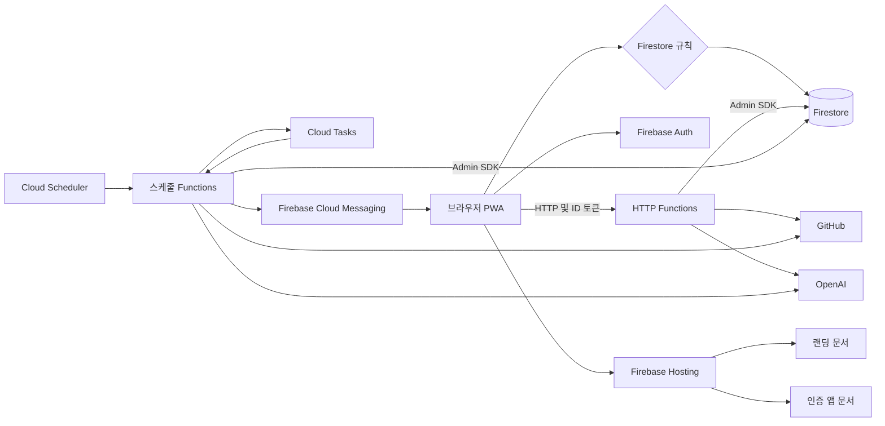
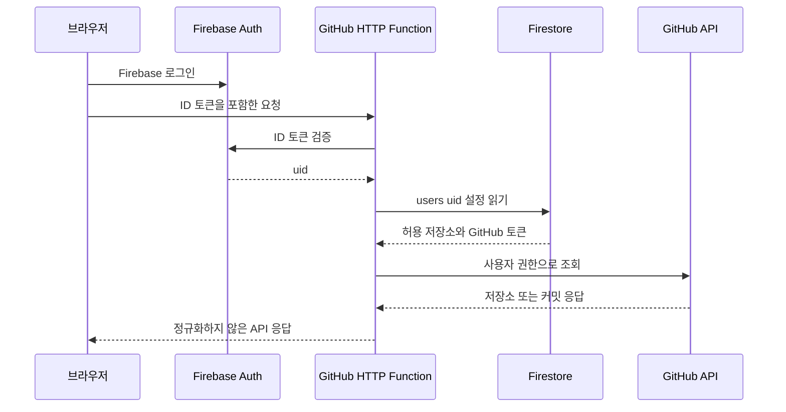
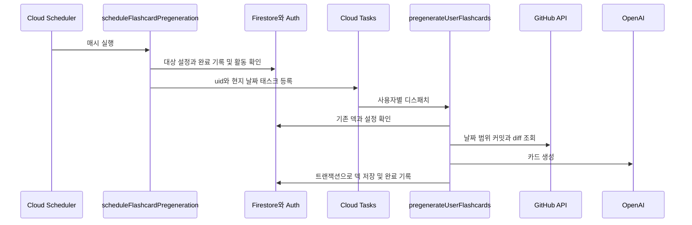

# 시스템 개요와 실행 경계

CodeRecall은 정적 React/Vite 번들(`app`)과 별도 Node.js Functions 번들(`functions`)을 Firebase에 배포한다. 브라우저는 Firebase Auth로 세션을 유지하고 Firestore 규칙이 허용한 자신의 문서와 공개 캐시를 직접 읽고 쓴다. 반대로 GitHub 접근 토큰을 사용하는 조회, OpenAI 호출, 사용량 차감, 전 사용자 대상 정기 작업 및 사전 생성 완료 기록은 Functions의 Admin SDK가 담당한다. 즉 Functions는 외부 API 프록시만이 아니라 **인증 검증, 서버 전용 상태, 호출량 제어, 비동기 작업**의 경계다.

*브라우저의 규칙 적용 경로와 Functions의 Admin SDK 경로, 그리고 스케줄러·큐가 외부 서비스와 만나는 실행 경계를 나타낸다.*

## 브라우저와 Hosting의 경계

Vite는 `index.html`과 `app.html`을 별도 Rollup 입력으로 빌드한다. 랜딩 문서는 `landing-main.tsx`를 통해 i18n, React Query, 랜딩 화면과 분석 이벤트를 초기화한다. 앱 문서는 `main.tsx`에서 i18n과 `App`을 렌더링하고, 로드 뒤 `firebase-messaging-sw.js` 등록을 시도한다. `App`은 `onAuthStateChanged`로 Firebase Auth 세션을 구독한 뒤, 사용자 문서와 오늘의 덱 상태에 따라 로그인·온보딩·복습·설정 화면을 선택한다.

Firebase Hosting은 `app/dist`를 제공한다. `/app`과 `/app/**`만 `app.html`로 rewrite하므로, 앱 내 URL은 SPA 진입점으로 돌아오고 랜딩 `/`은 별도 랜딩 문서다. PWA manifest의 `start_url`도 `/app`이며 Workbox의 탐색 fallback도 `/app.html`이다. `/terms`와 `/privacy`는 해당 정적 문서로 rewrite한다. URL 또는 진입점을 추가할 때에는 Vite 입력, Hosting rewrite 및 PWA fallback이 같은 URL 계약을 지키는지 함께 변경해야 한다.

개발 서버에서 브라우저의 Functions 요청은 `/api`로 보내며, Vite가 실행 모드에 맞는 `VITE_FUNCTIONS_URL_LOCAL` 또는 `VITE_FUNCTIONS_URL_PROD`로 프록시하고 `/api` 접두사를 제거한다. 프로덕션에서는 API 클라이언트가 `VITE_FUNCTIONS_URL_PROD`를 직접 base URL로 쓴다. 또한 이 클라이언트는 현재 Firebase 사용자의 ID 토큰을 `Authorization: Bearer` 헤더에 붙인다. 따라서 함수 이름이나 URL 체계를 바꾸면 프록시, 환경 설정, 브라우저 호출 경로를 같이 검토해야 한다.

## 배포 단위와 데이터 권한

`firebase.json`은 Hosting, Firestore 규칙, `functions` 코드베이스를 한 Firebase 프로젝트 구성으로 묶는다. 배포 전 Functions는 `pnpm --prefix "$RESOURCE_DIR" run build`로 TypeScript를 컴파일한다. 런타임은 Node.js 22이고, `functions/src/index.ts`는 Admin 앱을 초기화하여 HTTP·스케줄·태스크 트리거를 export한다. 전역 `maxInstances: 10`은 Functions 컨테이너 수의 상한이다.

클라이언트 Firestore SDK는 규칙을 통과해야 한다. `users/{uid}`와 그 `flashcards` 하위 컬렉션은 소유자만 접근하며, 사용자 문서는 클라이언트가 갱신할 수 있는 필드와 값 형식이 제한된다. 반면 `meta/trendingRepos`와 `demoFlashcards`는 비로그인 랜딩을 위해 공개 읽기만 허용한다. `aiUsage`, `demoRegenerateCounts`, `flashcardPregeneration`처럼 한도·중복 방지·완료 판단에 쓰는 컬렉션은 클라이언트 규칙을 열지 않아 기본 거부이고, Admin SDK만 다룬다. Admin SDK는 규칙을 우회하므로 서버 코드가 토큰, UID, 입력 및 쓰기 대상을 명시적으로 검증해야 한다. 컬렉션별 계약은 [Firestore 데이터 경계](firestore-data-boundary.md)를 참고한다.

*GitHub HTTP 경로는 브라우저가 전달한 저장소 식별자를 그대로 신뢰하지 않고, 검증한 Firebase UID의 Firestore 설정을 권한 기준으로 삼는다.*

## HTTP Functions와 외부 연동

GitHub HTTP Functions는 CORS와 `invoker: "public"`을 설정해 URL 수준에서는 호출될 수 있지만, 커밋·파일·저장소 목록 경로는 Firebase ID 토큰을 Admin Auth로 검증한다. 검증 뒤 해당 `users/{uid}` 문서에서 GitHub 토큰과 등록된 저장소를 읽고, 요청의 저장소가 등록 목록에 있을 때만 선택한다. `getFileContent`만은 공개 GitHub 원문 조회를 지원하기 위해 인증 없이도 허용하되, 대상 URL의 호스트를 GitHub 호스트 목록으로 제한한다. 세부 접근 계약은 [GitHub 접근](../integrations/github-access.md)을 따른다.

`openaiChatCompletions`와 `translateFlashcards`도 CORS와 공개 invoker를 사용한다. 그러나 OpenAI 요청 전에 서버 전용 `aiUsage` 카운터를 트랜잭션으로 차감한다. 인증 요청은 검증된 UID 및 서버가 읽은 구독 등급별 한도를, 비인증 요청은 IP 해시별 한도와 비인증 전체 한도를 함께 적용한다. 번역은 카드 수와 본문 길이를 먼저 거부하고, 플래시카드 생성 공통 경로는 긴 diff를 프롬프트 상한까지 잘라 모델에 전달한다. 이 경계의 한도·입력·카운터 세부 사항은 [공개 AI 함수 호출 경계](ai-call-guard.md)를 참고한다.

랜딩은 GitHub Trending을 실시간으로 읽지 않고 Firestore 공개 캐시를 읽는다. `refreshTrendingRepos`는 매일 09:00 KST에 `asia-northeast3`에서 GitHub Trending HTML을 파싱해 최대 10개를 저장한다. 파싱 결과가 5개 미만이면 이전 캐시를 보존한다. 목록을 저장한 뒤 데모 카드 생성 또는 오래된 데모 카드 정리가 실패해도 목록 캐시를 되돌리지 않으므로, 외부 HTML 또는 모델 오류가 랜딩의 저장소 목록을 비우지 않는다.

## 정기 작업과 사전 생성

| 작업 | 실행 경계 | 책임과 실패 의미 |
| --- | --- | --- |
| `sendDaily8amPush` | 매시 정각, `asia-northeast3` | `pushEnabled` 사용자에서 IANA 시간대의 현재 시가 선호 시각인 토큰을 골라 FCM으로 보낸다. 메시지는 500개 단위이며 `/app`을 여는 데이터를 포함한다. |
| `scheduleFlashcardPregeneration` | 매시 정각, `asia-northeast3` | 사용자 현지 0시 이상 6시 미만의 최근 활동 사용자만 골라 Cloud Tasks에 사용자별 작업을 넣는다. 등록 실패가 남으면 예외를 던져 Scheduler 재시도를 유도한다. |
| `pregenerateUserFlashcards` | Cloud Tasks, `asia-northeast3` | 사용자 저장소의 이전 날짜 커밋에서 덱을 만들고 `users/{uid}/flashcards/{dateKey}`에 저장한다. 큐는 최대 동시 디스패치 5개와 최대 3회 시도를 사용한다. |
| `refreshTrendingRepos` | 매일 09:00 KST, `asia-northeast3` | Trending 공개 캐시를 갱신한 뒤 랜딩용 데모 카드를 사전 생성한다. |
| `cleanupDeletedUsers` | 매일 12:00 KST, `asia-northeast3` | KST 기준 당일 탈퇴 기록만 남기고 이전 `deletedUsers` 문서를 배치 삭제한다. |

사전 생성 스케줄러는 각 후보의 `timezone`, 언어, 저장소 설정을 확인한 다음 `Intl.DateTimeFormat` 기반으로 현지 시각과 날짜를 계산한다. 유효하지 않은 IANA 시간대, 언어 또는 저장소 설정이 없으면 후보에서 제외한다. 최근 활동 여부는 Firebase Auth의 마지막 토큰 갱신 시각 또는 마지막 로그인 시각으로 판단한다. Scheduler의 시간대가 KST여도 사용자별 날짜를 KST로 고정하지 않는 이유다.

*스케줄러는 대상 선정과 큐 등록만 맡고, GitHub·OpenAI 호출 및 덱 저장은 사용자별 태스크가 맡는다.*

완료 기록은 서버 전용 `flashcardPregeneration`에 날짜와 결과를 남겨, 카드가 없는 경우와 아직 처리하지 않은 경우를 구분한다. 같은 시각의 태스크 ID는 `uid-날짜-시` 형식이라 Scheduler 재실행 시 중복 등록을 피하고, 다음 시각에는 새 ID로 미완료 사용자를 다시 시도할 수 있다. 작업자는 기존 덱을 먼저 확인하고, 저장 트랜잭션 안에서도 다시 확인한다. 따라서 자정 직후 앱 경로가 먼저 덱을 저장해도 사전 생성은 덮어쓰지 않는다. 모든 조합이 일시 오류로 실패해 빈 덱이 된 경우에는 완료 기록을 남기지 않고 오류를 던져 태스크 재시도 또는 다음 시각의 재등록 기회를 남긴다. 전체 카드 생성 흐름은 [플래시카드 생성 경로](../flashcard/generation-paths.md)와 [사전 생성](../flashcard/pregeneration.md)에서 다룬다.

## 운영 및 변경 검증

- **리전과 큐 이름:** 사전 생성 큐는 `locations/${REGION}/functions/pregenerateUserFlashcards`를 사용한다. 트리거만 다른 리전으로 옮기면 큐 연결이 깨질 수 있으므로 Scheduler, 태스크 함수, 큐 경로를 함께 변경한다.
- **처리량:** 전역 `maxInstances: 10`과 큐의 `maxConcurrentDispatches: 5`는 별개 제한이다. 후자는 사용자 작업 하나가 여러 저장소·복습 날짜를 병렬 처리하는 상황에서 GitHub·OpenAI 호출량을 조절한다.
- **보안 상태:** 공개 읽기 캐시에는 개인 설정이나 토큰을 넣지 않는다. 사용량 및 완료 기록처럼 클라이언트가 변경하면 경계가 사라지는 상태는 규칙으로 쓰기를 열지 않는 별도 서버 컬렉션에 둔다.
- **집중 검증:** 전용 테스트 파일은 확인되지 않는다. 변경 전후 `pnpm --filter app build`와 `pnpm --filter functions build`를 실행하고, Emulator 또는 배포 환경에서 Hosting의 `/app` rewrite, 비로그인 공개 캐시 읽기, ID 토큰이 필요한 GitHub 경로, 사전 생성의 중복 덱 방지와 재시도, 사용자 현지 시각의 푸시 대상을 점검한다. 푸시 수신 설정과 서비스 워커 동작은 [푸시 알림 운영](../operations/push-notifications.md)을 참고한다.
