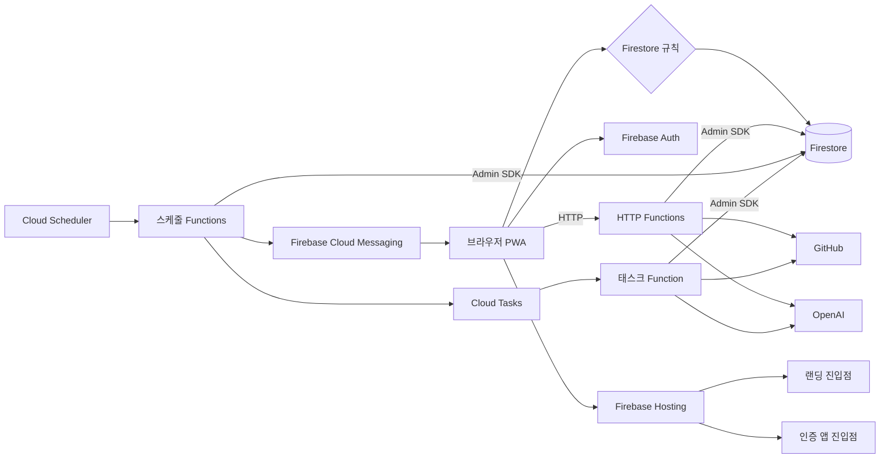
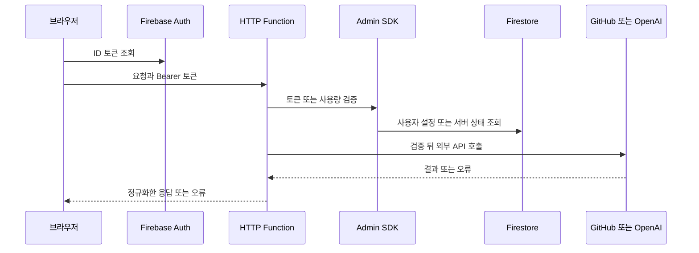
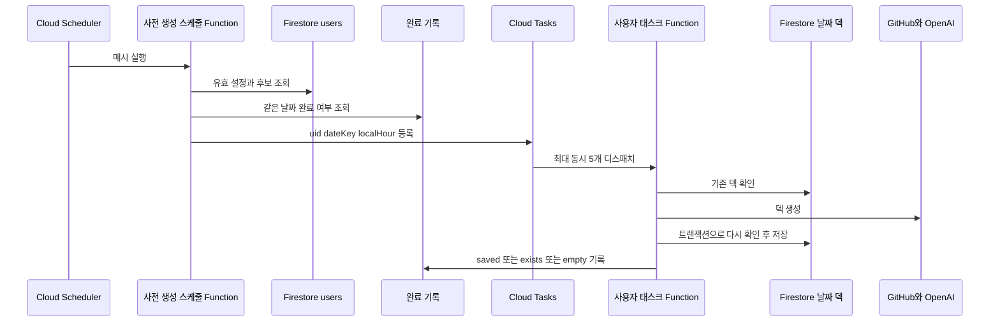

# 시스템 개요와 런타임 경계

CodeRecall은 Vite로 빌드한 브라우저 앱과 Node.js Cloud Functions를 Firebase에 각각 배포한다. 브라우저는 Firebase Auth로 사용자를 식별하고 Firestore 규칙이 허용하는 본인 데이터와 공개 캐시만 직접 다룬다. GitHub 토큰을 사용하는 조회, OpenAI 호출의 비용 제어, 전체 사용자 대상 FCM 전송, 완료 기록처럼 클라이언트가 신뢰할 수 없는 일은 Functions의 Admin SDK 경계에서 처리한다.

이 분리는 위키가 코드에서 재생성 가능한 시스템 요약이고 설계 결정의 이유는 별도 원본이라는 [ADR 0002](../../docs/adr/0002-adopt-openwiki.md)의 운영 결정을 따른다. 이 페이지는 그 결정을 재서술하지 않고 현재 런타임의 책임과 연결점에 집중한다.

*브라우저의 규칙 적용 경로와 서버의 Admin SDK 경로, 그리고 외부 서비스가 만나는 런타임 경계를 보여준다.*

## 브라우저, PWA, Hosting

Vite는 랜딩 `index.html`과 인증 앱 `app.html`을 별도 Rollup 입력으로 빌드한다. 랜딩은 `landing-main.tsx`에서 React Query와 랜딩 분석을 초기화하고, 앱은 `main.tsx`에서 `App`과 `/firebase-messaging-sw.js` 서비스 워커 등록을 초기화한다. 또한 이용 약관·개인정보 HTML도 독립 입력이므로, 두 앱 진입점만을 전제로 빌드 입력을 바꾸면 안 된다.

Firebase Hosting은 `app/dist`를 제공한다. `/app`과 `/app/**`만 `app.html`로 rewrite하고 `/terms`, `/privacy`는 정적 HTML로 보낸다. PWA manifest의 `start_url`과 Workbox의 navigation fallback도 앱 진입점인 `/app` 및 `app.html` 계약에 맞춰져 있다. 따라서 새 앱 라우트를 추가하거나 경로를 옮길 때는 Vite 입력, Hosting rewrite, Workbox fallback을 함께 검토한다.

`App`은 Auth 상태가 없으면 로그인 화면을, 로그인 뒤에는 사용자 문서의 온보딩 상태와 오늘 덱의 로딩·존재 여부에 따라 온보딩, 로딩, 빈 상태 또는 플래시카드·설정·가격 화면을 선택한다. 이 화면 전환은 서버의 인증 판정이 아니라 브라우저 Auth 구독과 소유 문서 읽기에 기반한다.

개발 환경의 Functions 호출은 `/api`를 Vite가 `VITE_FUNCTIONS_URL_LOCAL`로 프록시하고 접두사를 제거한다. 프로덕션 앱은 `VITE_FUNCTIONS_URL_PROD`를 사용한다. GitHub API 프록시 클라이언트는 현재 Firebase 사용자의 ID 토큰을 `Authorization: Bearer` 헤더에 붙이므로, 함수 URL이나 함수 이름 변경은 이 환경 변수·프록시·클라이언트 계약을 함께 바꾸어야 한다.

## 데이터 및 API 경계

Functions는 Node.js 22에서 실행되며 `index.ts`가 Admin 앱을 한 번 초기화하고 HTTP·스케줄·태스크 함수를 export한다. 전역 `maxInstances: 10`은 Functions 컨테이너의 공통 상한이다. Hosting, Firestore 규칙, Functions 배포는 `firebase.json`이 묶고, Functions 배포 전에는 `functions` 코드베이스에서 TypeScript 빌드를 수행한다.

클라이언트 Firestore SDK는 규칙을 통과해야 한다. `users/{uid}`와 그 `flashcards`는 소유자만 접근하며, `meta/trendingRepos`와 `demoFlashcards`는 랜딩을 위해 공개 읽기만 가능하다. 반대로 `aiUsage`와 `flashcardPregeneration` 같은 비용·완료 상태는 규칙 `match`가 없어 클라이언트에서 기본 거부되고 Admin SDK만 접근한다. Admin SDK는 규칙을 우회하므로, 서버는 규칙을 보안 검증의 대체물로 삼지 않고 인증·입력·소유 대상을 직접 확인해야 한다. 컬렉션별 쓰기 계약은 [Firestore 데이터 경계](firestore-data-boundary.md)를 따른다.

공개 HTTP 함수의 `invoker: "public"`과 CORS는 URL 도달 및 브라우저 preflight를 허용할 뿐 개인 데이터 권한을 주지 않는다. GitHub 함수는 ID 토큰을 검증하고 해당 `users/{uid}`의 GitHub 토큰과 허용된 `repositories` 목록을 가져와, 요청한 저장소가 목록에 있을 때만 선택한다. 반면 비로그인 랜딩 데모도 쓰는 AI 함수는 모델 호출 전에 서버 전용 사용량 guard를 통과해야 한다. 상세 한도와 실패 응답은 [AI 호출 비용·보안 경계](ai-call-guard.md), GitHub의 저장소·토큰 경계는 [GitHub 접근](../integrations/github-access.md)을 참고한다.

*GitHub 요청의 인증·설정 확인과 AI 요청의 서버 사용량 검증 뒤에만 외부 호출이 일어나는 HTTP 경로를 나타낸다.*

## 외부 연동의 책임

| 서비스 | 서버 또는 클라이언트 책임 | 중요한 경계 |
| --- | --- | --- |
| GitHub | Functions가 사용자 토큰으로 커밋·파일·저장소를 조회하고, 매일 Trending HTML을 수집한다. | 개인 토큰과 허용 저장소 검증은 서버에 둔다. 랜딩은 GitHub를 직접 호출하지 않는다. |
| OpenAI | HTTP 생성·번역·재생성 및 사전 생성이 모델 호출을 사용한다. | API 키와 비용 guard는 서버에만 둔다. |
| FCM | 앱 설정 화면이 권한 승인 뒤 토큰·사용 여부·선호 시간대를 소유 사용자 문서에 기록하고, 스케줄 Function이 발송한다. | 사용자 전체 토큰 조회와 전송 권한은 브라우저에 두지 않는다. |

랜딩의 Trending은 `meta/trendingRepos` 공개 Firestore 캐시를 읽고, 읽기 실패나 빈 캐시여도 호출자에게 `null`을 반환해 랜딩의 기본 목록 경로를 계속 사용할 수 있게 한다. `refreshTrendingRepos`는 매일 09:00 KST에 GitHub Trending 상위 10개를 수집한다. 파싱 결과가 5개 미만이면 기존 캐시를 보존하며, 목록을 저장한 뒤 데모 카드 생성·오래된 카드 정리가 실패해도 목록 캐시는 되돌리지 않는다. 이는 랜딩의 목록 가용성을 GitHub HTML 구조와 후속 모델 작업 실패에서 분리한다.

## 스케줄과 태스크의 수명

| 작업 | 실행 위치와 시각 | 책임 및 실패 의미 |
| --- | --- | --- |
| `sendDaily8amPush` | `asia-northeast3`, 매시 정각 | `pushEnabled` 사용자의 IANA 시간대 현지 시가 선호 시각과 같을 때 FCM 토큰에 리마인더를 보낸다. 토큰은 500개씩 전송하며 클릭 URL은 `/app`이다. |
| `scheduleFlashcardPregeneration` | `asia-northeast3`, 매시 정각 | 사용자 현지 0시 이상 6시 미만의 최근 활동 사용자를 골라 Cloud Tasks에 넣는다. 등록 실패가 있으면 예외를 던져 Scheduler 재시도를 요청한다. |
| `pregenerateUserFlashcards` | `asia-northeast3`, Cloud Tasks | 사용자별 GitHub 조회와 OpenAI 생성으로 날짜 덱을 저장한다. 동시 디스패치는 최대 5개, 태스크는 최대 3회 시도한다. |
| `refreshTrendingRepos` | `asia-northeast3`, 매일 09:00 KST | Trending 캐시와 데모 카드 사전 생성을 수행한다. 실행 제한은 540초, 메모리는 512MiB다. |
| `cleanupDeletedUsers` | `asia-northeast3`, 매일 12:00 KST | KST 기준 당일 `deletedUsers` 기록만 남기고 이전 기록을 배치 삭제한다. |

시간대 작업은 Scheduler의 `Asia/Seoul` 기준만으로 사용자의 현지 시간을 표현하지 않는다. 매시 실행한 뒤 `Intl.DateTimeFormat`으로 각 사용자 IANA 시간대를 계산한다. 사전 생성은 유효하지 않은 시간대·언어·저장소 설정을 후보에서 제외한다. 푸시는 선호 시간대가 없으면 `Asia/Seoul`을 사용한다. 푸시 설정과 전달 실패의 운영상 한계는 [시간대 기반 푸시 알림](../operations/push-notifications.md)을 참고한다.

*사전 생성은 빠른 후보 선별과 느린 사용자별 외부 호출을 분리하며, 저장 경쟁은 트랜잭션에서 해소한다.*

사전 생성 완료 기록은 `flashcardPregeneration/{uid}`에 날짜와 결과를 남긴다. 동일 시각의 태스크 ID는 `uid-날짜-시`이므로 스케줄러 재시도는 같은 태스크를 중복 등록하지 않는다. 태스크도 완료 기록과 기존 덱을 먼저 확인한다. 생성 중 앱이 먼저 덱을 저장할 수 있어, 저장 트랜잭션에서 비어 있지 않은 어느 언어 덱도 다시 검사하고 있으면 덮어쓰지 않는다. 카드가 전혀 없고 일부 조합이 일시 실패했다면 완료로 기록하지 않고 오류를 던져 태스크 재시도 및 다음 새벽 시각의 재시도 기회를 남긴다. 구체적인 대상 선정·날짜·덱 계약은 [오늘의 플래시카드 사전 생성](../flashcard/pregeneration.md)과 [플래시카드 생성 경로](../flashcard/generation-paths.md)를 따른다.

## 변경 및 검증 지점

- **URL·리전:** `/app`은 Hosting, PWA 및 FCM 클릭 URL의 공통 계약이다. `asia-northeast3` 변경 시에는 HTTP 함수 URL, Scheduler 트리거와 `locations/${REGION}/functions/pregenerateUserFlashcards` 태스크 큐 경로를 함께 바꾼다.
- **용량:** 전역 `maxInstances: 10`과 Cloud Tasks의 `maxConcurrentDispatches: 5`는 별개 제약이다. 후자는 사용자 태스크가 저장소·날짜 조합을 병렬 처리하는 상황에서 GitHub·OpenAI 호출량을 제한한다.
- **데이터 경계:** 공개 캐시에 개인 데이터나 토큰을 두지 않는다. 사용량·중복 방지·완료 상태를 클라이언트가 쓸 수 있게 만들면 이 페이지의 비용·멱등성 경계가 무너진다.
- **대표 확인:** `pnpm --filter app build`와 `pnpm --filter functions build`로 두 빌드 단위를 확인한다. 이후 Emulator 또는 배포 환경에서 `/app` deep link, 공개 Trending 읽기, ID 토큰 없는 GitHub 요청의 거부, AI guard의 한도 응답, 사전 생성의 재시도와 앱-태스크 저장 경쟁, FCM 클릭의 `/app` 이동을 점검한다.
