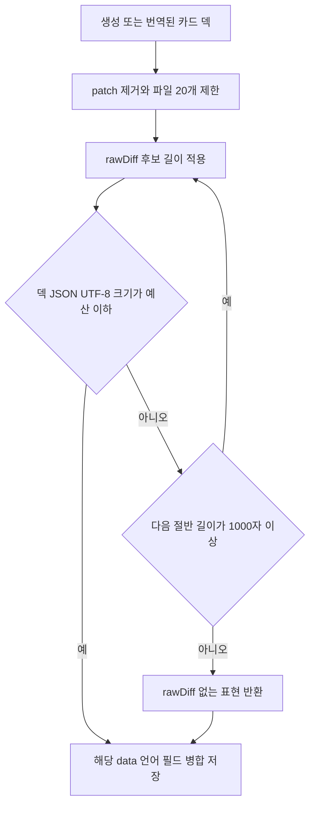

`users/{uid}/flashcards/{YYYY-MM-DD}` 한 문서는 언어별 배열 `data_ko`, `data_en`를 함께 가진다. Firestore 문서의 1 MiB 상한을 넘으면 쓰기가 거부되며, 한 커밋에서 나온 여러 카드가 같은 원문 diff를 반복 보관하면 문서가 빠르게 커진다. 앱과 Cloud Functions는 저장 전에 각 덱을 축소해 이 위험을 줄인다. 이 문서의 소유권과 클라이언트 접근 범위는 [Firestore 소유권과 보안 경계](../architecture/firestore-data-boundary.md)를 참고한다.

> **가장 중요한 변경 규칙:** `app/src/features/flashcard/lib/deck-size.ts`와 `functions/src/flashcard-deck-size.ts`는 별도 빌드 패키지의 복제 구현이다. 상수, UTF-8 측정, 축소 순서 또는 절단 표기를 한쪽만 바꾸면 앱 즉시 생성·번역과 서버 사전 생성이 같은 문서에 서로 다른 저장 표현을 남긴다. 두 파일과 두 쓰기 경로를 하나의 계약으로 검토한다.

## 예산과 측정 기준

| 항목 | 값 | 의미 |
|---|---:|---|
| Firestore 문서 상한 | 1 MiB (`1,048,576` bytes) | 코드 주석이 전제하는 문서 쓰기 상한 |
| `MAX_FLASHCARD_DOC_BYTES` | `900_000` bytes | 필드명 등을 위한 여유를 둔 안전 상한 |
| `FLASHCARD_DECK_BUDGET_BYTES` | `450_000` bytes | 두 언어 필드가 한 문서를 공유한다는 가정의 언어별 기본 예산 |
| `MAX_RAW_DIFF_CHARS` | `30_000`자 | 카드별 `rawDiff`의 최초 절단 상한 |
| `MIN_RAW_DIFF_CHARS` | `1_000`자 | 이 길이까지 줄여도 맞지 않으면 `rawDiff`를 생략하는 경계 |
| `MAX_FILES_PER_CARD` | `20`개 | 일반 사용자 덱의 카드별 파일 메타데이터 상한 |

앱은 `TextEncoder().encode(JSON.stringify(deck)).length`, Functions는 `Buffer.byteLength(JSON.stringify(deck), "utf8")`로 **덱 배열**의 JSON UTF-8 바이트 수를 잰다. 따옴표와 이스케이프가 포함되는 보수적 근사치이지만, 전체 Firestore 문서의 정확한 저장 크기 계산은 아니다. 따라서 이는 카드 수 제한도, 모든 쓰기를 가로막는 Firestore 규칙도 아니다.



*일반 사용자 덱에서 중복 파일 patch를 먼저 없애고 `rawDiff`를 단계적으로 줄이는 저장 전 흐름을 보여 준다.*

## 축소 계약과 잃는 정보

`fitFlashcardDeckToBudget`은 카드 자체를 삭제하지 않는다. 모든 카드에 같은 `rawDiff` 후보 길이를 적용한 표현을 만들고, 최초로 예산 이하가 되는 배열을 반환한다.

1. `metadata.files[].patch`를 항상 제거한다. 동일한 변경 내용이 `rawDiff`에 중복될 수 있기 때문이다.
2. `files`가 있으면 앞의 20개만 남기고, 결과가 빈 배열이면 `files` 필드를 쓰지 않는다. 파일 보기는 남은 `filename`, `raw_url` 등으로 원본을 다시 가져올 수 있다.
3. `rawDiff`가 있으면 30,000자에서 시작해 `30,000 → 15,000 → 7,500 → ...` 순으로 반감한다. 이 동안 질문, 답변, `highlights`, 커밋 메시지, 저장소, 브랜치와 파일의 비-`patch` 메타데이터는 유지한다.
4. 1,000자 이상 후보도 모두 예산을 넘으면 `rawDiff`를 생략한 표현을 반환한다. `rawDiff`가 있어야 카드 UI가 diff를 표시하고 질문 재생성 버튼을 보이므로, 이 fallback 카드에서는 diff 보기가 빈 상태가 되고 재생성 버튼도 없다.

`rawDiff` 절단은 단순한 `slice`가 아니다. 잘린 본문의 줄 시작 코드 펜스 ````` 개수가 홀수이면 닫는 `````를 추가하고, 항상 `…(truncated)`를 뒤에 붙인다. 따라서 마지막 hunk는 불완전할 수 있지만, 뒤따르는 Markdown이 코드 블록으로 흡수되는 것을 막고 저장된 내용이 원문 전체가 아님을 표시한다.

### 이 함수가 보장하지 않는 것

최종 `rawDiff` 없는 배열도 다시 크기를 재거나 카드를 버리지 않는다. 즉 질문·답변·`highlights` 또는 남은 메타데이터만으로 예산을 넘는 입력은 여전히 Firestore 쓰기 실패로 이어질 수 있다. 이 알고리즘은 일반적인 큰 diff를 줄이는 정책이지, 임의의 카드 입력에 대한 절대적 문서 크기 보장은 아니다.

또한 예산 적용은 생성·번역 저장 직전에만 있다. 기존 덱의 브랜치를 보강하는 `useTodayFlashcards` 경로와 카드 삭제 취소, 질문 재생성은 해당 언어 배열을 직접 `setDoc(..., { merge: true })`한다. 특히 재생성은 질문과 `highlights`를 바꾼 뒤 다시 쓰므로, 덱 표현을 크게 바꾸는 후속 기능을 추가할 때는 이들 쓰기에도 재측정·축소가 필요한지 별도로 판단해야 한다.

## 앱 쓰기와 두 언어의 남은 예산

`useTodayFlashcards`는 오늘 문서에서 현재 언어 덱을 우선 읽는다. 현재 언어 덱이 없고 반대 언어 덱이 있으면 새 GitHub 조회 대신 번역하고, 번역 결과를 축소한 뒤 현재 언어 필드만 병합 저장한다. 이때 예산은 다음과 같이 계산된다.

```ts
Math.min(
  FLASHCARD_DECK_BUDGET_BYTES,
  MAX_FLASHCARD_DOC_BYTES - measureFlashcardDeckBytes(otherDeck)
)
```

정상적으로 두 덱이 기본 예산 근처라면 각 언어에 450,000 bytes를 배분한다. 반대 언어 덱이 과거 버전처럼 큰 경우에는 남은 값을 우선해 번역 덱을 더 적극적으로 줄이려는 호환 처리다. 다만 반대 덱이 이미 `900_000` bytes 이상이면 이 값은 0 또는 음수가 될 수 있고, `fitFlashcardDeckToBudget`은 그 경우에도 `rawDiff` 없는 배열을 반환한다. 따라서 이 계산은 합계를 안전 상한 아래로 **유도**하지만, 초과한 기존 문서를 자동으로 복구하거나 새 쓰기 성공을 보장하지는 않는다.

두 언어가 모두 없으면 앱은 새로 생성한 덱에 기본 예산을 적용한다. 사전 생성은 어느 한 언어 덱이라도 존재하면 저장을 포기하므로, 서버가 먼저 한 언어를 만들고 사용자가 다른 언어를 선택한 경우의 두 번째 언어 채우기는 이 번역 경로의 책임이다. 전체 우선순위는 [카드 생성 경로](generation-paths.md)를 참고한다.

## 서버 사전 생성과 경쟁 방지

`pregenerateUserFlashcards`는 생성한 덱을 Functions 쪽의 `fitFlashcardDeckToBudget`으로 축소한다. 일반 읽기에서 `data_ko` 또는 `data_en` 중 비어 있지 않은 배열을 발견하면 AI 작업 없이 끝나며, 생성 중 앱이 먼저 저장하는 경쟁을 막기 위해 트랜잭션 안에서도 같은 판정을 다시 한다. 여전히 비어 있을 때만 설정 언어의 `data_{language}`를 `{ merge: true }`로 저장한다.

그 결과 서버는 앱이 먼저 만든 어느 언어 덱도 덮어쓰지 않는다. 이 정책은 언어별 빈 필드를 서버가 나중에 독립적으로 채우는 방식이 아니라, 첫 덱의 소유자를 보존하고 앱 번역으로 다른 언어를 채우는 방식이다. 스케줄, 완료 기록 및 재시도는 [오늘의 플래시카드 사전 생성](pregeneration.md)에 있다.

## 복제 구현을 안전하게 바꾸는 방법

두 구현은 현재 같은 숫자와 알고리즘을 가져야 한다. 다음 중 하나라도 바꾸면 `app/src/features/flashcard/lib/deck-size.ts`와 `functions/src/flashcard-deck-size.ts`를 함께 대조·수정한다.

- 문서·언어별 예산, diff 최대·최소 길이, 파일 수 상한
- JSON UTF-8 측정 방식과 `<=` 비교 조건
- `patch` 제거 대상, 남길 파일 필드, 빈 `files`와 빈 `rawDiff`의 처리
- 반감 순서, diff 생략 fallback, 코드 펜스 닫기와 `…(truncated)` 표식
- 카드 또는 파일 메타데이터 타입에 새로 추가한 큰 필드

한쪽만 변경하는 대표적인 위험은 다음과 같다.

| 불일치 | 관찰 가능한 결과 | 점검 지점 |
|---|---|---|
| 앱 예산만 확대 | 앱이 번역 덱을 더 크게 저장하려 하여 기존 반대 언어 덱과의 합이 안전 여유를 잃을 수 있음 | 반대 언어 덱이 있는 번역 저장과 문서 쓰기 결과 |
| Functions 예산만 확대 | 사전 생성 덱이 앱이 예상하는 언어별 몫보다 커지고, 후속 번역의 남은 예산이 작아짐 | 서버 저장 뒤 반대 언어 전환 |
| 절단 형식 또는 `patch` 정책만 변경 | 생성 주체에 따라 diff 보기·파일 보기·재생성 가능 여부와 문서 크기가 달라짐 | 열린 펜스, 닫힌 펜스, 빈 파일 목록, diff 없는 카드 |
| 측정 또는 fallback만 변경 | 한 경로만 경계 크기에서 저장하고 다른 경로는 더 많은 정보를 버리거나 실패함 | 정확히 예산 이하·초과인 UTF-8 fixture |

변경 전후에는 같은 fixture를 양 함수에 넣어 결과 배열과 바이트 수를 비교한다. 최소 fixture는 다중 바이트 문자, 긴 `rawDiff`, 열린·닫힌 코드 펜스, 20개 초과 파일, `patch`만 큰 파일, `rawDiff` 없는 카드, 그리고 diff를 모두 빼도 예산을 넘는 카드를 포함해야 한다. 이어 앱의 새 생성, 반대 언어 번역, 서버 사전 생성의 Firestore Emulator 쓰기를 각각 검증한다. Functions 변경은 다음 정적 검사와 빌드도 수행한다.

```bash
pnpm --prefix functions run lint
pnpm --prefix functions run build
```

## 별도 정책인 공개 데모 캐시

`demoFlashcards/{cacheId}`는 사용자 날짜 덱과 다른 공개 캐시다. `cacheId`는 `owner__repo__lang` 형식이며, 한국어와 영어는 각각 별도 문서다. 데모 생성은 커밋당 파일을 최대 10개로 제한하고 각 `patch`를 4,000자로 자른다. 그 후 `repositoryFullName`, `lang`, 선택 `branch`, `cards`로 만든 **문서 전체**를 JSON UTF-8로 측정해 900,000 bytes를 넘으면 축소 재시도 없이 저장을 건너뛴다.

따라서 데모의 `MAX_DOCUMENT_BYTES = 900_000`은 같은 Firestore 상한에 대한 캐시 보호 장치일 뿐, 사용자 날짜 문서의 두 언어가 공유하는 450,000-byte 덱 계약을 대체하지 않는다. 데모 캐시의 생성·캐시 미스 동작은 [카드 생성 경로](generation-paths.md)를 참고한다.
