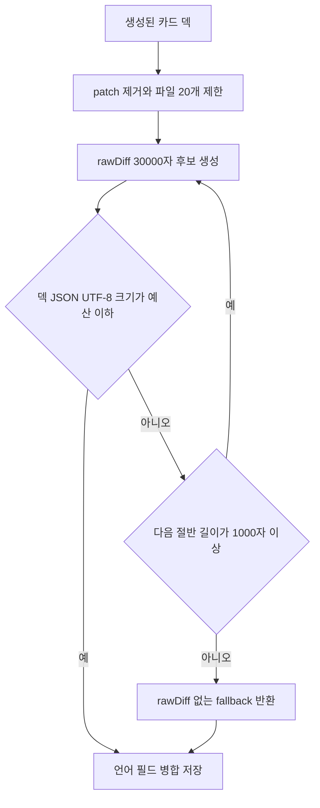

`users/{uid}/flashcards/{YYYY-MM-DD}` 한 문서에는 언어별 배열 `data_ko`, `data_en`가 함께 들어간다. Firestore 문서가 1 MiB(1,048,576 bytes)를 넘으면 쓰기가 거부되며, 큰 커밋의 원문 diff는 카드마다 반복될 수 있다. 앱과 서버는 저장 전에 덱의 저장 표현을 줄여 이 한계에 걸릴 가능성을 낮춘다. 경로의 소유권과 클라이언트 쓰기 권한은 [Firestore 데이터 경계](../architecture/firestore-data-boundary.md)를 참고한다.

## 예산과 측정 기준

| 항목 | 값 | 의미 |
|---|---:|---|
| Firestore 문서 상한 | 1,048,576 bytes | 넘으면 문서 쓰기가 거부되는 상한 |
| `MAX_FLASHCARD_DOC_BYTES` | 900,000 bytes | 필드 이름과 기타 문서 데이터를 위한 여유를 둔 안전 상한 |
| `FLASHCARD_DECK_BUDGET_BYTES` | 450,000 bytes | 두 언어 덱이 같은 문서 예산을 공유한다는 전제의 언어별 기본 예산 |
| `MAX_RAW_DIFF_CHARS` | 30,000자 | 카드에 남길 `rawDiff`의 최초 상한 |
| `MIN_RAW_DIFF_CHARS` | 1,000자 | 이 하한보다 더 줄여야 하면 `rawDiff`를 생략하는 경계 |
| `MAX_FILES_PER_CARD` | 20개 | 일반 사용자 덱의 카드당 파일 목록 상한 |

앱은 `TextEncoder().encode(JSON.stringify(deck)).length`, Functions는 `Buffer.byteLength(JSON.stringify(deck), "utf8")`로 **덱 배열**의 JSON UTF-8 바이트 수를 잰다. 따옴표와 이스케이프도 포함하지만 Firestore의 실제 저장 크기 계산식과 동일하지는 않다. 즉 이는 카드 수 제한이나 문서 전체의 정확한 검증이 아니라, 저장 전 일관되게 적용하는 보수적 근사치다.



*축소기는 처음 예산에 맞는 diff 후보를 택하고, 끝까지 맞지 않으면 diff를 뺀 fallback을 반환한다.*

## 축소 순서와 보존·제거되는 데이터

`fitFlashcardDeckToBudget`은 각 diff 길이 후보마다 모든 카드를 축소하고 크기를 재서, 예산 이하가 되는 첫 표현을 선택한다.

1. 모든 카드의 `metadata.files[].patch`를 제거한다. `rawDiff`와 겹치는 대용량 표현을 먼저 포기하되, `filename`, 상태, 변경량, `raw_url` 등 파일 메타데이터는 남긴다.
2. `files`는 원래 순서의 앞 20개만 남긴다. 따라서 21번째 이후 파일의 메타데이터와 patch는 보존되지 않는다.
3. `rawDiff`는 30,000자에서 시작해 절반씩 줄인다. 질문, 답변, `highlights`, 커밋·저장소·브랜치 메타데이터는 이 단계에서 유지된다.
4. 하한까지의 후보가 모두 초과하면 `rawDiff` 자체를 생략한다. 카드도 질문·답변도 임의로 제거하지 않으므로, diff 외 필드만으로도 예산을 넘는 덱은 반환될 수 있다.

마지막 항목은 중요한 실패 경계다. 이 함수는 diff를 모두 제거한 fallback의 크기를 다시 판정하거나 카드를 삭제하지 않는다. 따라서 호출자는 “반환값은 언제나 예산 이하”라고 가정할 수 없으며, 매우 큰 질문·답변·메타데이터 또는 음수인 번역 예산에서는 Firestore 쓰기가 여전히 실패할 수 있다. fallback에서 `rawDiff`가 없으면 앱은 그 카드를 재생성할 수 없고 Diff 보기에도 원문이 없다. 반대로 diff가 남으면 patch가 없어도 축소된 `rawDiff`를 표시할 수 있다.

### Markdown 안전 절단

`rawDiff`는 Markdown 코드 펜스를 포함할 수 있다. 절단 지점까지 `^````로 시작하는 펜스 수가 홀수이면 닫는 ` ``` `를 추가하고, 항상 `…(truncated)` 표식을 붙인다. 이로써 이후 본문까지 코드 블록으로 해석될 위험을 줄이지만, 마지막 diff hunk나 코드 줄 자체는 불완전할 수 있다.

## 앱 쓰기 경로와 두 언어의 남은 예산

`useTodayFlashcards`는 오늘 문서에서 현재 언어의 비어 있지 않은 덱을 우선 사용한다. 없고 반대 언어 덱이 있으면 새 GitHub 조회 대신 번역을 요청하고, 번역 덱에 다음 예산을 전달한다.

```ts
Math.min(
  FLASHCARD_DECK_BUDGET_BYTES,
  MAX_FLASHCARD_DOC_BYTES - measureFlashcardDeckBytes(otherDeck)
)
```

따라서 보통은 언어당 450,000 bytes를 넘지 않게 하며, 반대 덱이 더 크면 그 덱의 측정 크기를 뺀 남은 몫을 사용한다. 이는 두 배열이 같은 날짜 문서를 공유한다는 제약을 반영한 처리다. 다만 반대 덱만으로 900,000 bytes를 넘으면 전달 예산은 음수가 되고, 축소기의 fallback은 빈 덱으로 만들지 않는다. 또한 측정 대상은 배열뿐이므로 문서의 필드 오버헤드도 계산하지 않는다. 이 계산은 상한을 **목표로 삼는** 축소 입력이지, 어떤 기존 데이터에도 문서 전체 쓰기 성공을 보장하는 검증은 아니다.

두 언어 덱이 모두 없으면 앱은 기본 예산으로 축소한 결과를 `setDoc(..., { merge: true })`로 현재의 `data_{lang}`에 쓴다. 현재 언어 덱이 이미 있으면, 앱은 누락된 브랜치 정보를 보강한 덱을 같은 병합 쓰기로 다시 저장할 수 있는데 이 경로에는 `fitFlashcardDeckToBudget` 호출이 없다. 따라서 기존 덱의 크기나 보강으로 인한 증가도 이 모듈이 재조정하지 않는다. 생성·번역 우선순위는 [카드 생성 경로](generation-paths.md)를 참고한다.

## 서버 사전 생성과 쓰기 경쟁

서버 사전 생성은 생성한 덱을 Functions 쪽 `fitFlashcardDeckToBudget`으로 축소한 뒤, 설정 언어의 `data_{language}` 필드만 트랜잭션 병합 저장한다. 저장 전에 한 번, 트랜잭션 안에서 다시 한 번 `data_ko`와 `data_en` 중 어느 하나라도 비어 있지 않은지 확인한다. 있으면 서버는 저장하지 않으므로 앱이 먼저 만든 문서를 덮어쓰지 않는다. 이 정책은 서버가 두 번째 언어를 채우지 않는다는 뜻이며, 반대 언어를 추가하는 책임과 남은 예산 계산은 앱 번역 경로에 있다.

사전 생성의 스케줄, 완료 기록, 재시도 의미는 [오늘의 플래시카드 사전 생성](pregeneration.md)을 참고한다.

## 변경 계약: 중복 구현을 함께 바꾼다

앱의 `app/src/features/flashcard/lib/deck-size.ts`와 서버의 `functions/src/flashcard-deck-size.ts`는 별도 패키지라 코드를 공유하지 않는다. 그러나 같은 날짜 문서의 언어별 필드를 함께 쓰므로, 다음은 한쪽만 바꿀 수 없는 계약이다.

- 문서·언어별 예산, diff 최대·최소 길이, 파일 수 상한
- JSON UTF-8 측정 방법과 `<=` 비교 조건
- `patch` 제거, 파일 목록 자르기, `rawDiff` 생략 조건과 fallback 의미
- 코드 펜스 닫기와 `…(truncated)` 표식을 포함한 절단 형식
- 카드·파일 메타데이터 타입이 바뀔 때 축소해야 할 대용량 필드

한쪽만 변경하면 앱 즉시 생성·번역과 서버 사전 생성이 동일 문서에 서로 다른 크기와 정보 보존 정책으로 기록한다. 상수나 알고리즘을 바꿀 때는 두 구현을 함께 수정하고, 같은 fixture로 UTF-8 경계, 열린·닫힌 펜스, diff 없는 fallback, 큰 반대 언어 덱과 음수 남은 예산을 비교 검증해야 한다. 반환값이 budget을 넘을 수 있는 fallback을 계속 허용할지, 카드 제거·오류 처리·문서 전체 측정 중 어떤 정책을 택할지도 두 경로에서 명시적으로 결정해야 한다.

## 별도인 공개 데모 캐시 예산

`demoFlashcards/{cacheId}`는 사용자 날짜 덱과 다른 공개 읽기 전용 모델이다. 데모 사전 생성은 저장소·언어마다 `owner__repo__lang` 문서를 만들며, 최근 3개 커밋을 대상으로 한다. 커밋당 파일은 10개, 각 `patch`는 4,000자로 제한한다. 이후 `{ repositoryFullName, lang, branch, cards }` 전체 JSON의 UTF-8 크기를 재어 900,000 bytes보다 크면 축소 재시도 없이 저장을 건너뛴다.

따라서 데모의 `MAX_DOCUMENT_BYTES = 900_000`은 동일한 Firestore 상한에 대한 별도 캐시 정책이다. 사용자 날짜 문서처럼 `data_ko`와 `data_en`이 한 문서에서 남은 예산을 나누는 계약도 아니고, 일반 덱 축소기의 patch 제거·diff 반감·fallback을 적용하지도 않는다.
