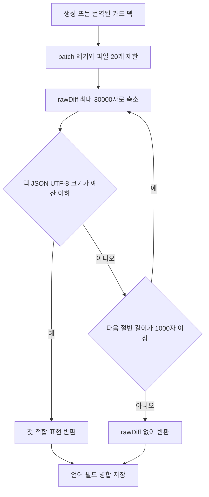

`users/{uid}/flashcards/{YYYY-MM-DD}` 문서는 언어별 배열 `data_ko`, `data_en`을 함께 가진다. Firestore 문서의 1 MiB(1,048,576 bytes) 상한에 비해, 큰 커밋의 원문 diff가 카드마다 반복되면 덱이 빠르게 커진다. 앱과 서버는 생성 결과를 쓰기 전에 덱의 저장 표현을 줄인다. 데이터 소유권과 클라이언트 쓰기 권한은 [Firestore 데이터 경계](../architecture/firestore-data-boundary.md)를 참고한다.

## 예산과 측정 단위

| 항목 | 값 | 의미 |
|---|---:|---|
| Firestore 문서 상한 | 1,048,576 bytes | 이를 넘으면 문서 쓰기가 거부된다. |
| `MAX_FLASHCARD_DOC_BYTES` | 900,000 bytes | 필드 등 문서 오버헤드에 여유를 둔 안전 상한이다. |
| `FLASHCARD_DECK_BUDGET_BYTES` | 450,000 bytes | 같은 문서에 두 언어 덱이 공존하는 경우의 언어별 기본 예산이다. |
| `MAX_RAW_DIFF_CHARS` | 30,000자 | 카드 `rawDiff`의 최초 상한이며 생성 프롬프트의 diff 상한과 같다. |
| `MIN_RAW_DIFF_CHARS` | 1,000자 | 이 길이까지 줄여도 맞지 않으면 `rawDiff`를 생략한다. |
| `MAX_FILES_PER_CARD` | 20개 | 사용자 덱 카드의 파일 메타데이터 상한이다. |

앱은 `TextEncoder().encode(JSON.stringify(deck)).length`, Functions는 `Buffer.byteLength(JSON.stringify(deck), "utf8")`로 덱 배열의 JSON UTF-8 바이트 수를 잰다. 이는 Firestore 저장 크기의 정확한 계산식은 아니지만 따옴표와 이스케이프를 포함하는 일관된 근사치다. 카드 수가 아니라 **직렬화된 저장 표현**을 제한하는 규칙이다.



*생성·번역 덱의 축소 순서와, diff 없는 마지막 반환도 예산 충족을 다시 확인하지 않는 현재 제어 흐름을 보여 준다.*

## 축소 순서와 보존 정보

`fitFlashcardDeckToBudget`은 후보별로 모든 카드를 축소하고 측정하여, 예산 이하가 되는 첫 표현을 반환한다.

1. 각 카드의 `metadata.files[].patch`를 제거한다. 동일한 변경 내용이 `rawDiff`에 중복되며, 파일 보기에는 `filename`, `raw_url` 등 남은 메타데이터를 쓴다.
2. `files`는 앞의 20개만 유지한다.
3. `rawDiff`는 30,000자부터 `30,000 → 15,000 → 7,500 → 3,750 → 1,875` 순으로 후보를 만든다. 질문·답변·하이라이트와 커밋·저장소·브랜치 메타데이터는 이 단계에서 보존한다.
4. 1,000자 이상 후보도 예산을 넘으면 `rawDiff`를 생략한 덱을 반환한다. 이때도 카드 자체를 임의로 삭제하지 않는다.

따라서 이 함수는 `rawDiff`가 없는 최종 표현의 크기를 다시 판정하거나 실패를 반환하지 않는 **best-effort 축소기**다. 질문·답변 등 비-diff 필드만으로도 예산을 넘는 덱, 또는 음수인 번역 예산에는 반환값도 예산을 넘을 수 있고, 이후 Firestore 쓰기가 거부될 수 있다. 호출자가 성공 여부를 받지 못하므로, 엄격한 보장이 필요하면 최종 덱과 전체 문서 표현을 다시 측정해 쓰기를 건너뛰거나 카드 감소 정책을 별도로 정해야 한다.

`rawDiff`가 남으면 카드 뒷면의 Diff 보기와 질문 재생성이 가능하다. 최종 단계에서 생략되면 재생성 UI는 숨겨지지만 질문·답변과 비-diff 메타데이터는 보존된다. 이는 저장 실패를 줄이기 위해 중복 표현과 원문 세부도를 먼저 희생하는 선택이다.

### Markdown 안전 절단

`rawDiff`는 Markdown 코드 펜스를 포함할 수 있다. 절단 지점까지 `^````에 맞는 펜스 수가 홀수이면 닫는 ` ``` `를 추가하고, 항상 `…(truncated)` 표식을 붙인다. 따라서 잘린 마지막 hunk나 코드 줄은 불완전할 수 있어도 이후 본문이 코드 블록으로 계속 렌더링되는 일을 막고, 저장용 미리보기임을 표시한다.

## 앱 쓰기 경로: 기본 예산과 남은 예산

`useTodayFlashcards`는 오늘 문서에서 현재 언어 덱을 먼저 읽는다. 현재 언어가 없고 반대 언어 덱이 있으면 GitHub 재조회 대신 번역한 뒤 다음 값으로 축소한다.

```ts
Math.min(
  FLASHCARD_DECK_BUDGET_BYTES,
  MAX_FLASHCARD_DOC_BYTES - measureFlashcardDeckBytes(otherDeck)
)
```

이는 기본적으로 언어별 450,000-byte 예산을 적용하되, 예산 도입 전의 큰 반대 언어 덱이 있으면 900,000-byte 안전 상한에서 측정한 잔여분보다 더 쓰지 않도록 하는 계산이다. 다만 축소기는 최종 크기 초과를 보고하지 않으므로, 반대 언어 덱이 이미 안전 상한 이상이거나 번역 결과의 비-diff 부분이 잔여 예산보다 크면 이 계산만으로 합계가 보장되지는 않는다.

두 언어 덱이 모두 없으면 앱은 기본 예산으로 축소한 뒤 `setDoc(..., { merge: true })`로 `data_{lang}`만 저장한다. 현재 덱·반대 언어 덱·즉시 생성의 우선순위는 [카드 생성 경로](generation-paths.md)를 참고한다.

### 축소기를 거치지 않는 후속 쓰기

이 예산 제어는 새로 생성하거나 번역하는 덱의 저장 전 단계다. 기존 덱에서 누락된 `branch`를 보강하는 쓰기와, 질문 재생성 결과의 질문·하이라이트를 반영하는 쓰기는 현재 배열을 그대로 `setDoc(..., { merge: true })`로 다시 쓴다. 이 경로들은 `fitFlashcardDeckToBudget`을 호출하지 않는다. 카드 형식 또는 재생성 결과를 키우는 변경에서는 이 쓰기들도 문서 한도 실패 지점이 될 수 있으므로, 크기 정책을 강화할 때 함께 보호해야 한다.

## 서버 사전 생성과 경쟁

`pregenerateUserFlashcards`는 생성한 덱을 Functions의 `fitFlashcardDeckToBudget`으로 축소한다. 저장 전 일반 읽기와 실제 저장 트랜잭션 안에서 모두 `data_ko`, `data_en` 중 **어느 하나라도** 비어 있지 않은 배열인지 검사한다. 기존 덱이 있으면 AI 생성 자체를 건너뛰거나 트랜잭션 쓰기를 포기하고 `exists` 완료 기록을 남긴다. 비어 있을 때만 선택 언어의 `data_{language}`를 `{ merge: true }`로 저장한다.

이 이중 검사는 앱이 자정 직후 먼저 만든 문서를 서버가 덮어쓰지 않도록 한다. 그 결과 서버는 다른 언어 필드를 나중에 채우지 않으며, 언어 전환 뒤 빈 필드를 채우는 책임은 앱의 번역 경로에 있다. 스케줄링·완료 기록·재시도는 [오늘의 플래시카드 사전 생성](pregeneration.md)에 있다.

## 변경 계약: 복제 구현을 함께 갱신

앱의 `app/src/features/flashcard/lib/deck-size.ts`와 Functions의 `functions/src/flashcard-deck-size.ts`는 별도 패키지라 같은 정책을 각각 구현한다. 둘은 현재 다음을 동일하게 둔다.

- 900,000-byte 문서 안전 상한과 450,000-byte 언어별 기본 예산
- JSON UTF-8 측정과 `<=` 비교
- `patch` 제거, 파일 20개 제한, 30,000자에서 시작하는 반감, diff 없는 fallback
- 코드 펜스 닫기와 `…(truncated)` 표식을 포함한 절단 형식
- 카드·파일 메타데이터 중 축소할 필드

상수나 축소 순서를 한쪽만 바꾸면 실시간 생성·번역과 서버 사전 생성이 같은 날짜 문서에 다른 크기와 표현의 덱을 쓴다. 변경 시 두 구현, 앱의 남은 예산 계산, 그리고 모든 후속 덱 쓰기를 한 변경으로 검토한다. 특히 다음 경계를 검증하는 fixture 기반 단위 테스트가 필요하다: 정확히 예산 이하/초과인 UTF-8 JSON, 열린 코드 펜스, diff 없는 fallback, 큰 반대 언어 덱, 그리고 축소 후에도 예산을 넘는 덱이다. 현재 두 패키지에는 전용 `deck-size` 테스트 파일이 없다.

## 별도 정책인 데모 캐시

`demoFlashcards/{owner}__{repo}__{lang}`는 사용자 날짜 덱과 다른 공개 캐시 모델이다. 서버는 한국어·영어 각각을 **별도 문서**로 만들며, 최근 3개 커밋을 대상으로 파일을 커밋당 10개, 각 `patch`를 4,000자로 제한한다. 문서 전체의 JSON UTF-8 크기가 `MAX_DOCUMENT_BYTES = 900_000`보다 크면 추가 축소나 재시도 없이 저장을 건너뛴다.

그러므로 데모의 900,000-byte 값은 같은 Firestore 한도에 대한 독립적인 캐시 거부 정책이다. 사용자 문서에서 `data_ko`와 `data_en`이 공유하는 450,000-byte 기본 예산이나 앱·Functions 축소 계약을 대체하지 않는다.
