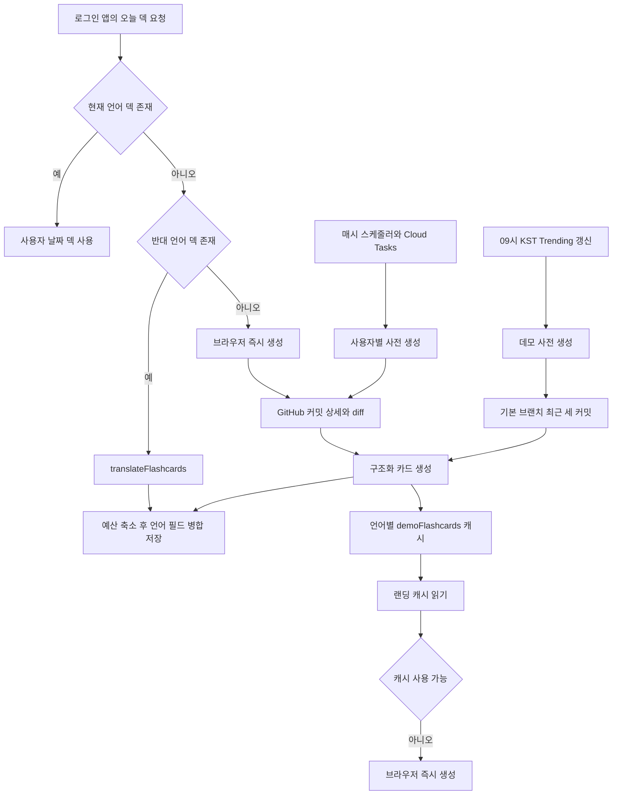
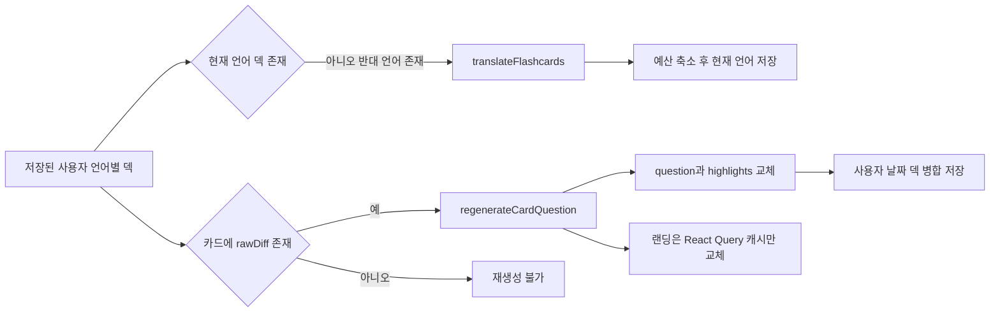

카드 생성은 같은 카드 형태를 만들지만, **생성 주체와 문서 소유권**은 세 갈래다. 로그인 앱은 사용자 날짜 덱을 읽고 필요할 때 즉시 만들며, 서버는 같은 덱을 사용자의 새벽 시간에 미리 채운다. 랜딩은 Trending 저장소만 별도 공개 캐시로 준비한다. 사용자 날짜 덱과 공개 캐시의 읽기·쓰기 경계는 [Firestore 데이터 경계](../architecture/firestore-data-boundary.md)를 참고한다.

## 경로와 저장 지점

| 경로 | 진입 시점 | 커밋 선택 | 저장 지점과 소비자 |
|---|---|---|---|
| 앱 즉시 생성 | `useTodayFlashcards`가 오늘 문서의 두 언어 덱을 모두 찾지 못할 때 | 선택 저장소별로 Free는 1·7일 전, Pro는 1·7·30일 전의 첫 변경 포함 커밋 | `users/{uid}/flashcards/{YYYY-MM-DD}`의 `data_ko` 또는 `data_en`; 로그인 앱 |
| 사용자별 사전 생성 | 매시 스케줄러가 최근 활동 사용자의 현지 0–6시 태스크를 넣을 때 | 같은 저장소와 등급별 복습 간격. 사용자 시간대의 날짜 범위로 조회 | 같은 사용자 날짜 문서의 현재 언어 필드; 이후 앱 읽기 |
| 랜딩 데모 캐시 | 매일 09:00 KST Trending 갱신 뒤 | 기본 브랜치 최근 세 커밋 | `demoFlashcards/{owner}__{repo}__{lang}`; 랜딩 |



*사용자 날짜 덱의 언어 우선 분기, 서버 사전 생성, 랜딩 캐시 미스를 함께 나타낸다.*

## 로그인 앱: 언어 우선 읽기와 즉시 생성

`useTodayFlashcards`는 먼저 사용자의 선택 저장소를 읽는다. 저장소가 없으면 카드가 없다고 끝내며, 있으면 브라우저의 IANA 시간대와 현재 표시 언어를 사용자 문서에 best-effort로 동기화한다. 이 설정은 사용자별 사전 생성의 날짜와 언어 입력이다.

오늘 문서에서는 다음 우선순위를 지킨다.

1. 현재 언어 배열이 비어 있지 않으면 생성하지 않는다. 브랜치가 빠진 기존 카드는 기본 브랜치를 조회해 best-effort로 보강할 수 있다.
2. 현재 언어가 없고 반대 언어 덱이 있으면 GitHub와 카드 생성 대신 `translateFlashcards`를 호출한다. 번역 결과를 예산에 맞춘 뒤 현재 `data_{lang}`만 병합 저장한다.
3. 두 언어 덱이 모두 없을 때만 저장소와 복습 날짜를 순차 처리한다. 각 조합에서 변경 파일이 있는 첫 커밋의 diff를 만들고 `openaiChatCompletions`에 보낸다. 한 조합의 오류는 다음 조합을 막지 않는다.
4. 카드가 하나 이상일 때만 축소 후 저장한다. 빈 결과나 상위 단계 오류는 덱 없음 상태가 된다.

`openaiChatCompletions`는 공개 HTTP 진입점이지만, `text`를 확인한 뒤 모델 호출 전에 호출자별 AI 사용량 검사를 한다. 입력·한도·실패의 자세한 경계는 [공개 AI 함수 호출 경계](../architecture/ai-call-guard.md)에 있다.

## 사용자별 사전 생성: 보완 경로와 경합 방지

사전 생성은 별도 덱을 만드는 기능이 아니라 앱의 첫 대기를 줄이는 보완 경로다. `scheduleFlashcardPregeneration`은 언어·유효 시간대·저장소 설정이 있고 최근 7일 안에 활동한 사용자 중 현지 시각이 0–6시인 대상을 고른다. 당일 완료 기록이 없는 사용자만 Cloud Tasks에 넣고, 같은 시각의 중복 태스크는 ID로 막는다. 태스크 등록 일부가 실패하면 스케줄러를 실패시켜 재시도한다.

작업 함수는 생성 전에 날짜 문서의 **어느 언어든** 비어 있지 않은 덱이 있는지 확인한다. 생성 뒤에도 Firestore 트랜잭션 안에서 다시 확인하므로, 앱이 먼저 쓴 덱을 덮어쓰지 않는다. 사용자 안에서는 저장소와 날짜 조합을 병렬로 생성하지만 결과 배열은 저장소·복습 날짜 순서를 유지한다.

`flashcardPregeneration/{uid}`는 클라이언트 접근이 열리지 않은 서버 전용 완료 기록이다. `saved`, `exists`, `empty`, `unavailable`은 처리 종료를 뜻한다. 반면 조합 오류가 있었는데 카드가 비면 커밋 없음으로 확정하지 않고 예외를 던진다. Cloud Tasks 재시도와 다음 새벽 시간 태스크가 다시 처리할 수 있게 하기 위해서다. 설정 누락 또는 GitHub 인증 오류는 `unavailable`으로 끝낸다. 스케줄·재시도·완료 상태의 상세는 [오늘의 플래시카드 사전 생성](pregeneration.md)에 있다.

## 랜딩 데모: 공개 캐시와 fallback

`refreshTrendingRepos`는 매일 09:00 KST에 Trending 목록을 가져온다. 유효한 목록 수가 최소치보다 작으면 기존 목록과 카드 캐시를 유지한다. 목록을 먼저 `meta/trendingRepos`에 저장한 뒤 데모 카드를 만들기 때문에, 카드 생성 실패가 뱃지 목록 갱신을 되돌리지는 않는다.

데모 생성은 저장소를 순차 처리하고 한 저장소의 커밋은 병렬 처리한다. 각 언어에서 커밋당 첫 카드 한 장만 보관한다. 카드 뒷면에 쓰는 파일은 최대 10개, patch는 파일당 최대 4,000자로 줄이며, 직렬화 문서가 900,000 bytes를 넘으면 그 언어 캐시를 쓰지 않는다. 이번 Trending 목록에 없는 언어별 캐시는 정리한다.

랜딩의 `useDemoFlashcards`는 URL에 명시적 `@branch`가 없는 경우에만 캐시를 먼저 읽는다. 캐시가 없거나 읽기 실패하면 `generateDemoFlashcards`로 즉시 생성하며, 이 fallback은 Firestore에 저장하지 않는다. 공개 `demoFlashcards` 문서는 누구나 읽을 수 있지만 클라이언트 쓰기는 허용되지 않는다.

## 공용 생성 계약

서버의 `flashcard-generation.ts`는 사용자 사전 생성과 데모 사전 생성이 공유하는 GitHub·모델 경계다. 토큰이 있으면 GitHub Bearer 인증을 사용하고, 없으면 데모 User-Agent로 공개 저장소를 조회한다. 401은 `GitHubAuthError`로 구분한다. 기본 브랜치 조회에서 일반 오류는 브랜치 없이 후속 조회를 계속하게 하지만, 인증 오류는 전파한다.

| 단계 | 계약 | 경로별 차이 |
|---|---|---|
| GitHub 상세 조회 | 목록에 없는 파일과 patch는 `fetchCommitDetail`로 얻고 `formatCommitDiff`가 메시지·짧은 SHA·파일 상태·patch의 Markdown diff를 만든다 | 사용자 사전 생성은 사용자 토큰을 쓴다. 데모 서버 생성은 공개 저장소를 읽는다. 앱 fallback은 브라우저 구현이다. |
| 모델 호출 | `requestFlashcardCompletion`은 입력을 30,000자로 절단하고 Structured Outputs의 `items[].question`, `answer`, `highlights` 스키마로 요청한다 | 데모는 커밋당 첫 항목만 쓴다. 앱 즉시 생성은 HTTP 정규화 응답을 파싱해 유효한 모든 항목을 카드화한다. |
| 파싱 | `parseFlashcardItems`는 문자열 `question`·`answer`가 아닌 항목을 버리고 유효한 문자열 `highlights`만 남긴다 | 잘못된 JSON은 호출 실패다. 데모는 해당 커밋을 건너뛰고, 사용자 사전 생성과 앱 즉시 생성은 해당 조합을 건너뛴다. |

프롬프트, 응답 스키마, 필드 의미를 바꾸면 공용 모듈만 고쳐서는 충분하지 않다. 앱의 `FlashcardStructuredOutput`, 데모 fallback, 번역·질문 재생성의 별도 스키마와 카드 형태를 함께 대조해야 한다.

## 저장 형식과 예산: app과 Functions의 복제 계약

`app/`과 `functions/`은 별도 패키지이므로 다음 계약이 복제되어 있다. 한쪽만 바꾸면 즉시 생성, 사전 생성, 언어 전환의 결과가 달라질 수 있으므로 같은 변경에서 함께 갱신·검토한다.

| 계약 | 앱 | Functions 및 영향 |
|---|---|---|
| 복습 날짜 | `DATES_AGO_FREE = [1, 7]`, `DATES_AGO_PRO = [1, 7, 30]` | `flashcard-pregeneration.ts`도 같은 값으로 서버 덱 범위를 정한다. |
| 날짜 덱 형태 | `data_ko`/`data_en` 안의 question, answer, highlights, metadata | 사전 생성 카드와 Structured Output이 호환되어야 한다. `rawDiff`, files, repositoryFullName, branch는 뒷면과 재생성에 쓰인다. |
| 덱 축소 | 앱 `deck-size.ts` | 서버 `flashcard-deck-size.ts`도 900,000-byte 문서 안전 상한과 언어별 450,000-byte 예산을 적용한다. 자세한 규칙은 [덱 문서 크기 예산](deck-size-budget.md)을 따른다. |
| 데모 캐시 ID | `toDemoFlashcardCacheId`를 쓰는 읽기 API | 서버와 `owner__repo__lang` 형식이 같아야 캐시를 찾는다. |

축소기는 `rawDiff` 길이를 단계적으로 줄이고 `files[].patch`를 제거한다. 그래도 예산을 넘으면 `rawDiff` 없이 저장한다. 이 경우 카드 자체는 남지만 질문 재생성에 필요한 원문이 없으므로 재생성은 제공할 수 없다. 반대 언어 번역 저장은 이미 있는 덱의 직렬화 크기를 빼서 남은 예산과 기본 언어 예산 중 작은 값을 사용한다.

## 생성 후 계약: 번역과 질문 재생성



*번역은 사용자 문서의 다른 언어 필드를 채우며, 질문 재생성의 지속 위치는 로그인 화면과 랜딩에서 다르다.*

`translateFlashcards`는 question·answer만 배치 번역하고, 결과를 원본 배열 인덱스에 다시 붙여 `highlights`와 `metadata`를 보존한다. 카드 수 또는 본문 상한을 넘으면 대응 관계가 깨지지 않도록 자르지 않고 413으로 거부한다. 모델 응답 수가 달라도 해당 인덱스의 원문 question·answer를 유지한다.

`regenerateCardQuestion`은 `rawDiff`, 기존 question·answer, 최대 10개의 다른 질문을 바탕으로 새 question과 highlights를 반환한다. 로그인 카드 화면은 이를 현재 언어의 사용자 날짜 덱에 저장한다. 랜딩은 `useDemoFlashcards`의 React Query 캐시만 바꾸므로 공개 `demoFlashcards` 문서를 수정하지 않는다. 재생성은 로그인과 비로그인의 별도 일일 카운터·인증 분기 및 별도 응답 스키마를 가지므로, 공용 카드 생성이나 번역과 같은 한도·실패 정책이라고 가정하면 안 된다.

## 변경과 검증

- 프롬프트·모델·응답 스키마·입력 상한 변경 시에는 공용 생성, 앱 즉시 생성, 데모 fallback, 번역, 질문 재생성의 카드 필드를 함께 확인한다.
- 복습 날짜·카드 타입·축소 규칙 변경 시에는 앱과 Functions의 복제 정의 및 두 언어가 한 Firestore 문서에 공존하는 경우를 함께 검증한다.
- 사전 생성 변경 시에는 앱과의 경합, GitHub 401의 `unavailable`, 빈 결과와 부분 실패의 구분, 태스크 재시도를 점검한다.
- Trending 또는 데모 저장 제한 변경 시에는 작은 목록에서 기존 캐시 보존, 카드 생성 실패 뒤 목록 유지, 오래된 캐시 정리를 점검한다.
- 현재 저장소에는 이 경로를 검증하는 테스트 파일이 없다. 계약 변경에는 유효·비정상 JSON, 덱 예산 경계, 사전 생성 트랜잭션 경합, 캐시 hit/miss와 `@branch` 우회를 fixture 기반 단위 테스트 또는 Emulator 테스트로 추가하는 것이 안전하다.

```bash
pnpm --prefix functions run lint
pnpm --prefix functions run build
```
