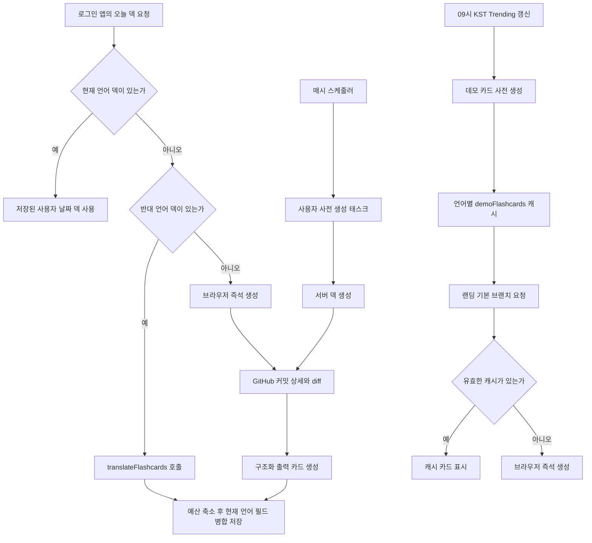
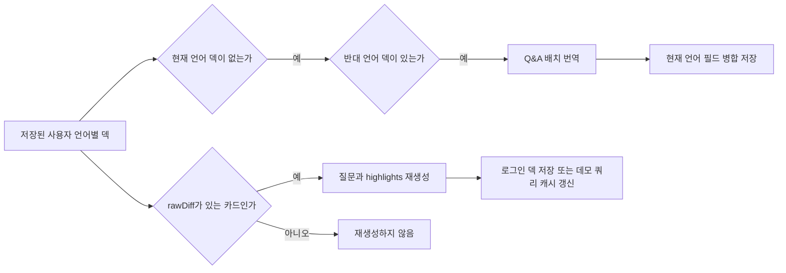

사용자 날짜 덱과 랜딩 데모는 모두 GitHub 커밋을 질문·답변 카드로 바꾸지만, 생성 주체와 저장소가 다르다. 로그인 앱은 이미 저장된 오늘의 언어별 덱을 먼저 읽고, 반대 언어 덱만 있으면 번역하며, 두 덱이 모두 없을 때만 브라우저에서 생성한다. 서버는 같은 사용자 날짜 덱을 새벽에 미리 채울 수 있고, 랜딩은 Trending 저장소의 공개 캐시를 우선 읽는다. 데이터 소유권과 읽기 권한은 [Firestore 데이터 경계](../architecture/firestore-data-boundary.md)를 참고한다.

## 경로 선택과 결과 저장

| 경로 | 진입 시점 | 커밋 선택 | 결과 |
|---|---|---|---|
| 앱 즉석 생성 | `useTodayFlashcards`에서 두 언어 덱이 모두 없을 때 | 선택 저장소별 Free는 1·7일 전, Pro는 1·7·30일 전의 변경 파일이 있는 첫 커밋 | `users/{uid}/flashcards/{YYYY-MM-DD}`의 `data_ko` 또는 `data_en` |
| 사용자 사전 생성 | 매시 스케줄러가 사용자 현지 시각 0–6시에 태스크를 등록할 때 | 즉석 생성과 같은 저장소·등급별 복습 날짜 | 같은 사용자 날짜 문서의 사용자 언어 필드 |
| 랜딩 데모 | 매일 09:00 KST Trending 갱신 뒤 | 기본 브랜치 최근 3개 커밋 | `demoFlashcards/{owner}__{repo}__{lang}` |



*오늘의 덱은 언어별 저장 데이터를 우선하고, 사용자·데모 사전 생성과 브라우저 생성은 각각 다른 저장 지점으로 합류한다.*

### 로그인 앱의 순서

`useTodayFlashcards`는 먼저 사용자 문서에서 선택 저장소를 읽는다. 저장소가 없으면 덱을 만들지 않는다. 저장소가 있으면 현재 표시 언어를 `ko` 또는 `en`으로 정하고, 브라우저 IANA 시간대와 언어를 사용자 문서에 best-effort로 동기화한다. 서버 스케줄러는 이 설정으로 사용자의 날짜와 사전 생성 언어를 결정한다.

1. 오늘 문서의 현재 언어 배열이 비어 있지 않으면 그것을 사용한다. 이전 카드에 브랜치가 빠진 경우에는 기본 브랜치를 보강해 같은 언어 필드에 병합 저장할 수 있지만, 이 보강 실패는 읽기를 막지 않는다.
2. 현재 언어가 없고 반대 언어 덱이 있으면 GitHub을 다시 읽거나 카드를 새로 생성하지 않고 `translateFlashcards`를 호출한다. 번역 결과는 남은 문서 예산과 언어별 기본 예산 중 작은 값에 맞춘 뒤 현재 언어 필드에만 병합한다.
3. 두 언어 덱 모두 없을 때만 선택 저장소와 복습 날짜를 순서대로 처리한다. 날짜 범위에서 변경 파일이 있는 첫 커밋의 diff를 만들고 `openaiChatCompletions`로 보낸다. 한 저장소·날짜 조합의 GitHub, AI, JSON 파싱 오류는 로그만 남기고 다음 조합을 계속한다.
4. 생성 카드가 하나 이상이면 덱 크기를 축소해 `data_{lang}`에 병합 저장한다. 번역·생성의 최상위 호출이 실패하거나 카드가 비면 오늘 덱 없음 상태가 된다.

클라이언트의 `chatCompletions`와 `translateFlashcards` API 래퍼는 인증 토큰을 붙일 수 있고 `AbortController`로 공통 요청 시간 제한을 적용한다. HTTP 함수 `openaiChatCompletions`는 입력 검증과 호출자별 AI guard 뒤에 공용 생성 모듈을 호출한다. guard의 한도와 실패 의미는 [AI 호출 가드](../architecture/ai-call-guard.md)에 있다.

## 서버 사전 생성: 앱과의 경합을 피하는 보완 경로

사전 생성은 별도 덱 모델이 아니라 사용자 날짜 덱을 먼저 준비하는 경로다. `scheduleFlashcardPregeneration`은 매시 최근 7일 활동했고 유효한 시간대·언어·저장소 설정을 가진 사용자 중, 현지 시간이 0–6시이고 해당 날짜 완료 기록이 없는 사용자만 Cloud Tasks에 넣는다. 동일 시각의 태스크 ID는 중복 등록을 막고, 완료하지 못한 사용자는 다음 시각에 다시 대상이 될 수 있다.

태스크는 사용자 GitHub 토큰으로 저장소 × 복습 날짜 조합을 생성한다. 사용자 내부에서는 조합을 병렬 처리하지만 결과 배열은 저장소, 날짜 순서를 보존한다. 저장 전에는 오늘 문서의 **두 언어 중 어느 하나라도** 비어 있지 않은지 확인하고, 생성 후 Firestore 트랜잭션 안에서 다시 확인한다. 따라서 앱이 자정 직후 먼저 쓴 덱을 사전 생성 작업이 덮어쓰지 않는다.

`flashcardPregeneration/{uid}`는 클라이언트가 접근할 수 없는 완료 기록이며, `saved`, `exists`, `empty`, `unavailable`을 구분한다. 카드가 없고 조합 실패도 없을 때만 `empty`로 끝낸다. 일부 조합 실패로 덱이 비거나 일시 오류가 나면 완료 기록 없이 오류를 던져 태스크 재시도와 다음 스케줄 시각의 재시도를 허용한다. GitHub 인증 오류나 필요한 설정 부재는 재시도로 해결되지 않는 `unavailable`으로 기록한다. 더 자세한 대상 선정과 재시도는 [오늘의 플래시카드 사전 생성](pregeneration.md)을 참고한다.

## 랜딩 데모: 공개 캐시 우선, 즉석 생성 대체

`refreshTrendingRepos`는 매일 09:00 KST에 Trending Top 10을 수집한다. 파싱 결과가 5개보다 적으면 기존 목록과 카드 캐시를 보존한다. 충분하면 `meta/trendingRepos`를 먼저 갱신하고, 이어서 저장소별·언어별 데모 카드를 생성한다. 카드 생성이 실패해도 이미 저장한 Trending 목록은 되돌리지 않는다.

데모 생성은 공개 저장소의 기본 브랜치 최근 3개 커밋을 읽고, 언어마다 커밋당 첫 카드만 보관한다. 저장소는 순차 처리하고 한 저장소 내부의 커밋만 병렬 처리하므로, 한 커밋 또는 저장소의 실패가 나머지 대상을 중단시키지 않는다. 저장 전에는 파일 수, patch 길이, 직렬화 문서 크기를 제한하며, 이번 Trending 목록에 없는 캐시 문서는 삭제한다.

랜딩의 `useDemoFlashcards`는 URL에 명시 브랜치가 없을 때만 `demoFlashcards` 문서를 먼저 읽는다. 캐시 부재, 빈 카드, 읽기 실패, 또는 `@branch` 지정은 `generateDemoFlashcards`로 대체된다. 이 브라우저 fallback은 Firestore 캐시를 쓰지 않으며, 화면에서 바꾼 데모 카드는 React Query 캐시에만 보존된다.

## 공통 생성 모듈과 경로별 차이

`functions/src/flashcard-generation.ts`는 서버 실시간 생성, 사용자 사전 생성, 데모 사전 생성이 공유하는 GitHub·모델 경계다. 사용자 토큰이 있으면 GitHub Bearer 인증을, 없으면 데모 User-Agent를 사용한다. 401은 `GitHubAuthError`로 구분한다. 기본 브랜치 조회의 일반 오류는 브랜치 없이 후속 조회를 계속하지만, 인증 오류는 전파한다.

| 단계 | 공통 계약 | 경로별 차이 |
|---|---|---|
| GitHub 원문 | 커밋 목록 뒤 `fetchCommitDetail`로 파일과 patch를 얻고 `formatCommitDiff`로 diff를 만든다 | 사용자 사전 생성은 사용자 토큰을, 서버 데모는 익명 공개 조회를 사용한다. 브라우저 즉석 생성은 앱의 GitHub 클라이언트를 사용한다. |
| 모델 호출 | `requestFlashcardCompletion`은 프롬프트를 30,000자로 절단하고 Structured Outputs로 `question`, `answer`, `highlights`를 요청한다 | 서버 데모는 커밋의 짧은 파일·patch 요약을 입력으로 쓰고 첫 카드만 사용한다. |
| 파싱 | `parseFlashcardItems`는 문자열 `question`·`answer`가 아닌 항목을 버리고 문자열 highlight만 남긴다 | 앱 즉석 생성은 HTTP 정규화 응답을 자체 파싱한다. 잘못된 JSON은 호출 오류가 되어 각 경로의 조합·커밋 실패 처리로 넘어간다. |
| 저장 | 사용자 날짜 덱은 언어 필드별로 merge한다 | 데모는 언어별 독립 문서에 저장하고, 브라우저 데모 fallback은 저장하지 않는다. |

공용 모듈의 변경은 세 서버 경로에 동시에 영향을 준다. 특히 프롬프트·스키마·diff 형식을 바꾸면 빈 `items`, 잘못된 JSON, 일부 잘못된 항목과 GitHub 인증 오류가 각 경로에서 어떻게 격리되는지 확인해야 한다.

## 번역과 질문 재생성



*언어 전환은 반대 언어 덱을 보존한 채 번역 필드를 추가하고, 질문 재생성은 카드가 가진 `rawDiff`를 전제로 한다.*

`translateFlashcards`는 카드 배열의 `question`과 `answer`만 배치 번역한다. 응답을 원본 인덱스에 붙이므로 `highlights`와 `metadata`는 보존되며, 응답 항목 수가 다르면 해당 인덱스는 원문 Q&A를 유지한다. 카드 수나 직렬화한 Q&A 본문이 상한을 넘으면 대응 관계를 잃지 않도록 자르지 않고 413으로 거부한다.

`regenerateCardQuestion`은 `rawDiff`, 기존 질문·답변, 최대 10개의 다른 질문을 입력으로 받아 새 `question`과 `highlights`를 반환한다. 로그인 카드 화면은 현재 언어의 사용자 날짜 덱에 결과를 병합 저장한다. 랜딩 데모는 같은 결과를 React Query 캐시에만 반영하므로 공개 `demoFlashcards` 문서는 바꾸지 않는다. 재생성은 생성·번역과 별도 일일 제한과 인증·데모 기기 식별 경로를 사용한다.

## 함께 유지할 저장 계약과 점검

앱과 Functions는 별도 패키지이므로 복습 날짜, 카드 형태, 덱 축소 규칙을 각각 구현한다. `data_ko`와 `data_en`이 한 사용자 날짜 문서에 공존하므로 한쪽만 바꾸면 즉석 생성, 사전 생성, 번역 결과가 어긋나거나 쓰기가 실패할 수 있다.

- 앱과 Functions의 Free `[1, 7]`, Pro `[1, 7, 30]` 복습 날짜는 함께 변경한다.
- 두 패키지는 900,000-byte 문서 안전 상한과 언어별 450,000-byte 기본 예산을 같은 규칙으로 사용한다. 예산 초과 시에는 파일 patch와 `rawDiff`를 축소하며, 끝까지 맞지 않으면 `rawDiff`를 제거한다. 자세한 규칙은 [덱 문서 크기 예산](deck-size-budget.md)을 참고한다.
- `owner__repo__lang` 데모 캐시 ID 형식은 앱과 Functions가 같아야 하며, `/`를 문서 ID에 사용할 수 없다.
- 구조화 출력·GitHub 조회·저장 정책 변경은 앱 즉석 생성, 사용자 사전 생성, 데모 캐시 hit/miss와 명시 브랜치 우회를 함께 점검한다. 현재 `app/`과 `functions/`에는 테스트 파일이 없으므로, 계약 변경 시 이 경계와 사전 생성 트랜잭션 경합을 fixture 또는 Emulator 테스트로 추가하는 것이 안전하다.

```bash
pnpm --prefix functions run lint
pnpm --prefix functions run build
```
