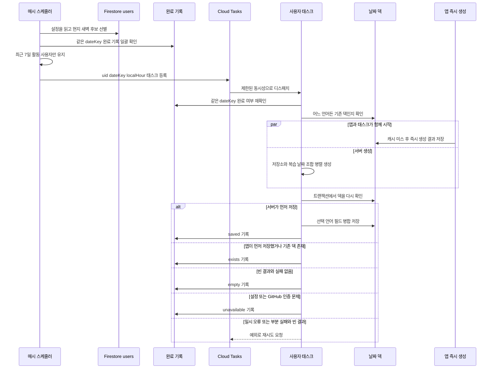

## 목적과 경계

`useTodayFlashcards`는 `users/{uid}/flashcards/{YYYY-MM-DD}`에서 현재 표시 언어의 덱을 먼저 읽는다. 현재 언어 덱이 없으면 반대 언어 덱을 번역하고, 두 덱이 모두 없을 때만 브라우저에서 GitHub 조회와 AI 생성을 수행한다. 사전 생성은 이 마지막 캐시 미스의 첫 화면 대기를 줄이기 위해 같은 날짜 문서를 미리 채우는 **보완 경로**다. 대상이 아니거나 사전 생성에 실패해도 앱의 즉시 생성 경로는 남는다. 언어 우선순위와 공용 생성 계약은 [카드 생성 경로](generation-paths.md)를 참고한다.

앱은 선택 저장소가 있을 때 브라우저의 IANA 시간대와 표시 언어(`ko` 또는 `en`)를 `users/{uid}`에 best-effort로 동기화한다. 서버는 이 설정으로 사용자별 `dateKey`와 카드 언어를 결정한다. `Intl` 기반 날짜 계산은 현지 자정부터 다음 자정 직전까지의 커밋 조회 구간을 만들므로 서머타임 전환일도 그 시간대의 일 경계를 따른다.

- **같은 덱 문서:** 서버는 선택 언어의 `data_ko` 또는 `data_en`만 병합 저장한다. 그러나 어느 언어든 비어 있지 않은 덱이 있으면 생성하지 않는다. 다른 언어를 채우는 책임은 앱의 번역 경로에 있다.
- **서버 전용 완료 상태:** `flashcardPregeneration/{uid}`는 덱 부재가 아직 미처리인지, 카드가 될 커밋이 없었는지를 구별한다. 이 컬렉션에는 클라이언트 접근을 허용하는 Firestore 규칙이 없다. 데이터 소유권 경계는 [Firestore 데이터 경계](../architecture/firestore-data-boundary.md)를 참고한다.
- **공유 범위:** Free는 1일·7일 전, Pro는 1일·7일·30일 전의 커밋을 대상으로 한다. 사용자 문서는 저장소를 최대 5개까지 허용하므로 태스크 하나는 최대 15개 조합을 병렬 처리할 수 있다. 저장 전에는 `fitFlashcardDeckToBudget`으로 덱 표현을 축소한다. 예산의 보장 범위는 [덱 문서 크기 예산](deck-size-budget.md)에 있다.

## 스케줄, 큐, 저장 경쟁

`functions/src/index.ts`가 `scheduleFlashcardPregeneration`과 `pregenerateUserFlashcards`를 배포한다. 전자는 `asia-northeast3`에서 매시 정각에 대상만 골라 Cloud Tasks에 넣고, 후자가 사용자 한 명의 GitHub·AI 생성과 저장을 담당한다. Functions 전역 인스턴스 상한은 10개이며 큐의 동시 디스패치는 5개다.



*대상 선정부터 앱과 서버의 저장 경쟁, 결정적 완료와 재시도 가능한 실패의 분기를 보여 준다.*

### 대상 선정과 중복 등록

스케줄러는 `language in ["ko", "en"]`인 `users` 문서에서 `timezone`, `language`, `repositories`만 읽는다. 이후 다음 조건을 모두 만족해야 한다.

1. 시간대가 런타임이 인식하는 IANA 시간대이고, 언어가 `ko` 또는 `en`이며, 저장소가 하나 이상이어야 한다. 설정이 없으면 언어나 날짜를 추측해 생성하지 않는다.
2. 스케줄 시각을 사용자 현지 시각으로 바꿨을 때 0시 이상 6시 미만이어야 한다. 새벽 6시간 창은 앞선 스케줄 또는 큐 실행이 실패했을 때 다음 정각에 따라잡을 기회를 준다.
3. 완료 문서의 `dateKey`가 현지 오늘과 같으면 제외한다. 완료 기록은 사용자당 하나의 문서이고 스케줄러는 최대 100개씩 읽는다.
4. Firebase Auth의 `lastRefreshTime`을 우선하고 없으면 `lastSignInTime`을 사용해, 기준 시각에서 최근 7일 안에 활동한 사용자만 남긴다.

태스크 본문은 `uid`, `dateKey`, `localHour`이며 ID는 `${uid}-${dateKey}-h${localHour}`다. 같은 정각의 스케줄러 재실행은 `functions/task-already-exists`를 건너뛰므로 중복 등록하지 않는다. 다음 정각에는 다른 ID를 사용하므로 미완료 사용자를 다시 등록할 수 있다. enqueue 실패가 하나라도 있으면 스케줄러가 예외를 던진다. 스케줄러는 최대 3회, 최소 60초 및 최대 1,800초 간격으로 재시도한다.

## 태스크의 생성과 저장 규칙

태스크는 요청 본문의 `dateKey`를 저장 대상 날짜로 사용한다. 시작 시 완료 기록을 다시 읽어, 이전 시각 태스크가 늦게 끝난 뒤 도착한 다음 태스크를 건너뛴다. 이어 사용자 문서의 설정과 `githubToken`을 읽는다. 설정 또는 토큰이 없으면 `unavailable`을 기록하고 종료한다.

저장소별 작업과 각 저장소의 복습 날짜별 작업은 `Promise.all`로 병렬 수행하지만, 결과 배열은 저장소·날짜 순서를 유지한다. 브랜치가 설정되지 않았으면 기본 브랜치를 조회하며, 일반 조회 실패는 브랜치 없이 GitHub 기본값을 쓰는 조회로 계속한다. 각 조합은 사용자 시간대에서 해당 날짜의 변경 파일이 있는 첫 커밋을 찾고, 상세 커밋 diff를 `generateFlashcardItems`에 전달한다. GitHub 401은 `GitHubAuthError`로 구별한다.

생성 전 일반 읽기는 불필요한 AI 호출을 피하고, 저장 트랜잭션의 재검사는 데이터 손실을 막는다. `hasDeck`은 `data_ko` 또는 `data_en` 중 하나가 비어 있지 않은 배열인지 검사한다.

- 일반 읽기에서 덱을 찾으면 AI 호출 없이 `exists`를 기록한다.
- 카드가 생성되면 덱 크기를 맞춘 후 트랜잭션 안에서 다시 `hasDeck`을 검사한다. 여전히 없을 때만 선택 언어 필드를 `{merge: true}`로 저장하고 `saved`를 기록한다.
- 그 사이 앱이 먼저 저장했다면 트랜잭션은 쓰지 않고 `false`를 반환하며 태스크는 `exists`를 기록한다. 따라서 서버는 앱이 어느 언어로 생성했든 덮어쓰지 않는다.

## 완료 기록과 실패 의미

날짜 덱이 없다는 사실만으로는 **카드가 될 커밋이 없음**과 **아직 생성하지 않았거나 실패함**을 구분할 수 없다. 그래서 확정적으로 끝난 경우만 완료 문서에 `{ dateKey, outcome, updatedAt }`를 기록한다.

| `outcome` | 확정 의미 | 이후 처리 |
|---|---|---|
| `saved` | 서버가 축소한 카드 덱을 저장했다 | 같은 날짜 후보에서 제외 |
| `exists` | 앱 또는 다른 경로가 먼저 비어 있지 않은 덱을 저장했다 | 같은 날짜 후보에서 제외 |
| `empty` | 모든 조합이 정상적으로 끝났지만 카드가 없다 | 같은 날짜 후보에서 제외 |
| `unavailable` | 설정·토큰이 없거나 GitHub 토큰이 무효다 | 같은 날짜 후보에서 제외 |

조합별 일반 오류는 기록하고 다른 조합을 계속 처리하며 `failedCount`를 올린다. 모든 결과가 비었고 실패도 없을 때만 `empty`다. 부분 실패가 있고 덱도 비었으면 완료 기록을 쓰지 않고 예외를 던진다. 실패한 조합에 카드가 될 커밋이 있었을 수 있기 때문이다. GitHub 인증 오류는 재시도로 해결되지 않는 것으로 보고 `unavailable`로 끝낸다.

카드가 하나라도 있으면 부분 실패 수가 있어도 저장하고 `saved`로 완료한다. 반대로 **부분 실패와 빈 결과**는 미처리로 남긴다. 이 구분이 빈 덱을 정상 완료로 오인하지 않는 핵심 불변식이다. 그 밖의 오류가 태스크 밖으로 전파되면 Cloud Tasks는 최대 3회, 최소 120초 backoff로 재시도한다. 모든 시도가 실패해도 완료 기록이 없으므로, 새벽 창 안의 다음 정각 스케줄러가 새 ID의 태스크를 다시 넣을 수 있다.

## 변경 및 운영 점검

- 시간대·언어 필드는 앱이 best-effort로 쓰며, `users` 규칙은 이 두 필드를 클라이언트 허용 목록과 형식 검증에 포함한다. 필드명이나 언어 집합을 바꾸면 앱, 규칙, `readPregenerationSettings`를 함께 바꾼다.
- 복습 간격, 카드 메타데이터, 덱 축소 정책은 앱과 Functions에 각각 구현돼 있다. 한쪽만 바꾸면 같은 날짜 문서에 서로 다른 계약의 데이터를 기록할 수 있다.
- 태스크 함수 export 이름은 큐 경로의 함수명과 일치해야 한다. 리전, 동시 실행 수, 540초 timeout, 재시도 설정은 AI 호출량과 새벽 창 내 완료율에 영향을 주므로 함께 검토한다.
- 현재 `functions/`와 `app/`에는 전용 테스트 파일이 없다. 이 워크플로를 변경할 때는 Emulator 또는 의존성 mock으로 시간대·서머타임 경계, 활동·완료 필터, 결정적 태스크 ID, 앱과 트랜잭션 저장의 경쟁, `empty`와 부분 실패의 구분, GitHub 401의 `unavailable`, 완료 기록 없는 재시도 경로를 검증하는 테스트를 추가하는 것이 안전하다.

```bash
pnpm --prefix functions run lint
pnpm --prefix functions run build
```

로컬 Emulator와 배포 절차는 [로컬 개발 및 배포](../operations/local-development-and-deployment.md)를 따른다.
