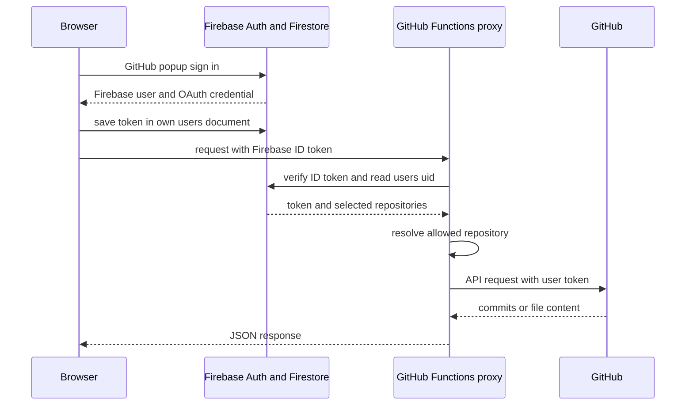

# GitHub 인증과 저장소 접근

로그인 사용자의 GitHub API 호출은 브라우저가 GitHub OAuth 토큰을 직접 보내는 구조가 아니다. 로그인 때 얻은 토큰은 사용자 Firestore 문서에 저장되고, 브라우저는 Firebase ID 토큰만 Functions 프록시에 보낸다. 프록시는 검증된 `uid`로 문서를 읽고, 저장된 토큰과 선택 저장소를 사용해 GitHub API를 호출한다. 반면 랜딩 데모는 토큰 없이 GitHub Public API를 브라우저에서 직접 호출하며, `getFileContent`는 공개 raw 파일을 위해 익명 요청도 허용한다.

카드 생성의 캐시·AI 생성 흐름은 [카드 생성 경로](../flashcard/generation-paths.md), 사용자별 예약 생성은 [플래시카드 사전 생성](../flashcard/pregeneration.md), 공개 AI 함수의 호출량 경계는 [공개 AI 함수 호출 경계](../architecture/ai-call-guard.md), 사용자 문서 읽기·쓰기 규칙은 [Firestore 데이터 경계](../architecture/firestore-data-boundary.md)를 참고한다.

*로그인 사용자 흐름에서 브라우저는 Firebase ID 토큰만 프록시에 보내며, GitHub OAuth 토큰은 함수가 사용자 문서에서 읽어 GitHub 호출에 사용한다.*

## 인증 자료의 수명과 소유자

### 로그인과 토큰 갱신

`githubProvider`는 `user:email` 및 `repo` scope를 요청한다. `Login`은 `signInWithPopup` 결과의 GitHub credential에서 access token을 얻어 `users/{uid}.githubToken`에 저장한다. 문서가 이미 있으면 `githubToken`과 `updatedAt`만 갱신하므로 기존 저장소 설정은 유지된다. 새 사용자 문서는 이 필드들로 생성한다. 토큰 값이나 사용자별 접근 정보는 로그·분석 이벤트·문서에 기록하지 않는다.

`githubToken`은 Firebase Auth 세션의 ID 토큰과 별개다. `apiClient` 요청 인터셉터는 `auth.currentUser.getIdToken()`의 결과만 `Authorization: Bearer ...`에 넣는다. 따라서 `githubApi.ts`의 `getCommits`, `getFilename`, `getMarkdown`, `getFileContent`, `getRepositories`, `getBranches` 호출은 GitHub 토큰을 함수 URL로 전송하지 않는다.

Firestore 규칙은 본인만 `users/{uid}`를 읽고 쓰게 하고, 클라이언트 쓰기를 허용 필드와 타입·길이로 한정한다. `githubToken`과 `repositories`도 클라이언트 소유 필드다. 즉 다른 Firebase 사용자의 읽기는 막지만 토큰은 사용자 문서에 있으므로, 클라이언트 경계에서 토큰을 노출하거나 기록하지 않는 운영 규율이 필요하다.

### Functions 프록시의 인증 경계

`getCommits`, `getFilename`, `getMarkdown`은 Bearer Firebase ID 토큰을 Admin SDK로 검증한 뒤 그 `uid`의 사용자 문서에서 GitHub 토큰과 비어 있지 않은 `repositories`를 요구한다. 검증 또는 설정 확인에 실패하면 GitHub에 요청하지 않는다. `getRepositories`와 `getBranches`도 ID 토큰을 검증하고 같은 사용자 문서에서 GitHub 토큰을 찾는다.

이 HTTP 함수는 `cors: true`, `invoker: "public"`으로 배포된다. 공개 invoker는 브라우저의 CORS 및 preflight 요청을 도달하게 하는 수단일 뿐이다. 각 핸들러의 Firebase ID 토큰 검증과, 커밋·상세·마크다운 핸들러의 저장소 허용 목록 검증을 대체하지 않는다. 특히 `getFileContent`만은 공개 raw 리소스 제공을 위해 인증을 선택적으로 처리한다.

| 앱 함수 | 프록시 엔드포인트 | 역할과 인증 |
| --- | --- | --- |
| `getRepositories` | `/getRepositories` | 인증된 사용자의 토큰으로 GitHub `/user/repos`를 조회 |
| `getCommits` | `/getCommits` | 날짜 범위, 선택 저장소, 브랜치의 커밋 목록을 조회 |
| `getFilename` | `/getFilename` | 선택 저장소에서 특정 SHA의 상세·변경 파일을 조회 |
| `getMarkdown` | `/getMarkdown` | 선택 저장소의 경로를 raw 형식으로 조회 |
| `getFileContent` | `/getFileContent` | 허용된 GitHub 호스트의 raw URL을 조회하고, 인증 시에만 토큰을 선택적으로 첨부 |
| `getBranches` | `/getBranches` | 인증된 사용자의 토큰으로 요청한 저장소의 브랜치 목록을 조회; deprecated |

개발 환경의 `apiClient` 기본 URL은 `/api`이고 프로덕션에서는 `VITE_FUNCTIONS_URL_PROD`를 쓴다. 프록시를 배포하거나 로컬에서 연결할 때는 함수 이름, CORS, 이 base URL을 함께 맞춰야 한다.

## 선택 저장소와 브랜치

### 설정이 만드는 허용 목록

온보딩은 선택한 한 저장소를 `repositories: [{ fullName, url, branch? }]` 형태로 저장한다. 설정 화면은 Free에서 1개, Pro에서 최대 5개를 저장하며 저장 성공 뒤 기존 플래시카드를 삭제하고 페이지를 새로고침한다. Firestore 규칙은 배열 최대 5개, 각 항목의 필수 `fullName`·HTTPS `url`, 선택적 문자열 `branch`를 검사한다.

커밋·커밋 상세·마크다운 프록시는 요청 `repositoryFullName`이 저장된 `repositories` 중 `fullName`과 정확히 일치할 때만 그것을 사용한다. 파라미터가 없거나 일치하지 않으면 첫 번째 저장소를 사용한다. 이 서버 측 해석이 임의의 `owner/repo`를 해당 세 GitHub API 경로에 주입하는 것을 막는다.

`getBranches`는 UI가 저장소별 브랜치 선택지를 채울 때 호출하지만 deprecated 상태다. 이 핸들러는 호출자와 토큰은 확인해도 요청 `owner`와 `repo`를 저장된 `repositories`에 대조하지 않는다. 따라서 브랜치 목록 API를 저장소 허용 목록의 강제 수단으로 취급해서는 안 된다. 온보딩과 설정 UI는 저장소가 바뀌거나 선택 해제된 뒤 늦게 도착한 브랜치 응답을 무시한다.

### 브랜치의 적용 범위

저장된 브랜치는 `getCommits`의 GitHub commits API `sha` 파라미터로 사용된다. 단, 요청의 비어 있지 않은 `branch`가 있으면 현재 구현은 저장 브랜치보다 요청 값을 우선하며 저장된 브랜치 목록과 대조하지 않는다. 저장소 범위는 강제하지만 브랜치 고정 범위는 강제하지 않는다는 뜻이다. 특정 브랜치를 보안 또는 재현성 조건으로 고정하려면 함수가 요청 브랜치를 저장값과 비교하여 거부하거나 무시하도록 바꿔야 한다.

`getFilename`은 SHA로 커밋 상세를 조회한다. 반면 `getMarkdown`은 `/contents/{filename}`에 ref를 주지 않으므로 GitHub 기본 브랜치의 현재 파일을 읽는다. 카드 생성은 날짜 범위의 커밋 목록을 먼저 받고, 순서대로 상세를 조회해 변경 파일이 있는 첫 커밋의 diff를 사용한다. 사용자별 사전 생성도 같은 상세 조회·선택 규칙을 서버에서 사용자 토큰으로 수행한다.

## 공개 데모와 raw 파일의 별도 경계

| 경로 | 호출과 인증 | 범위 | private 저장소 |
| --- | --- | --- | --- |
| 로그인 커밋·상세·마크다운 | Firebase ID 토큰 검증 후 사용자 문서 토큰 | 저장된 `repositories` 중 하나, 불일치 시 첫 항목 | 토큰 권한이 있으면 가능 |
| 로그인 raw 파일 | 유효한 ID 토큰에서 찾은 토큰을 선택적으로 첨부 | 허용 GitHub 호스트의 URL | 토큰이 URL 자원에 권한이 있으면 가능 |
| 비로그인 raw 파일 | Firebase·GitHub 토큰 없음 | 허용 GitHub 호스트의 공개 URL | 불가 |
| 랜딩 데모 | 브라우저가 GitHub Public API 직접 호출 | 입력한 공개 URL의 기본 또는 지정 브랜치 | 불가 |

`generateDemoFlashcards`는 Firebase나 Firestore에 저장하지 않는다. 입력 URL을 파싱하고 지정 브랜치가 없으면 공개 저장소 API에서 기본 브랜치를 찾은 뒤, 해당 브랜치의 최근 세 커밋과 각각의 상세를 토큰 없이 조회한다. 목록 조회의 `404`는 저장소 없음으로, 그 밖의 비성공 응답은 GitHub API 실패로 처리한다. 상세 조회가 실패하면 그 커밋의 목록 항목으로 폴백한다. 토큰이 없으므로 private 저장소는 이 경로의 대상이 아니다.

### raw URL 프록시

`getFileContent`는 `raw_url`을 파싱하고 hostname이 `github.com`, `raw.githubusercontent.com`, `api.github.com` 중 하나일 때만 요청한다. URL이 없거나 잘못되었거나 허용 목록 밖이면 `400`을 반환한다. 유효한 Firebase 인증으로 사용자 문서의 GitHub 토큰을 찾으면 Authorization 헤더를 붙이고, 그렇지 않으면 토큰 없이 요청한다.

이 엔드포인트는 `repositories` 설정을 요구하지 않고 URL의 owner·repository를 선택 저장소와 비교하지 않는다. 허용 목록도 초기 URL의 hostname 검사다. 따라서 이는 공개 데모의 파일 보기와 private raw 접근의 편의 경로이지, 선택 저장소를 강제하는 장치나 범용 URL 프록시로 확장해서는 안 된다. 더 강한 경계가 필요하면 URL의 저장소 식별자를 파싱해 허용 목록과 대조하고 redirect 정책도 명시해야 한다.

## 실패 의미와 변경 시 확인할 점

- GitHub가 비성공 상태를 돌려주면 커밋·상세·마크다운·저장소·브랜치·raw 프록시는 대체로 동일 상태와 오류 본문을 응답에 담는다. 그러나 `getCommits`, `getFilename`, `getMarkdown`의 인증·설정 확인 오류는 공통 catch에서 `500`이 된다. 클라이언트는 이를 단순 GitHub 장애로만 표시하지 말고 로그인, 재로그인, 저장소 설정을 확인하도록 안내해야 한다.
- 사용자별 사전 생성은 토큰이나 설정이 없거나 `GitHubAuthError`가 발생하면 `unavailable`로 완료 처리한다. 일반 오류 때문에 일부 조합이 실패했고 덱이 비었으면 예외를 던져 Task Queue 재시도가 가능하게 한다. 토큰 만료를 자동 갱신하지 않으므로 재로그인이 갱신 경로다.
- 이 영역에는 `github.ts` 또는 앱 프록시 래퍼의 전용 테스트 파일이 없다. 변경 시에는 ID 토큰 없음·무효, 저장소 미설정, 허용·비허용 `repositoryFullName`, 저장 브랜치와 쿼리 브랜치 우선순위, 허용·비허용 raw host, 로그인·비로그인 public/private 응답을 테스트로 고정하는 것이 중요하다.
