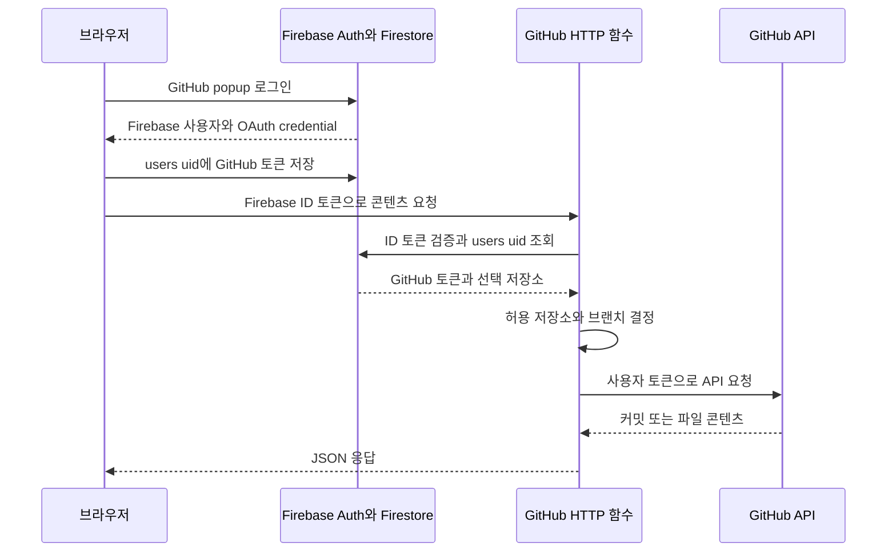

# GitHub 인증과 콘텐츠 접근

앱은 브라우저에서 GitHub OAuth 토큰으로 GitHub API를 직접 호출하지 않는다. GitHub 로그인 결과의 토큰은 `users/{uid}` 문서에 보관하고, 브라우저는 Cloud Functions에 Firebase ID 토큰만 보낸다. 함수는 검증한 `uid`로 해당 문서를 읽은 뒤에만 GitHub 요청에 사용자 토큰을 붙인다. 따라서 함수 URL이 `invoker: "public"`이고 CORS를 허용하더라도, 로그인 사용자용 커밋·상세·마크다운 조회가 익명 접근 가능한 것은 아니다.

이 문서는 인증과 GitHub 콘텐츠 조회의 경계를 다룬다. 사용자 문서의 읽기·쓰기 규칙은 [Firestore 데이터 경계](../architecture/firestore-data-boundary.md), 카드 생성의 캐시와 AI 호출 경로는 [카드 생성 경로](../flashcard/generation-paths.md), 예약 생성의 실행 모델은 [플래시카드 사전 생성](../flashcard/pregeneration.md)을 참고한다.

*로그인 사용자 조회 흐름: 브라우저는 Firebase ID 토큰만 함수에 보내며, GitHub OAuth 토큰은 함수가 검증된 사용자 문서에서 읽어 GitHub API에만 사용한다.*

## 자격 증명의 수명과 소유

`githubProvider`는 `user:email` 및 `repo` scope를 요청한다. `Login`은 popup 결과의 `GithubAuthProvider` credential에서 access token을 얻어 `githubToken`으로 저장한다. 기존 문서에서는 `githubToken`과 `updatedAt`만 갱신하므로 선택한 저장소 설정은 유지되며, 새 문서에는 이 필드들이 생성된다. 토큰 원문은 UI, 로그, 분석 이벤트, 문서 예시에 기록하지 않는다.

`apiClient`는 `auth.currentUser.getIdToken()`으로 얻은 Firebase ID 토큰을 `Authorization` 헤더에 붙인다. `githubApi.ts`의 `getCommits`, `getFilename`, `getMarkdown`, `getFileContent`, `getRepositories`, `getBranches`는 모두 이 클라이언트를 통하므로 GitHub 토큰을 요청 매개변수나 헤더로 전달하지 않는다. 개발 환경의 함수 base URL은 `/api`, 운영 환경의 base URL은 `VITE_FUNCTIONS_URL_PROD`다.

Firestore 규칙은 `users/{uid}`를 본인만 읽고 쓰게 한다. 클라이언트 쓰기에서는 허용된 필드만 변경할 수 있고, `githubToken`은 문자열 및 길이 제한을, `repositories`는 항목 구조와 최대 다섯 개 제한을 통과해야 한다. 이는 다른 사용자의 문서 접근을 막는 규칙이지, 사용자 브라우저가 읽을 수 있는 문서에 있는 비밀값을 UI나 telemetry에 노출해도 된다는 뜻은 아니다.

## 함수 프록시의 인증과 저장소 범위

### 로그인 사용자용 엔드포인트

`getCommits`, `getFilename`, `getMarkdown`은 Bearer 형식의 Firebase ID 토큰을 Admin SDK로 검증하고, 검증된 `uid`의 사용자 문서에서 `githubToken`과 비어 있지 않은 `repositories`를 요구한다. 둘 중 하나가 없으면 GitHub 요청을 하지 않는다. 이후 `repositoryFullName`은 저장된 항목의 `fullName`과 일치할 때만 채택하며, 생략하거나 불일치하면 배열 첫 번째 저장소를 사용한다. 이 확인이 임의의 `owner/repo`를 요청해 사용자 설정 밖 저장소로 이동하는 것을 막는다.

| 앱 래퍼 | HTTP 함수 | 용도와 범위 |
| --- | --- | --- |
| `getRepositories` | `/getRepositories` | 검증된 사용자 문서의 토큰으로 `/user/repos`를 조회해 선택 UI에 제공 |
| `getCommits` | `/getCommits` | 날짜 범위의 선택 저장소 커밋 목록 조회 |
| `getFilename` | `/getFilename` | 선택 저장소에서 커밋 SHA의 파일 목록과 patch를 포함한 상세 조회 |
| `getMarkdown` | `/getMarkdown` | 선택 저장소의 경로를 GitHub raw 표현으로 조회 |
| `getFileContent` | `/getFileContent` | 카드가 가진 raw URL의 콘텐츠 조회 |

`getRepositories`와 `getBranches`는 헤더가 없으면 명시적으로 `401`을 반환한다. 반면 세 콘텐츠 프록시는 인증·설정 확인에서 난 오류를 공통 catch로 받아 현재 `500`으로 응답한다. GitHub가 비성공 응답을 반환한 경우에는 대체로 그 상태 코드와 오류 본문을 전달하며, 필수 쿼리가 빠지거나 raw URL이 잘못된 경우는 `400`이다. 클라이언트 오류 UX는 GitHub 장애뿐 아니라 로그인 갱신과 저장소 미설정도 안내해야 한다.

### 저장소와 브랜치 설정

온보딩은 하나의 `{ fullName, url, branch? }` 항목을 `repositories`에 저장한다. 설정 화면은 Free에서 하나, Pro에서 최대 다섯 저장소를 저장하며, 저장 후 기존 플래시카드를 지우고 페이지를 새로 고친다. Firestore 규칙도 각 항목의 `fullName`, HTTPS `url`, 선택적 문자열 `branch`와 목록 최대 다섯 개를 검사한다.

저장된 브랜치는 `getCommits`가 GitHub commits API에 보내는 `sha`에 쓰인다. 그러나 비어 있지 않은 `branch` 쿼리가 있으면 서버는 저장된 브랜치보다 그 값을 우선하며, 저장된 브랜치 목록과 비교하지 않는다. 저장소 이름은 허용 목록에 묶이지만 브랜치 고정은 현재 보안 경계가 아니다. 특정 브랜치만 강제해야 한다면 서버가 요청 브랜치를 저장값과 비교하여 거부하거나 무시하도록 바꾸고, 콘텐츠 조회에 필요한 ref 처리도 함께 설계해야 한다.

`getMarkdown`은 `/contents/{filename}`에 ref를 보내지 않으므로 GitHub 기본 브랜치의 현재 콘텐츠를 읽는다. 카드 플레이어는 파일의 `raw_url`이 있으면 `getFileContent`를 우선 호출하고, 없을 때만 `getMarkdown`으로 폴백한다. 커밋 시점 파일을 재현해야 하는 카드에는 raw URL 메타데이터를 보존해야 한다.

`getBranches`는 설정 UI가 브랜치 이름을 채우기 위해 호출하지만 `@deprecated` 상태다. 이 함수는 Firebase 인증과 사용자 토큰은 확인하나, 요청한 `owner`와 `repo`를 `repositories` 허용 목록에 대조하지 않는다. 따라서 표시용 보조 엔드포인트를 새 기능의 저장소 권한 검사로 사용해서는 안 된다.

## 카드 생성에서의 GitHub 조회

앱의 즉석 생성은 저장소와 복습 날짜별로 커밋 목록을 조회한 뒤, 각 커밋의 상세를 순서대로 조회한다. 변경 파일로 구성할 diff가 있는 첫 커밋만 카드 생성 입력으로 사용한다. 생성 전에 저장소에 브랜치가 없으면 `getRepositories`의 `default_branch`로 보완하려 시도한다.

사용자별 사전 생성은 브라우저 프록시를 경유하지 않고 서버에서 사용자 문서의 토큰을 사용한다. 각 저장소·날짜 조합에서 같은 목록→상세→첫 diff 선택 규칙을 적용한다. 토큰 또는 사전 생성 설정이 없거나 `GitHubAuthError`가 발생하면 해당 날짜는 `unavailable`로 완료 기록을 남긴다. 다른 오류 때문에 하나 이상의 조합이 실패했고 결과 덱이 비어 있으면 예외를 던져 task queue의 재시도 대상이 된다. 커밋이 없어서 비어 있는 경우만 `empty`로 완료한다.

## 공개 데모와 raw URL의 별도 경계

### 랜딩 데모

`generateDemoFlashcards`는 Firebase와 Firestore에 읽거나 쓰지 않는다. 입력한 GitHub URL을 파싱하고, 지정 브랜치 또는 공개 API로 알아낸 기본 브랜치에서 최근 세 커밋 및 각각의 상세를 브라우저의 GitHub Public API로 조회한다. 토큰이 없으므로 private 저장소에는 사용할 수 없다. 저장소 조회가 `404`이면 찾을 수 없는 저장소로, 다른 비성공 응답은 GitHub API 실패로 구분한다. 상세 조회 하나가 실패하면 그 목록 항목으로 폴백하며, AI 생성도 실패하면 로컬 fallback 질문·답변을 만든다.

### `getFileContent`의 호스트 제한

`getFileContent`는 `raw_url`을 URL로 파싱하고 hostname이 `github.com`, `raw.githubusercontent.com`, `api.github.com` 중 하나일 때만 fetch한다. Firebase ID 토큰이 유효하고 해당 사용자 문서에 GitHub 토큰이 있으면 그 토큰을 선택적으로 붙이며, 없거나 검증에 실패하면 토큰 없이 요청한다. 따라서 로그인 사용자는 권한이 있는 private raw 리소스를 읽을 수 있고, 비로그인 데모는 공개 raw 리소스만 읽을 수 있다.

이 경로는 `repositories` 설정을 요구하지 않고 raw URL을 선택 저장소와 대조하지 않는다. 허용 여부도 입력 URL의 hostname만 검사한다. 따라서 이것을 임의 URL 프록시나 선택 저장소 강제 장치로 확장하면 안 된다. 더 강한 경계가 필요하면 URL의 저장소·경로를 파싱해 허용 목록과 대조하고, redirect 정책도 명시적으로 제한해야 한다.

## 변경·운영 시 점검

- 토큰 만료나 GitHub 권한 변경을 서버가 자동으로 회복하지는 않는다. 로그인 popup을 다시 수행해 `githubToken`을 갱신하는 것이 현재 갱신 경로다.
- Functions URL, 함수 export 이름, CORS 설정과 개발 프록시 `/api` 또는 `VITE_FUNCTIONS_URL_PROD`를 함께 점검한다.
- 현재 `app` 및 `functions` 아래에는 이 경계를 대상으로 한 전용 test/spec 파일이 없다. 변경 시에는 ID 토큰 없음·검증 실패, 토큰/저장소 설정 없음, 허용·비허용 `repositoryFullName`, 저장 브랜치와 쿼리 브랜치 우선순위, 세 raw 호스트와 비허용 호스트, 로그인·비로그인에서 public·private raw 응답을 자동 테스트로 고정하는 것이 적절하다.
