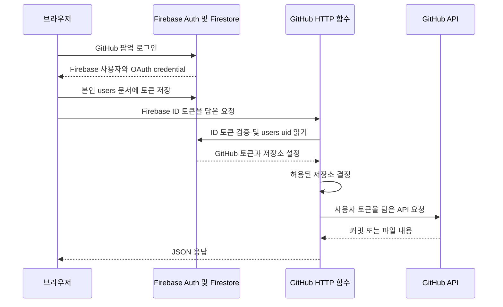

# GitHub 인증과 커밋 조회 경계

앱의 로그인 사용자 GitHub 조회는 브라우저에서 OAuth 토큰으로 GitHub API를 직접 호출하는 구조가 아니다. 로그인 결과의 GitHub OAuth 토큰은 해당 사용자의 Firestore 문서에 보관하고, 브라우저는 Firebase ID 토큰만 HTTP 함수에 보낸다. 함수는 ID 토큰을 검증해 얻은 `uid`로 사용자 문서를 읽은 뒤, 보관된 토큰으로 GitHub API를 호출한다. 따라서 함수의 `invoker: "public"` 설정은 HTTP 및 CORS preflight의 도달 가능성을 뜻할 뿐 익명 데이터 접근을 허용한다는 뜻이 아니다.

이 문서는 커밋과 파일 원문을 읽는 GitHub 경계를 다룬다. 카드 생성의 캐시·AI 처리 흐름은 [카드 생성 경로](../flashcard/generation-paths.md), 사용자 문서의 클라이언트 읽기·쓰기 규칙은 [Firestore 데이터 경계](../architecture/firestore-data-boundary.md), 사전 생성의 작업 수명은 [플래시카드 사전 생성](../flashcard/pregeneration.md)을 참고한다.

*로그인 사용자의 커밋 조회 순서: 브라우저는 Firebase ID 토큰만 보내며, GitHub OAuth 토큰은 함수가 사용자 문서에서 읽어 외부 호출에 사용한다.*

## 인증 자료의 소유와 전달

`githubProvider`는 `user:email` 및 `repo` scope를 요청한다. `Login`은 팝업 로그인 결과의 GitHub credential에서 access token을 얻어 `users/{uid}.githubToken`에 저장한다. 기존 문서에서는 토큰과 `updatedAt`만 갱신하므로 이미 저장한 저장소 설정을 유지하고, 문서가 없으면 두 필드로 새 문서를 만든다. 토큰 값과 특정 사용자·저장소 식별 정보는 로그나 문서에 기록하지 않는다.

공용 `apiClient`는 `auth.currentUser.getIdToken()`의 결과를 `Authorization` 헤더에 넣는다. `githubApi.ts`의 `getRepositories`, `getCommits`, `getFilename`, `getMarkdown`, `getFileContent`, `getBranches`는 모두 이 클라이언트를 사용한다. 즉 브라우저가 함수에 GitHub 토큰을 전달하지 않으며, 로그인한 사용자 요청의 권한 연결은 다음과 같다.

- **Firebase Auth**: 요청자가 누구인지 확인할 ID 토큰을 발급한다.
- **Firestore `users/{uid}`**: 해당 사용자에게 연결된 GitHub 토큰과 선택 저장소 설정을 보관한다.
- **Cloud Functions**: ID 토큰을 Admin SDK로 검증하고 문서를 읽은 후 GitHub 요청을 수행한다.

Firestore 규칙은 `users/{uid}`를 본인만 읽고 쓰도록 제한하고, 클라이언트가 변경할 수 있는 필드와 `repositories`의 형태를 검사한다. 이는 다른 Firebase 사용자의 문서 접근을 막는 규칙이다. 토큰을 포함한 민감 필드는 UI, 클라이언트 로그, 분석 이벤트에 노출하지 않아야 한다.

## HTTP 프록시의 인증과 저장소 범위

### 사용자 설정을 요구하는 엔드포인트

`getCommits`, `getFilename`, `getMarkdown`은 공통 `getUserData`를 거친다. 이 과정은 Bearer 형식의 Firebase ID 토큰 존재 확인, Admin SDK 검증, 검증된 `uid`의 사용자 문서 조회, GitHub 토큰 및 비어 있지 않은 `repositories` 배열 검사를 순서대로 수행한다. 어느 조건이든 충족하지 않으면 GitHub에 요청하지 않는다.

| 앱 래퍼 | HTTP 함수 | 용도와 서버 범위 |
| --- | --- | --- |
| `getRepositories` | `/getRepositories` | 인증 사용자 문서의 토큰으로 GitHub `/user/repos`를 조회해 설정 후보를 제공한다. 저장소 설정은 요구하지 않는다. |
| `getCommits` | `/getCommits` | 날짜 범위의 커밋 목록을 선택 저장소에서 조회한다. |
| `getFilename` | `/getFilename` | 선택 저장소에서 커밋 SHA의 상세와 변경 파일을 조회한다. |
| `getMarkdown` | `/getMarkdown` | 선택 저장소의 파일 경로를 GitHub contents API에서 raw 표현으로 읽는다. |
| `getFileContent` | `/getFileContent` | 카드 메타데이터의 raw URL 내용을 별도 호스트 허용 목록 아래에서 읽는다. |

세 엔드포인트는 요청의 `repositoryFullName`이 저장된 `repositories[].fullName`과 정확히 일치할 때만 그 값을 사용한다. 누락되거나 일치하지 않으면 배열의 첫 저장소로 해석한다. 따라서 임의의 `owner/repo`를 넘겨 다른 저장소로 바꾸는 것은 막지만, 잘못된 값이 명시적 거부가 아니라 첫 저장소 조회로 바뀐다는 점을 호출자가 알아야 한다.

`getRepositories`와 `getBranches`도 Firebase ID 토큰을 검증하고 해당 사용자 문서의 GitHub 토큰을 읽지만, `getBranches`의 `owner`와 `repo`는 저장된 저장소 목록과 대조하지 않는다. 또한 함수 자체가 `@deprecated`로 표시되어 있다. 현재 온보딩과 설정 UI는 브랜치 선택 목록을 위해 이를 호출하므로, 이 엔드포인트를 저장소 권한 검증 수단으로 사용하거나 새 공개 범위를 추가해서는 안 된다.

### 브랜치와 커밋 시점

설정의 각 저장소에는 선택적으로 `branch`를 저장한다. 온보딩은 하나의 `{ fullName, url, branch? }` 항목을 저장하고, 설정 화면은 Free에서 1개, Pro에서 최대 5개를 저장한다. 규칙도 각 항목의 필수 `fullName`·HTTPS `url`, 선택 문자열 `branch`, 배열 최대 5개를 검증한다. 설정을 저장하면 기존 플래시카드 문서를 삭제한 뒤 새로고침하여 새 설정으로 생성하도록 한다.

`getCommits`는 비어 있지 않은 쿼리 `branch`를 저장된 브랜치보다 우선하여 GitHub commits API의 `sha`에 넣는다. 쿼리 브랜치는 저장된 목록과 대조하지 않는다. 쿼리가 비었을 때만 선택 저장소의 `branch`를 쓴다. 그러므로 저장소 선택은 서버가 강제하지만 브랜치 고정은 강제하지 않는다. 특정 브랜치를 보안 또는 재현성 조건으로 고정하려면 서버에서 요청 브랜치를 저장 값과 비교해 거부하거나 무시하도록 바꿔야 한다.

`getFilename`은 커밋 SHA로 상세를 읽는다. 반면 `getMarkdown`은 GitHub contents API에 ref를 전달하지 않으므로 기본 브랜치의 현재 파일을 읽는다. 카드 플레이어는 파일 메타데이터에 `raw_url`이 있으면 `getFileContent`를 우선 사용하고, 없는 이전 형식의 카드만 `getMarkdown`으로 폴백한다. 커밋 시점의 파일 보존이 필요하면 카드 메타데이터의 `raw_url`을 유지해야 한다.

## 카드 생성에서의 커밋 선택

로그인 사용자의 즉시 생성은 날짜 범위로 `getCommits`를 호출한 뒤, 커밋을 순서대로 `getFilename`으로 상세 조회한다. 변경 파일이 있는 첫 상세 커밋만 diff 입력으로 사용한다. 사전 생성도 사용자 문서의 토큰으로 저장소별·날짜별 커밋 목록과 상세를 호출하고 같은 선택 규칙을 적용한다. 사전 생성은 설정 브랜치가 없을 때 기본 브랜치를 먼저 조회하며, 그 조회가 일반 오류로 실패하면 GitHub의 기본 동작에 맡겨 계속 시도한다.

사용자별 사전 생성에서 토큰 또는 생성 설정이 없으면 해당 날짜를 `unavailable`로 완료 처리한다. GitHub가 `401`을 반환해 `GitHubAuthError`가 된 경우도 동일하다. 반대로 일반 GitHub·네트워크 오류로 일부 저장소/날짜 조합이 실패해 덱이 비면 예외를 던진다. 완료 기록을 남기지 않아 Task Queue의 재시도 대상이 된다.

## raw URL과 랜딩 데모의 별도 경계

| 경로 | 인증 및 호출 주체 | 대상 범위 | private 저장소 |
| --- | --- | --- | --- |
| 로그인 커밋·상세·마크다운 | Firebase ID 토큰 검증 후 사용자 문서의 GitHub 토큰 사용 | 저장된 `repositories` 중 하나, 불일치 시 첫 항목 | 사용자 토큰 권한이 있으면 가능 |
| 로그인 raw 파일 | 유효한 Firebase ID 토큰에서 찾은 GitHub 토큰을 선택적으로 첨부 | 허용된 GitHub 호스트의 URL | 토큰이 URL 대상에 권한이 있으면 가능 |
| 비로그인 raw 파일 | Firebase·GitHub 토큰 없이 함수 호출 | 허용된 GitHub 호스트의 공개 URL | 불가 |
| 랜딩 데모 커밋 | 브라우저가 GitHub Public API 직접 호출 | 입력한 공개 저장소와 기본 또는 지정 브랜치 | 불가 |

### raw URL 프록시

`getFileContent`는 `raw_url`을 파싱하고 hostname이 `github.com`, `raw.githubusercontent.com`, `api.github.com` 중 하나일 때만 가져온다. URL이 없거나 파싱에 실패하거나 호스트가 목록 밖이면 `400`으로 끝난다. 유효한 Firebase 인증이 있고 사용자 문서에서 GitHub 토큰을 찾을 수 있을 때만 원격 요청의 `Authorization` 헤더를 추가한다. 인증이 없거나 검증·문서 조회에 실패하면 토큰 없이 계속 요청하므로 공개 raw 리소스는 비로그인 카드에서도 표시할 수 있다.

이 경로는 `repositories` 설정을 요구하지 않으며 raw URL의 소유자·저장소·경로를 선택 저장소와 대조하지 않는다. 허용 목록 검사는 최초 URL의 hostname에 한정된다. 따라서 이를 임의 URL 프록시나 선택 저장소 강제 장치로 해석해서는 안 된다. 더 강한 범위가 필요하면 URL 좌표를 파싱해 저장된 `repositories`와 대조하고, redirect 정책도 명시적으로 제한해야 한다.

### 랜딩 데모

`generateDemoFlashcards`는 Firebase 및 Firestore에 저장하지 않는다. 입력을 `owner/repo`, `owner/repo@branch`, 또는 GitHub URL로 해석하고, 지정 브랜치가 없으면 Public API로 기본 브랜치를 조회한다. 이후 토큰 없이 그 브랜치의 최근 세 커밋과 각 커밋 상세를 브라우저에서 요청한다. 상세 조회가 실패하면 목록 항목을 사용하고, AI 생성도 실패하면 로컬 폴백 질문·답변을 구성한다. 404는 저장소를 찾지 못한 경우로, 다른 비성공 응답은 GitHub API 실패로 표시한다. 이 경로에는 사용자 토큰이 없으므로 private 저장소를 조회할 수 없다.

서버의 데모 사전 생성도 공용 `fetchGitHub` helper를 토큰 없이 사용한다. 이 helper는 토큰이 없을 때 `User-Agent`만 넣어 공개 저장소를 조회하고, 로그인 사용자 또는 사전 생성에서 토큰을 받으면 Bearer 인증으로 전환한다.

## 실패 처리와 운영 변경점

- GitHub 응답이 비성공이면 각 프록시는 대체로 그 상태 코드와 오류 본문을 전달한다. 필수 쿼리 누락과 잘못된 raw URL은 `400`이다. `getCommits`·`getFilename`·`getMarkdown`의 인증·설정 오류는 공통 catch를 거쳐 현재 `500`으로 응답하므로, UI는 GitHub 장애만이 아니라 로그인, 재로그인, 저장소 설정 누락도 안내해야 한다.
- `getRepositories`와 `getBranches`는 Authorization 헤더가 없으면 명시적으로 `401`을 응답한다. 유효하지 않은 ID 토큰 등 그 밖의 예외는 `500` catch 경로가 처리한다.
- `apiClient`의 개발 base URL은 `/api`이고 프로덕션에서는 `VITE_FUNCTIONS_URL_PROD`를 사용한다. 함수 이름, CORS, Vite 프록시 및 이 base URL을 함께 맞춰야 로컬과 배포 환경에서 같은 경로가 연결된다. 배포 절차는 [로컬 개발과 배포](../operations/local-development-and-deployment.md)를 참고한다.
- 이 영역에는 `github.ts` 또는 앱 프록시 래퍼를 대상으로 한 전용 테스트 파일이 없다. 변경 시 ID 토큰 없음·무효, 사용자 문서/토큰/저장소 설정 없음, 허용·불일치 `repositoryFullName`, 쿼리·저장 브랜치 우선순위, raw URL 허용·비허용 호스트, 로그인·비로그인 public/private 응답을 테스트로 고정하는 것이 중요하다.
