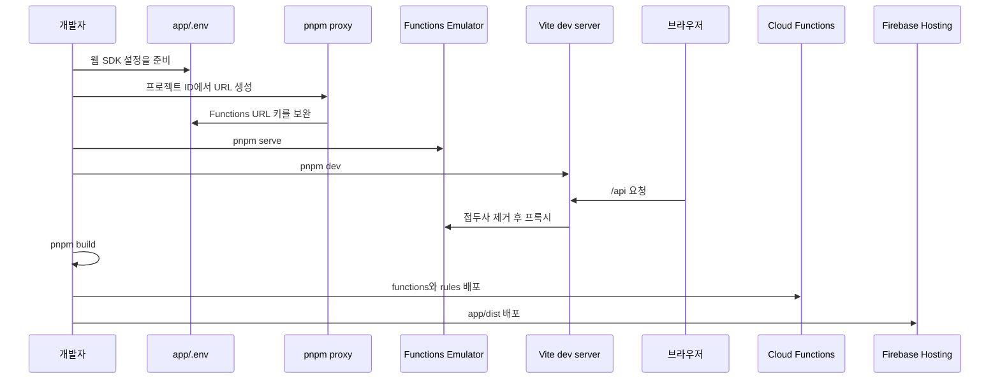

# 로컬 개발·배포·운영 확인

이 저장소는 Vite 브라우저 패키지 `app`과 Firebase Cloud Functions 패키지 `functions`를 별도로 빌드한다. 개발 중 브라우저의 Functions 요청은 Vite의 `/api` 프록시를 거쳐 Functions Emulator로 가며, production 번들은 Functions 공개 URL을 직접 호출한다. 따라서 **프로젝트 연결 → 환경 변수와 URL 생성 → 빌드 → 서버 측 배포 → Hosting 배포** 순서를 지켜야 URL과 정적 산출물이 어긋나지 않는다.

`pnpm serve`는 Functions Emulator만 시작한다. Firestore와 Authentication Emulator는 이 절차에 포함되지 않으므로, 로컬 앱의 Auth·Firestore SDK는 `app/.env`가 가리키는 Firebase 프로젝트를 사용한다. 공유 또는 운영 프로젝트를 선택한 상태에서 데이터를 쓰는 수동 검증은 피한다.



*환경 변수 생성부터 로컬 프록시, 서버 측 배포, 검증된 Hosting 산출물 배포까지의 안전한 순서다.*

## 시작 전: 워크스페이스와 프로젝트 연결

루트 워크스페이스에는 `app`과 `functions`가 있다. Node.js 22 이상, pnpm, Firebase CLI를 준비하고 루트에서 의존성을 설치한다. 루트의 package manager는 `pnpm@10.18.0`이며 Functions 런타임도 Node.js 22를 선언한다.

```bash
pnpm install
```

Firebase 로그인 뒤에는 이 작업 사본에서 쓸 프로젝트를 선택한다. `.firebaserc`는 Git에서 무시되므로 새 clone 또는 worktree에서는 다시 연결하고, 배포 전에는 활성 선택을 다시 확인한다.

```bash
firebase login
firebase use --add
firebase use
```

`firebase init`은 실행하지 않는다. 저장소가 이미 `firebase.json`, `firestore.rules`, `functions` 설정을 소유한다. 초기화 마법사는 기존 배포 설정이나 규칙을 바꿀 수 있으므로 프로젝트 연결에는 `firebase use --add`를 사용한다.

## 환경 변수와 `pnpm proxy`

`app/.env.example`을 `app/.env`로 복사한 뒤 Firebase 웹 SDK 초기화용 `VITE_API_KEY`, `VITE_AUTH_DOMAIN`, `VITE_PROJECT_ID`, `VITE_STORAGE_BUCKET`, `VITE_MESSAGING_SENDER_ID`, `VITE_APP_ID`, `VITE_MEASUREMENT_ID`를 설정한다. 웹 푸시에는 `VITE_VAPID_KEY`, Clarity에는 선택적으로 `VITE_CLARITY_PROJECT_ID`를 사용한다. AI HTTP 함수의 제공자 키는 `functions/.env`에서 관리한다.

```bash
cp app/.env.example app/.env
```

`.env`와 `.firebaserc`는 Git에서 무시된다. 환경 변수의 **값**, API 키, 운영 프로젝트·계정 정보는 커밋, 문서, 터미널 공유 로그, 스크린샷에 넣지 않는다.

그 다음 `pnpm proxy`를 실행한다. `scripts/setup-proxy.js`는 `app/.env`의 `VITE_PROJECT_ID`가 없거나 파일이 없으면 실패하며, 이 값으로 다음 키를 보완한다.

| 키 | 용도 |
| --- | --- |
| `VITE_FIREBASE_PROJECT_ID` | Functions 주소 구성에 쓰는 프로젝트 ID |
| `VITE_FIREBASE_REGION` | Functions 리전 |
| `VITE_FUNCTIONS_URL_LOCAL` | Vite 프록시가 향할 Emulator 기본 URL |
| `VITE_FUNCTIONS_URL_PROD` | production 브라우저가 HTTP Functions를 호출할 기본 URL |

```bash
pnpm proxy
```

이 스크립트는 없는 키를 추가하고, 이미 있는 키는 값이 비어 있을 때만 채운다. 비어 있지 않은 기존 값은 덮어쓰지 않는다. 따라서 프로젝트 또는 리전을 바꿨다면, 명령을 재실행하기 전에 기존 Functions URL이 의도한 대상인지 검토하고 필요하면 안전하게 수정한 뒤 다시 실행한다.

### Functions URL은 빌드 계약이다

Vite 설정은 development에서 `VITE_FUNCTIONS_URL_LOCAL`, production에서 `VITE_FUNCTIONS_URL_PROD`를 선택한다. 개발 API 모듈은 `/api`를 기본 경로로 쓰지만 production 모듈은 production URL에 함수 이름을 붙여 요청한다. 즉 이 URL은 서버가 런타임에 발견하는 값이 아니라 Vite가 번들에 포함하는 빌드 시점 계약이다.

프로젝트·리전·URL·함수 HTTP 이름을 바꿀 때는 다음을 수행한다.

1. `app/.env`의 `VITE_PROJECT_ID`와 Functions URL 키가 같은 의도한 프로젝트·리전을 가리키는지 확인한다.
2. `pnpm proxy`로 누락되거나 빈 키를 보완한다.
3. 실행 중인 Vite 개발 서버를 재시작한다.
4. 배포할 변경이면 `pnpm build`로 새 `app/dist`를 만든다.
5. 이미 Hosting에 올라간 번들은 이전 URL을 포함하므로 Functions만 재배포해 호출 대상을 바꿀 수 없음을 확인한다.

공개 Functions URL은 비밀 정보가 아니다. API 호출의 인증·입력·사용량 제한은 Functions 경계에서 다뤄야 한다. 관련 보안 계약은 [공개 AI 함수 호출 경계](../architecture/ai-call-guard.md)를 참고한다.

## 로컬 실행과 Emulator 범위

Functions를 먼저 준비하고 별도 터미널에서 Vite를 실행한다.

```bash
# 터미널 1
pnpm proxy
pnpm serve
```

```bash
# 터미널 2
pnpm dev
```

루트 `pnpm serve`는 Functions TypeScript를 빌드한 뒤 `firebase emulators:start --only functions`를 실행한다. `pnpm dev`는 `app`의 Vite 개발 서버를 실행한다. Vite는 `/api` 요청을 `VITE_FUNCTIONS_URL_LOCAL`로 프록시하고 `/api` 접두사를 제거한다. 예를 들어 `/api/openaiChatCompletions`는 Emulator의 `/openaiChatCompletions`로 전달된다.

`--only functions`은 Firestore, Auth, Hosting Emulator를 띄우지 않는다. 앱의 Firebase 초기화 코드에도 Auth·Firestore Emulator 연결이 없다. 따라서 Firestore 읽기·쓰기는 선택한 Firebase 프로젝트의 규칙과 데이터에 영향을 줄 수 있다. 규칙 변경은 테스트용 프로젝트에서 소유자 허용, 비소유자 거부, 공개 읽기, 거부되어야 할 쓰기를 작은 범위로 검증한다.

Functions의 AI 경로를 확인하려면 로컬 `functions/.env`에 필요한 제공자 키가 있어야 한다. 키가 없을 때의 오류 경로도 검증하되 값을 노출하지 않는다. 사전 생성 서버 작업은 [사용자 덱 사전 생성](../flashcard/pregeneration.md), 알림의 브라우저·서버 경계는 [시간대 기반 푸시 알림](push-notifications.md)을 참고한다.

## 빌드와 배포 단위

루트 `pnpm build`는 두 워크스페이스의 build 스크립트를 실행한다. `app`은 `tsc && vite build`로 `app/dist`를 만들고, `functions`는 `tsc`로 `functions/lib`을 만든다. 두 생성물은 Git에서 무시된다.

```bash
pnpm build
pnpm --filter functions lint
```

`firebase.json`에서 Functions는 배포 직전에 `pnpm --prefix "$RESOURCE_DIR" run build`를 실행한다. Firestore 규칙도 같은 Firebase 설정의 배포 대상이다. 반면 Hosting은 `app/dist`를 public 디렉터리로 지정할 뿐 Vite를 실행하는 predeploy가 없다. 따라서 `firebase deploy`와 `firebase deploy --only hosting`은 현재 있는 `app/dist`를 업로드하며, Hosting을 배포하기 전에 현재 검토한 환경 변수로 `pnpm build`를 성공시켜야 한다.

Functions 진입점은 Admin 앱을 초기화하고 HTTP·스케줄·태스크 트리거 모듈을 export한다. 전역 `maxInstances: 10`도 배포되는 함수 집합에 적용된다. Functions와 규칙의 변경은 함께 배포하는 서버 측 계약인지 검토하고, 스케줄·태스크 변경은 배포 직후가 아니라 다음 트리거 또는 의도적인 운영 검증 시점에 결과가 나타날 수 있음을 고려한다.

Hosting은 `/app`과 `/app/**`를 `app.html`로 rewrite하고, `/terms`와 `/privacy`를 각각 정적 문서로 보낸다. Vite는 랜딩·앱·약관·개인정보의 한국어·영어 HTML, 총 여섯 입력을 빌드한다. 라우트나 엔트리를 바꾼 배포 뒤에는 `/`, `/app`, `/app/` 하위 새로고침, `/terms`, `/privacy`를 모두 확인한다. 시스템 경계의 개요는 [시스템 개요와 런타임 경계](../architecture/system-overview.md)를 참고한다.

## PWA 캐시를 고려한 배포 후 확인

Vite PWA 설정은 `registerType: 'autoUpdate'`를 사용하고 JavaScript·CSS·HTML·아이콘·이미지 정적 자산을 Workbox precache 대상으로 지정한다. navigation fallback은 `/app.html`이다. 따라서 Hosting에 새 `app/dist`를 올렸더라도 이미 설치되었거나 열려 있던 클라이언트는 서비스 워커 갱신과 캐시 교체 시점 때문에 이전 HTML·번들·Functions URL을 잠시 사용할 수 있다.

배포 후에는 새 브라우저 세션뿐 아니라 기존 탭 또는 설치된 PWA에서도 다음을 확인한다.

- 새로고침 뒤 변경한 화면과 실제 API 대상이 갱신됐는지 브라우저 네트워크 도구로 확인한다.
- 예상과 다른 이전 번들이 계속 보이면 서비스 워커의 갱신 상태와 캐시를 먼저 점검하고, 하드 새로고침 또는 서비스 워커 갱신 뒤 다시 확인한다.
- `/app` 진입과 하위 라우트 새로고침이 `app.html` fallback과 Hosting rewrite 모두에서 정상인지 확인한다.

수동으로 등록하는 `/firebase-messaging-sw.js`는 푸시 메시징용 서비스 워커이므로, Workbox의 앱 캐시 문제와 혼동하지 않는다.

## 안전한 배포 순서와 점검표

Functions와 Firestore 규칙이 함께 바뀌면 서버 측 단위를 먼저 배포하고, 그 계약을 가리키도록 빌드한 Hosting 번들을 배포한다.

```bash
# 1. 활성 Firebase 프로젝트 확인
firebase use

# 2. URL 계약 확인, 빌드, 정적 검사
pnpm proxy
pnpm build
pnpm --filter functions lint

# 3. 서버 코드와 규칙 배포
firebase deploy --only functions,firestore:rules

# 4. 방금 만든 app/dist만 Hosting에 배포
firebase deploy --only hosting
```

`pnpm push`는 `firebase deploy`의 별칭일 뿐 Hosting 빌드를 대신하지 않는다. 전체 배포에도 위의 환경 변수·활성 프로젝트·산출물 점검을 선행한다.

배포 전후에는 다음을 기록 가능한 범위에서 확인한다.

- `firebase use`가 의도한 프로젝트인지 확인한다. ID나 계정 정보를 출력·공유하지 않는다.
- `pnpm proxy` 뒤 Functions URL 키에 오래된 비어 있지 않은 값이 남지 않았는지 확인한다.
- `pnpm build`와 `pnpm --filter functions lint`가 통과하는지 확인한다. 저장소에는 전용 자동화 테스트 스위트가 없으므로 변경 경계의 정상·실패 경로를 수동 확인한다.
- Functions 변경이면 Emulator에서 대표 HTTP 요청과 인증 실패 경로를 확인한다. 반복적인 AI 호출은 비용·한도를 고려한다.
- 규칙 변경이면 허용·거부 사례를 테스트용 프로젝트에서 확인한다. Admin SDK 경로에는 Firestore 규칙이 적용되지 않으므로 Functions의 인증·입력 검증도 별도로 확인한다.
- Hosting 배포 뒤 라우트, 실제 API 대상, 기존 PWA 클라이언트의 캐시 갱신을 확인한다.
