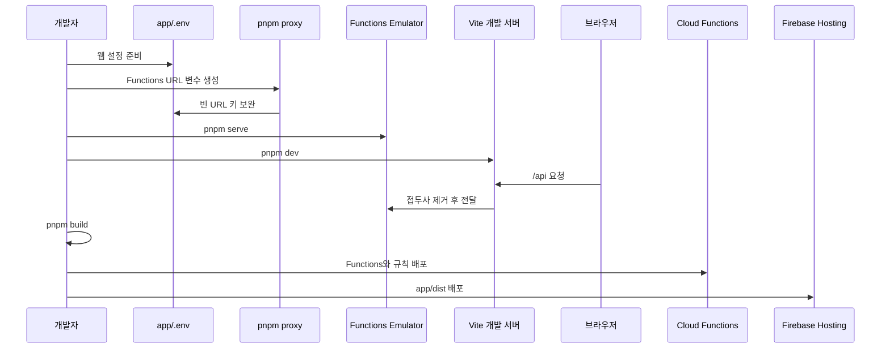

# 로컬 개발·검증·배포

이 저장소의 워크스페이스는 Vite 브라우저 앱 `app`과 Firebase Cloud Functions `functions`로 구성된다. 두 패키지는 별도로 빌드한다. 개발 중 Functions 요청은 Vite의 `/api` 프록시를 통해 Functions Emulator로 보내며, production 번들은 Functions 공개 URL을 직접 사용한다. 반면 `pnpm serve`는 Functions Emulator만 시작한다. Auth와 Firestore는 앱에 Emulator 연결 코드가 없으므로, 로컬에서의 읽기·쓰기도 `app/.env`가 가리키는 Firebase 프로젝트에 영향을 줄 수 있다.



*환경 설정부터 로컬 프록시, 빌드 산출물, Firebase 배포까지의 제어 흐름이다.*

## 시작 전: 설치, 환경 파일, 프로젝트 연결

Node.js 22 이상, pnpm, Firebase CLI가 필요하다. 루트의 package manager는 `pnpm@10.18.0`이며 Functions 런타임은 Node.js 22를 선언한다. 의존성은 루트에서 설치한다.

```bash
pnpm install
```

`app/.env.example`을 `app/.env`로 복사한 뒤 환경 변수를 설정한다. 값이나 프로젝트 식별자, 운영 계정 정보는 커밋·문서·스크린샷에 넣지 않는다.

```bash
cp app/.env.example app/.env
```

| 환경 변수 | 용도 |
| --- | --- |
| `VITE_API_KEY`, `VITE_AUTH_DOMAIN`, `VITE_PROJECT_ID`, `VITE_STORAGE_BUCKET`, `VITE_MESSAGING_SENDER_ID`, `VITE_APP_ID`, `VITE_MEASUREMENT_ID` | Firebase 웹 앱 초기화 설정 |
| `VITE_VAPID_KEY` | 웹 푸시 구독에 쓰는 VAPID 공개 키 |
| `VITE_CLARITY_PROJECT_ID` | 선택적 Clarity 분석 설정 |
| `VITE_FIREBASE_PROJECT_ID`, `VITE_FIREBASE_REGION`, `VITE_FUNCTIONS_URL_LOCAL`, `VITE_FUNCTIONS_URL_PROD` | `pnpm proxy`가 보완하는 Functions 주소 구성 및 호출 대상 |
| `OPENAI_API_KEY` | Functions의 AI 호출 인증 |

`.env`와 `.firebaserc`는 Git에서 무시된다. 새 clone 또는 worktree에서는 Firebase 로그인 뒤 현재 작업 사본에 사용할 프로젝트를 다시 연결하고, 배포 전 활성 선택을 확인한다.

```bash
firebase login
firebase use --add
firebase use
```

`firebase init`은 실행하지 않는다. 이 저장소는 이미 `firebase.json`, `firestore.rules`, Functions 설정을 소유한다. 프로젝트 연결에는 `firebase use --add`를 사용하여 초기화 마법사가 기존 설정이나 규칙을 바꾸지 않게 한다.

## `pnpm proxy`: Functions 주소 계약 생성

`pnpm proxy`는 `scripts/setup-proxy.js`를 실행한다. `app/.env` 파일과 그 안의 `VITE_PROJECT_ID`가 없으면 실패한다. 존재하면 `VITE_FIREBASE_PROJECT_ID`, `VITE_FIREBASE_REGION`, `VITE_FUNCTIONS_URL_LOCAL`, `VITE_FUNCTIONS_URL_PROD`를 구성한다.

이미 비어 있지 않은 키는 덮어쓰지 않고 빈 값만 채운다. 따라서 프로젝트 또는 리전을 변경한 경우, 다시 실행하기 전에 기존 Functions URL 키가 새 대상과 일치하는지 직접 검토해야 한다. 이 동작은 의도치 않은 주소 변경을 막지만 오래된 URL을 자동으로 고치지는 않는다.

브라우저 API 모듈은 development에서 `/api`를 기본 URL로 사용하고 production에서 `VITE_FUNCTIONS_URL_PROD`를 사용한다. Vite도 모드에 따라 로컬 또는 production Functions URL을 `/api` 프록시 대상으로 선택하며, 프록시할 때 `/api` 접두사를 제거한다. 예를 들어 `/api/openaiChatCompletions`는 Emulator에 `/openaiChatCompletions`로 전달된다.

따라서 Functions URL은 배포 번들에 포함되는 빌드 시점 계약이다. URL·리전·프로젝트를 변경했다면 다음 순서를 따른다.

1. `app/.env`의 `VITE_PROJECT_ID`와 Functions URL 키의 대상을 검토한다.
2. `pnpm proxy`로 누락되거나 빈 키를 보완한다.
3. 개발 서버를 재시작하고, 배포할 경우 `pnpm build`로 새 번들을 만든다.
4. 기존 Hosting 배포물에는 이전 URL이 남을 수 있으므로 Functions만 재배포해 호출 대상을 바꾸려 하지 않는다.

Functions의 공개 URL은 비밀이 아니다. 공개 AI HTTP 함수의 인증·입력·사용량 경계는 [공개 AI 함수 호출 경계](../architecture/ai-call-guard.md)를 참고한다.

## 로컬 실행과 범위

Functions를 먼저 시작하고, 다른 터미널에서 Vite를 실행한다.

```bash
pnpm proxy
pnpm serve
```

```bash
pnpm dev
```

루트 `serve`는 `functions`를 빌드한 뒤 `firebase emulators:start --only functions`를 실행한다. `dev`는 `app`의 Vite 개발 서버를 실행한다. Vite는 Emulator가 준비된 뒤 시작하는 편이 `/api` 요청의 실패 원인을 분리하기 쉽다.

`--only functions`은 Firestore, Auth, Hosting Emulator를 시작하지 않는다. 또한 앱은 Firebase 웹 설정으로 Auth와 Firestore 클라이언트를 생성할 뿐 Emulator에 연결하지 않는다. 따라서 Firestore 규칙 또는 데이터 변경을 확인할 때는 테스트용 프로젝트에서 작은 범위로 실행하고, 운영 프로젝트를 선택한 상태에서 임의 데이터를 만들지 않는다. 알림 구독의 로컬 확인은 [푸시 알림 운영](push-notifications.md)을 함께 참고한다.

Functions 진입점은 Admin 앱을 초기화하고 HTTP·스케줄·태스크 트리거 모듈을 export한다. 전역 최대 인스턴스 수는 10이므로, Functions 배포는 단일 HTTP 엔드포인트만의 변경이 아니라 이 트리거 집합과 전역 실행 제한을 포함한 배포 단위로 취급한다.

## 빌드와 검증의 경계

루트 `pnpm build`는 워크스페이스의 build 스크립트를 실행한다. `app`은 `tsc && vite build`로 `app/dist`를 만들고, `functions`는 `tsc`로 `functions/lib`을 만든다. Functions 정적 검사는 별도 명령이다.

```bash
pnpm build
pnpm --filter functions lint
```

이 저장소에는 현재 자동화된 테스트 스위트가 없다. `pnpm build`는 타입 검사와 산출물 생성, `pnpm --filter functions lint`는 Functions ESLint 검사일 뿐 동작 테스트가 아니다. 존재하지 않는 테스트 명령을 만들지 말고, 변경 경계를 아래처럼 수동 확인한다.

- 프런트엔드 변경: `pnpm dev`에서 변경 화면과 오류 상태를 확인한다.
- Functions 변경: Emulator에서 대표 요청과 인증 실패 경로를 확인한다. 비용·쿼터가 있는 AI 호출은 불필요하게 반복하지 않는다.
- Firestore 규칙 변경: 테스트 프로젝트에서 소유자 접근, 비소유자 거부, 공개 읽기, 서버 전용 경로의 클라이언트 거부를 확인한다. Admin SDK에는 Firestore 규칙이 적용되지 않으므로 Functions의 인증·입력 검증은 별도로 확인한다.
- 배포 후: 브라우저 네트워크 도구에서 API 요청이 기대한 Functions 대상으로 향하는지 확인한다.

## Hosting 산출물과 배포 불변식

`firebase.json`에서 Functions는 배포 전에 TypeScript build를 실행하고 Firestore는 `firestore.rules`를 사용한다. 반면 Hosting은 `app/dist`를 public 디렉터리로 지정하지만 Hosting predeploy 명령은 없다. 즉 `firebase deploy --only hosting`은 Vite를 실행하지 않고 현재의 `app/dist`를 업로드한다.

> Hosting 배포 전에는 현재 검토한 환경 변수로 `pnpm build`를 성공시켜 새 `app/dist`를 만들어야 한다.

`app/dist`와 `functions/lib`은 생성물이므로 clone 직후 또는 이전 산출물이 남은 작업 사본에서 특히 이 순서를 생략하지 않는다. 이전 산출물을 배포하면 이전 코드나 Functions URL이 그대로 올라갈 수 있다.

Hosting은 `/app` 및 `/app/**`를 `app.html`로 rewrite하고, `/terms`와 `/privacy`는 각각의 정적 문서로 보낸다. Vite는 랜딩, 앱, 한국어·영어 약관, 한국어·영어 개인정보 HTML을 다중 입력으로 빌드한다. 라우트 또는 엔트리 변경 뒤에는 `/`, `/app`, `/app/` 하위 경로 새로고침, `/terms`, `/privacy`를 수동으로 확인한다.

## 안전한 배포 순서

Functions와 Firestore 규칙이 함께 바뀌면 서버 측 단위를 먼저 배포해 API와 권한 계약을 맞춘 뒤 검증한 Hosting 번들을 배포한다.

```bash
# 1. 활성 Firebase 프로젝트 확인
firebase use

# 2. Functions URL 계약 확인, 전체 빌드 및 Functions 정적 검사
pnpm proxy
pnpm build
pnpm --filter functions lint

# 3. 서버 코드와 규칙 배포
firebase deploy --only functions,firestore:rules

# 4. 방금 만든 app/dist만 Hosting에 배포
firebase deploy --only hosting
```

`pnpm push`는 `firebase deploy`의 별칭이다. Hosting 빌드를 대신하지 않으므로 위의 환경 변수·활성 프로젝트·산출물 검증 후에만 사용한다. UI만 변경해도 Hosting predeploy가 없으므로 build가 선행되어야 하며, Functions URL 또는 브라우저 API 계약이 바뀌면 Functions와 Hosting을 함께 배포한다. 전체 구조는 [시스템 개요](../architecture/system-overview.md), 최초 설정은 [빠른 시작](../quickstart.md)에서 확인할 수 있다.
