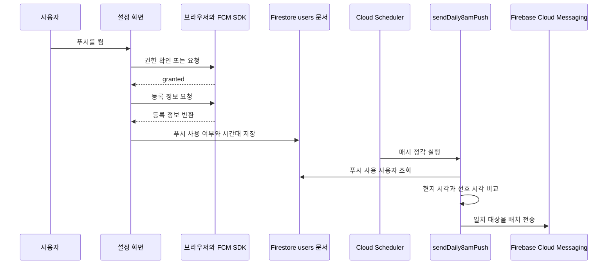
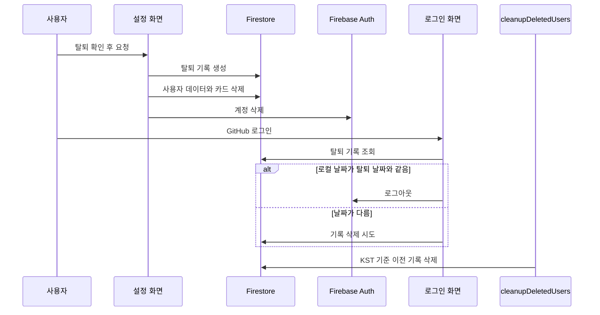

# 시간대별 푸시 알림과 탈퇴 기록 정리

이 기능은 설정 화면의 브라우저 권한 요청과 FCM 등록 정보 저장, Cloud Functions의 매시 대상 선별·발송, 그리고 탈퇴 기록의 짧은 보존을 연결한다. 전송은 클라이언트가 아니라 Admin SDK를 쓰는 `sendDaily8amPush`가 수행한다. 등록 정보나 계정 식별 정보는 문서·로그·테스트 산출물에 복사하지 않는다.

## 푸시 설정부터 발송까지

*브라우저에서 권한을 얻어 설정을 저장한 뒤, 매시 서버 작업이 사용자별 시간대를 필터링해 FCM 전송을 시도하는 흐름이다.*

앱은 로드 완료 뒤 `/firebase-messaging-sw.js` 등록을 시도하며, 등록 오류는 현재 무시한다. 예약 작업의 알림 데이터에는 앱 진입 경로인 `/app`이 들어 있고, Firebase Hosting은 `/app` 및 `/app/**`를 `app.html`로 rewrite한다. 따라서 클릭 경로나 서비스 워커 동작을 바꾸려면 이 URL 계약과 Hosting rewrite를 함께 확인해야 한다.

### 권한과 설정 쓰기

로그인하지 않은 상태에서는 토글을 바꾸지 않는다. 켜는 경로는 `Notification` API 지원 여부를 확인하고, 권한이 `default`일 때만 `Notification.requestPermission()`을 호출한다. 결과가 `granted`가 아니거나 등록 정보를 얻지 못하면 저장하지 않고 오류를 표시한다. 허용된 경우에만 Firebase Messaging의 `getToken()`을 호출하며, `VITE_VAPID_KEY`가 설정돼 있을 때에만 그 값을 옵션으로 넘긴다.

성공 시 설정 화면은 `setDoc(..., { merge: true })`로 `pushEnabled`, 등록 정보, `preferredPushTimezone`, `updatedAt`을 사용자 문서에 병합한다. 이미 `preferredPushTimezone`이 있으면 유지하고, 없을 때만 브라우저의 `Intl.DateTimeFormat().resolvedOptions().timeZone` 값을 사용한다. 끌 때는 `updateDoc()`으로 `pushEnabled: false`와 `updatedAt`만 갱신한다. 즉 토글 해제는 등록 정보를 제거하지 않으며, 토큰 회전·기기 교체·권한 철회를 정리하는 별도 경로도 현재 없다.

`preferredPushHour`는 설정을 읽을 때 숫자가 아니면 UI에서 8로 시작한다. Pro UI의 시각 선택기는 0–23을 제공하고, 선택 시 선호 시각과 **그 시점 브라우저 시간대**를 함께 갱신한다. 반대로 토글을 켜는 경로는 기존 시간대를 우선하므로, 시간대가 바뀐 사용자가 토글을 다시 켜도 자동 갱신된다고 가정해서는 안 된다.

### 클라이언트 데이터 경계

`users/{uid}`는 본인만 읽고 생성·갱신·삭제할 수 있다. 클라이언트가 쓸 수 있는 필드 목록에는 푸시 사용 여부, 등록 정보, 선호 시각, 선호 시간대가 포함되며, 규칙은 각각 boolean, 최대 1,024자 문자열, 0–23 number, 최대 64자 문자열로 제한한다. `preferredPushHour`는 정수만으로 좁히지 않으며, 시간대 문자열은 길이만 검사한다. 따라서 규칙 자체는 유효한 IANA 시간대인지를 보장하지 않는다. 데이터 소유권과 규칙 변경 절차는 [Firestore 데이터 경계](../architecture/firestore-data-boundary.md)를 따른다.

## 시간대 판정과 FCM 발송

`sendDaily8amPush`는 `asia-northeast3`에서 cron `0 * * * *`로 실행된다. 트리거의 기준 시간대는 `Asia/Seoul`이지만, 이는 **스케줄을 해석하는 시간대**다. 각 사용자의 발송 시각은 문서의 `preferredPushTimezone`으로 별도 계산하므로, 이 설정이 사용자 선호 시간대를 서울 시간으로 고정하지는 않는다.

작업은 `pushEnabled == true` 사용자 문서를 읽고, 문자열 등록 정보가 있는 문서만 검사한다. 이벤트의 `scheduleTime`이 문자열이면 그 시각을 기준으로 하고, 그렇지 않으면 현재 시각을 사용한다. 문서의 선호 시각이 숫자가 아니면 8, 시간대가 빈 문자열이거나 문자열이 아니면 `Asia/Seoul`을 사용한다. `Intl.DateTimeFormat`으로 그 기준 시각을 사용자 시간대의 0–23시로 변환하고, 선호 시각과 같은 대상만 전송 배열에 넣는다. 자정을 24로 표시하는 런타임은 `getHourInTimezone()`이 0으로 정규화한다.

따라서 매시 실행은 서로 다른 UTC 오프셋의 사용자를 포괄하기 위한 방식이다. `Intl`이 해당 시점의 시간대 규칙을 적용하므로 서머타임 시각 판정도 런타임에 맡긴다. 다만 잘못된 시간대 문자열은 변환에서 예외를 낼 수 있다. 처리 전체가 하나의 `try/catch`에 있으므로, 이 예외는 그 실행의 이후 판정과 전송을 중단시키고 오류 로그만 남긴다.

대상이 없으면 작업은 로그를 남기고 정상 종료한다. 대상이 있으면 같은 notification 및 `type: "daily-reminder"`, `url: "/app"` 데이터를 가진 메시지를 만들고, 최대 500개씩 나눠 `messaging.sendEach()`를 **순차적으로** 호출한다. 사용자 문서 하나에는 단일 등록 정보 필드만 있어 여러 브라우저·기기를 독립적으로 관리하지 않으며, 서로 다른 문서의 값이 중복돼도 작업은 중복 제거하지 않는다.

## 실패 관찰과 운영 한계

정상 응답한 배치에서는 성공·실패 수를 합산하고, 실패 응답의 배치 내 위치와 오류 메시지를 경고 로그에 남긴다. 마지막에는 전체 합계를 기록한다. 그러나 실패·무효 등록 정보를 Firestore에서 제거하거나 푸시를 자동 해제하지 않으며, 영속적인 실패 이력·재시도 큐·정확히 한 번 전송 보장은 없다. 무효한 대상도 다음 매시 실행에서 다시 후보가 될 수 있다.

`sendEach()` 자체가 reject하거나 앞선 시간대 변환이 예외를 던지면 바깥 `try/catch`가 오류를 기록하고 반환한다. 이후 배치를 계속 시도하지 않으며, 이 코드만으로 Scheduler 재시도나 실패 전송의 복구를 보장하지 않는다. 실패 정리를 추가할 때는 오류 코드를 분류하고, 사용자 설정과 독립된 서버 전용 상태에 재시도·정리 상태를 두며, 등록 정보나 개인 식별 정보를 로그에 남기지 않는다.

## 탈퇴 당일 재가입 제한과 정리

*탈퇴 기록은 로그인 화면의 당일 비교에 쓰이고, 별도 예약 작업이 KST 기준으로 보존 기간을 정리한다.*

설정 화면은 확인 문구가 맞을 때 먼저 `deletedUsers/{uid}` 기록을 만들고, 그 다음 사용자 카드 하위 문서와 사용자 문서를 삭제한 뒤 마지막에 Firebase Auth 계정을 삭제한다. Auth 삭제 전에 기록을 만드는 순서이므로, 중간 단계가 실패하면 일부 데이터나 탈퇴 기록이 남을 수 있다. Auth가 최근 로그인 재인증을 요구하면 팝업 재인증 뒤 이 순서를 다시 시도한다. 이 일련의 클라이언트 작업은 트랜잭션이 아니다.

GitHub 로그인 직후 클라이언트는 해당 탈퇴 기록을 조회한다. 브라우저 로컬 시간대에서 계산한 오늘 날짜가 기록의 탈퇴 날짜와 같으면 즉시 로그아웃하고 재가입 오류를 표시한다. 날짜가 다르면 로그인 코드는 기록 삭제를 시도한다. 단, 규칙은 `deletedUsers/{uid}`에 본인의 읽기와 **생성**만 허용하고 갱신·삭제는 허용하지 않는다. 따라서 이 클라이언트 삭제 시도는 규칙상 성공할 수 없고, 오류는 잡힌 뒤 로그인 흐름이 계속된다. 또한 기록 조회 자체가 실패해도 로그인은 계속 진행한다. 이 방식은 서버 강제 차단이 아니라 클라이언트 확인이며, 실패 시 열려 있는 동작이다.

`cleanupDeletedUsers`는 `asia-northeast3`에서 매일 `0 3 * * *`, `Asia/Seoul` 기준으로 실행된다. 이는 KST 정오에 해당한다. 작업은 모든 `deletedUsers` 기록을 읽어 KST 날짜가 실행일과 같은 기록만 남기고 나머지를 한 Firestore batch로 삭제한다. 즉 운영 보존 정책은 “KST 기준 오늘 생성된 기록”이며, 로그인 화면의 비교는 브라우저 로컬 날짜를 쓴다. 두 기준이 다르므로 전 세계 사용자에게 단일한 달력상 ‘당일’ 차단을 보장한다고 해석하면 안 된다. 삭제 대상이 500건을 넘을 수 있는 규모로 늘어나면 단일 batch의 한계도 고려해 페이지네이션·복수 batch 전략을 설계해야 한다.

## 변경과 검증 체크리스트

- **필드 또는 시간대 변경:** 설정 화면의 읽기·쓰기, `firestore.rules`의 허용 목록과 형태 검사, 스케줄러의 폴백·필터를 함께 바꾼다. 시간대 유효성 검사를 도입한다면 잘못된 한 문서가 전체 작업을 중단하지 않도록 사용자 단위 격리를 함께 설계한다.
- **전송 정책 변경:** 매시 cron을 하루 한 번의 서울 시간 cron으로 바꾸면 사용자 현지 시각 전달 범위가 사라진다. 배치 크기, 병렬화, 리전 변경은 FCM 제한, 전체 사용자 조회 비용, 전역 `maxInstances: 10`을 함께 평가한다.
- **실패 처리 추가:** 자동 정리 전에는 무효 대상 판정, 상태 저장 위치, 재시도 상한, 관찰 가능한 집계와 개인정보를 포함하지 않는 로그 정책을 명시한다. 현재 실패가 자동 정리를 수행한다고 운영자나 사용자에게 안내하지 않는다.
- **탈퇴 정책 변경:** 차단 기준 시간대를 하나로 정하고, 로그인 전·후 어느 서버 경계가 이를 강제할지 결정한다. 클라이언트 규칙과 cleanup 작업의 삭제 권한·보존 일정을 함께 바꾼다.
- **배포:** Functions 진입점은 스케줄 모듈을 export하며 전역 최대 인스턴스 수를 10으로 설정한다. `firebase.json`은 Functions 배포 전 빌드를 수행한다. 환경 변수, 빌드 및 Hosting 배포 순서는 [로컬 실행과 Firebase 배포](local-development-and-deployment.md)를 참고한다.

전용 테스트 파일은 현재 확인되지 않는다. 변경 전에는 `pnpm build`와 `pnpm --filter functions lint`를 실행하고, 별도 테스트 프로젝트에서 다음을 확인한다.

1. 지원하지 않는 브라우저, 권한 거부, 등록 정보 획득 실패, 토글 해제와 기존 시간대 보존.
2. 시간대 경계의 자정, 기본 서울 시간대·8시, 서머타임 전환, 잘못된 시간대 하나가 전체 실행에 미치는 현재 동작.
3. 500개 경계, 일부 응답 실패, `sendEach()` reject 뒤 후속 배치가 실행되지 않는 현재 동작 및 실패 자동 정리가 없다는 사실.
4. 탈퇴 성공·중간 실패·재인증, 로컬 날짜와 KST 날짜가 다른 경우, 규칙상 허용·거부되는 탈퇴 기록 접근, KST 정오 정리 결과.
5. 배포 환경에서 `/app`과 하위 경로 새로고침, 브라우저 권한 허용 뒤 수신과 클릭 경로.
