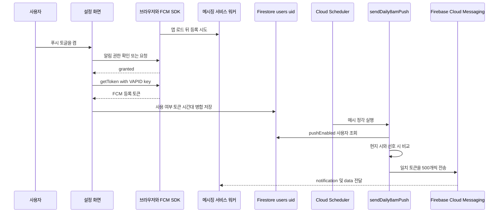

# 푸시 알림과 시간대 운영

이 기능은 설정 화면이 FCM 등록 토큰과 사용자의 시간대 기반 선호를 `users/{uid}`에 저장하고, 서버의 `sendDaily8amPush`가 매시 전송 후보를 다시 계산하는 구조다. 브라우저는 전송자가 아니며, Cloud Functions의 Admin SDK가 Firestore를 조회해 Firebase Cloud Messaging을 호출한다.

`VITE_VAPID_KEY`는 웹 푸시 토큰 획득에 쓰는 VAPID 공개 키 환경 변수다. 이 이름과 용도 외의 환경 변수 값, FCM 토큰, 사용자 식별 정보는 문서·로그·테스트 산출물에 기록하지 않는다.

## 등록부터 예약 발송까지



*서비스 워커 등록과 설정 저장에서 시작해, 매시 시간대 선별 뒤 FCM 배치 전송으로 이어지는 실제 제어 흐름이다.*

앱은 로드 뒤 `/firebase-messaging-sw.js` 등록을 시도하며 실패는 무시한다. 따라서 등록 실패를 설정 UI가 별도로 표시하지 않는다. 예약 작업의 모든 메시지는 `notification`과 `type: "daily-reminder"`, `url: "/app"` 데이터를 가진다. 코드의 `url`은 알림 클릭 시 열 경로로 지정되어 있으며, Hosting은 `/app`과 `/app/**`를 `app.html`로 rewrite한다. 이 경로는 랜딩 `/`와 구분되는 앱 진입점이다.

## 설정과 사용자 문서 계약

### 푸시 켜기와 끄기

로그인 사용자가 푸시를 켜면 설정 화면은 다음 순서로 처리한다.

1. `Notification` API가 없으면 오류를 보여 주고 중단한다.
2. 권한이 `default`일 때만 `Notification.requestPermission()`을 호출한다. 결과가 `granted`가 아니면 Firestore에 푸시 사용 설정을 저장하지 않는다.
3. 동적으로 불러온 `firebase/messaging`의 `getMessaging(app)`과 `getToken()`으로 등록 토큰을 얻는다. `VITE_VAPID_KEY`가 있으면 이를 옵션으로 넘기며, 빈 토큰은 오류로 취급한다.
4. 기존 문서의 `preferredPushTimezone`이 있으면 보존하고, 없으면 `Intl.DateTimeFormat().resolvedOptions().timeZone`에서 브라우저의 시간대를 얻는다.
5. `setDoc(..., { merge: true })`로 `pushEnabled`, `fcmToken`, `preferredPushTimezone`, `updatedAt`을 병합한다.

토글을 끌 때는 `updateDoc`으로 `pushEnabled: false`와 `updatedAt`만 갱신한다. 기존 `fcmToken`은 삭제하지 않는다. 다시 켜면 당시의 `getToken()` 결과가 같은 단일 필드를 덮어쓴다. 그러므로 이 구현에는 다중 기기 토큰 집합 관리나 권한 철회·토큰 만료에 따른 정리 단계가 없다.

### 희망 시각과 시간대

`preferredPushHour`가 숫자가 아니면 설정 UI와 서버 모두 `8`을 기본값으로 쓴다. 서버는 `preferredPushTimezone`이 비어 있거나 문자열이 아니면 `Asia/Seoul`을 사용한다. 불완전한 기존 문서는 따라서 서울 시간 08시에 발송 후보가 된다.

희망 시각 선택기는 Pro UI에서만 노출되며 0부터 23까지의 값을 제공한다. 값을 바꾸면 현재 브라우저 시간대를 함께 `preferredPushTimezone`에 기록한다. 반면 토큰 등록은 이미 저장된 시간대를 우선 보존한다. 여행·기기 설정 변경 뒤 시간대를 갱신하려면 현재 구현에서는 Pro의 시각 선택 저장 경로가 필요하다.

Firestore 규칙은 `users/{uid}`를 UID 소유자에게만 읽기·생성·갱신·삭제 허용한다. 클라이언트 쓰기는 허용 필드 목록으로 제한되며, 푸시 관련 필드는 다음 제약을 받는다.

| 필드 | 클라이언트 입력 제약 |
| --- | --- |
| `pushEnabled` | `bool` |
| `fcmToken` | 최대 1,024자의 `string` |
| `preferredPushHour` | 0–23 범위의 `number` |
| `preferredPushTimezone` | 최대 64자의 `string` |

규칙은 시간대 문자열의 길이와 타입만 검사하며 IANA 식별자인지는 검사하지 않는다. 또한 갱신에서는 변경된 키만 검증하므로, 서버 전용 필드가 기존 문서에 있어도 클라이언트는 이를 바꾸지 않는 한 자신의 설정을 병합할 수 있다. 이 소유권과 서버 전용 상태의 원칙은 [Firestore 데이터 경계](../architecture/firestore-data-boundary.md)를 따른다.

## 매시 대상 선별과 전송

`sendDaily8amPush`는 `asia-northeast3`에서 cron `0 * * * *`로 실행된다. 트리거의 `timeZone: "Asia/Seoul"`은 cron 해석 기준이며, 사용자 알림을 서울 시간으로 고정하지 않는다.

실행마다 함수는 `pushEnabled == true`인 모든 `users` 문서를 읽고, Scheduler가 제공한 `event.scheduleTime`을 우선 기준 시각으로 삼는다. 각 문서에서 문자열 `fcmToken`이 있고 해당 시간대의 현지 `hour`가 `preferredPushHour`와 같을 때만 토큰 배열에 넣는다. `getHourInTimezone()`은 `Intl.DateTimeFormat`으로 현지 시를 구하고, 런타임이 자정을 `24`로 표기하는 경우 0으로 정규화한다. 시간대 규칙 계산을 `Intl`에 맡기므로 서머타임 오프셋도 해당 기준 시각의 규칙을 사용한다.

토큰이 없으면 함수는 로그를 남기고 반환한다. 있으면 다음 방식으로 발송한다.

- 최대 500개씩 자르고, 각 토큰에 같은 `notification` 및 `data` payload를 만든다.
- `messaging.sendEach()`를 `await`하는 `for` 루프로 호출하므로 배치는 순차 실행된다.
- 각 응답의 성공·실패를 집계하고, 실패 응답에는 배치 전체 기준 토큰 인덱스와 오류 메시지를 경고 로그로 남긴다.

문서당 토큰 필드는 하나뿐이고, 후보 토큰은 중복 제거하지 않는다. 따라서 사용자 여러 기기를 독립 등록할 수 없으며 서로 다른 사용자 문서가 같은 토큰을 갖는 경우에는 같은 실행에서 중복 전송될 수 있다.

## 실패 의미와 운영상 한계

현재 발송 실패의 내구성 있는 기록은 없다. `sendEach()`가 응답하면 실패 응답별 경고와 마지막 성공·실패 합계만 함수 로그에 남긴다. 실패 또는 무효 토큰을 Firestore에서 삭제·비활성화하지 않고, 실패 사유·재시도 상태도 저장하지 않는다. 다음 시간에는 같은 토큰이 다시 후보가 될 수 있다.

전체 작업은 하나의 `try/catch`로 감싸여 있다. 유효하지 않은 시간대 문자열은 `Intl.DateTimeFormat`에서 예외를 일으킬 수 있고, 이 경우 이후 문서 판정과 전송을 진행하지 않고 오류만 로그에 남긴다. `sendEach()` 자체가 reject하면 뒤의 배치는 실행되지 않는다. 함수가 오류를 다시 던지지 않으므로, 이 코드만으로 Scheduler의 재시도나 실패 배치 재처리를 보장하지 않는다.

따라서 현재 보장은 “조건에 맞는 토큰에 전송을 시도하고 결과를 함수 로그로 관찰한다”까지다. 다음 항목은 구현되어 있지 않다.

- FCM 오류 코드에 따른 무효 토큰 제거 또는 비활성화
- 사용자·토큰·시각 단위의 발송 이력, 실패 큐, 재시도 정책
- 잘못된 시간대 한 건을 다른 사용자와 격리하는 처리
- 다중 기기 토큰 관리와 사용자별 정확히 한 번 전송 보장

개선 시 원문 토큰을 로그에 쓰지 않는다. 오류 코드를 분류하고, 재시도·정리 상태는 사용자가 삭제할 수 있는 `users/{uid}` 설정과 분리된 서버 전용 컬렉션에 둔다.

## 변경·배포 시 확인할 계약

- **필드 변경:** 설정 화면, `firestore.rules`의 허용 목록·검증, 스케줄 함수의 필드 읽기와 폴백을 함께 바꾼다. 전달 이력이나 재시도 상태를 사용자가 삭제 가능한 `users` 문서에 추가하지 않는다.
- **시간대 검증:** 현재 규칙은 유효한 IANA 시간대인지 보장하지 않는다. 검증을 추가하거나 사용자별 예외를 격리할 때는 캐시된 이전 앱이 쓰는 값과 호환되는지 검토한다. 기본값 변경은 설정이 없는 모든 사용자에게 영향을 준다.
- **스케줄과 용량:** 매시 cron을 하루 한 번의 서울 시간 cron으로 바꾸면 사용자별 현지 시각 전송 계약이 사라진다. 배치 크기 500, 전체 `users` 조회 비용, FCM 제한, Functions 전역 `maxInstances: 10`을 함께 평가한다.
- **클릭 경로:** `data.url`과 Hosting rewrite는 하나의 URL 계약이다. `/app` 또는 `app.html` 경로를 바꾸면 메시지 payload와 Hosting 설정을 함께 검증한다.
- **배포:** Functions 엔트리는 스케줄 모듈을 export하고 Admin SDK를 초기화한다. `firebase.json`은 Functions 배포 전에 해당 코드베이스를 빌드한다. 환경 파일, 빌드 산출물, 배포 순서는 [로컬 개발·검증·배포](local-development-and-deployment.md)를 따른다.

## 검증 우선순위

`app/package.json`과 `functions/package.json`에는 테스트 스크립트가 없다. 현재 제공되는 정적 검증은 빌드와 Functions lint이므로, 변경 전에는 다음을 수행한다.

```bash
pnpm build
pnpm --filter functions lint
```

이어 테스트용 Firebase 프로젝트에서 다음을 수동 또는 새 자동화 테스트로 확인한다.

1. 본인만 푸시 필드를 읽고 쓸 수 있는지, 잘못된 타입·범위·길이가 규칙에서 거부되는지 확인한다.
2. 미지원 브라우저, 권한 거부, 빈 토큰, 토글 해제, 기존 시간대 보존을 확인한다. 토큰이나 계정 식별자는 산출물에 남기지 않는다.
3. 0시, `Asia/Seoul` 및 8시 폴백, 서머타임 전환일, 유효하지 않은 시간대 하나의 영향을 검증한다.
4. 500개 경계, 일부 응답 실패, `sendEach()` reject 뒤 후속 배치가 실행되지 않는 현재 동작을 검증한다.
5. 배포 환경에서 권한 허용 후 수신과 `/app` 진입 경로를 확인한다.
