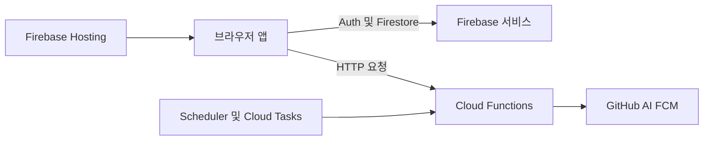

# CodeRecall 변경 안내서

CodeRecall은 `app`의 React/Vite 브라우저 번들과 `functions`의 Firebase Cloud Functions를 분리한 pnpm 워크스페이스다. 브라우저는 Firebase Auth·Firestore와 상호작용하고, Functions는 GitHub·AI·스케줄·태스크처럼 서버 권한이나 비동기 실행이 필요한 경계를 맡는다. 변경 전에는 아래 표에서 **변경이 넘는 경계**를 골라 해당 문서와 코드를 함께 읽는다.



*브라우저 직접 접근, Functions의 외부 연동, 정기 작업 및 Hosting 배포물이 만나는 런타임 경계다.*

## 작업 유형별 라우팅 맵

| 변경하려는 작업 | 먼저 읽을 페이지 | 함께 확인할 경계 |
| --- | --- | --- |
| 화면, 라우트, 랜딩, 앱 진입점 또는 `/api` 호출 | [시스템 개요와 실행 경계](architecture/system-overview.md) | Vite 다중 진입점, Hosting rewrite, 개발 프록시와 production Functions URL |
| 로컬 실행, 환경 변수, Emulator 또는 Firebase 배포 | [로컬 개발·검증·배포](operations/local-development-and-deployment.md) | `pnpm proxy`, `pnpm serve`, `pnpm dev`, 빌드 산출물과 배포 순서 |
| Firestore 문서·필드·규칙 또는 Admin SDK 쓰기 | [Firestore 소유권과 보안 경계](architecture/firestore-data-boundary.md) | 사용자 소유 문서, 공개 캐시, 서버 전용 상태 및 규칙 |
| AI HTTP 함수의 인증, 입력 또는 호출량 제한 | [AI 호출 비용·입력 경계](architecture/ai-call-guard.md) | 공개 URL과 서버의 인증·입력 검증·사용량 제어의 구분 |
| 오늘의 카드, 번역, 질문 재생성 또는 랜딩 데모 캐시 | [플래시카드 생성 경로](flashcard/generation-paths.md) | 앱 즉시 생성, 서버 사전 생성, GitHub·AI·Firestore 계약 |
| 카드 수, `rawDiff`, 저장 필드 또는 문서 크기 | [일별 덱 크기 예산](flashcard/deck-size-budget.md) | `app`과 `functions`에 복제된 덱 축소 정책 |
| 자정 이후 카드 준비, Scheduler, Cloud Tasks, 중복 또는 재시도 | [사용자 덱 사전 생성](flashcard/pregeneration.md) | 시간대, 완료 기록, 태스크 재시도와 앱 생성의 경합 |
| GitHub 로그인, 선택 저장소·브랜치 또는 커밋·파일 조회 | [GitHub 인증과 콘텐츠 접근](integrations/github-access.md) | Firebase ID 토큰, 사용자 토큰, 허용 저장소와 공개 접근의 차이 |
| 알림 권한, FCM 토큰, 희망 시각·시간대 또는 예약 발송 | [푸시 알림과 시간대 운영](operations/push-notifications.md) | 사용자 설정, 매시 대상 선별, FCM 실패 처리 |

여러 행에 걸치는 변경은 관련 문서를 모두 읽는다. 예를 들어 카드 필드를 추가하면 생성 경로·덱 크기 예산·Firestore 경계를 함께, 앱 URL을 바꾸면 시스템 개요·Hosting rewrite·PWA 진입점을 함께 검토한다.

## 가장 짧은 로컬 시작 경로

Node.js 22 이상, pnpm, Firebase CLI가 필요하다. `app/.env`를 준비하고 현재 작업 사본에 Firebase 프로젝트를 연결한다. 환경 파일과 `.firebaserc`는 커밋하지 않는다.

```bash
cp app/.env.example app/.env
firebase login
firebase use --add
pnpm install
pnpm proxy
pnpm serve
```

다른 터미널에서 Vite 개발 서버를 시작한다.

```bash
pnpm dev
```

`firebase init`은 실행하지 않는다. 저장소가 이미 `firebase.json`, `firestore.rules`, `functions/` 구성을 소유하므로 프로젝트 연결에는 `firebase use --add`를 쓴다. `pnpm serve`는 Functions를 빌드한 뒤 Functions Emulator만 시작하고, `pnpm dev`는 별도로 `app`의 Vite 서버를 시작한다. Firestore와 Auth Emulator는 이 명령으로 시작하지 않으므로, 데이터·규칙 변경은 선택한 프로젝트에 영향을 줄 수 있다는 전제에서 작은 범위로 확인한다.

`pnpm proxy`는 `app/.env`의 `VITE_PROJECT_ID`에서 Functions 호출에 필요한 프로젝트·리전·URL 변수를 보완한다. 이미 비어 있지 않은 값은 유지하므로, 프로젝트나 리전을 바꾼 경우 기존 URL이 새 대상과 맞는지 확인한다. Vite는 개발 중 `/api`를 Functions Emulator 대상으로 프록시하면서 접두사를 제거하고, production API 클라이언트는 `VITE_FUNCTIONS_URL_PROD`를 직접 사용한다. 이 값은 번들에 포함되므로 URL 계약을 바꾸면 개발 서버를 다시 시작하고 배포 전에는 다시 빌드한다. 세부 환경 변수와 Emulator 범위는 [로컬 개발·검증·배포](operations/local-development-and-deployment.md)를 따른다.

## 빌드·검증·배포 진입점

루트 `pnpm build`는 두 워크스페이스의 build를 실행한다. `app`은 타입 검사 후 Vite 산출물 `app/dist`를 만들고, `functions`는 TypeScript를 컴파일한다. PR 전에는 최소한 전체 빌드와 Functions lint를 실행한다.

```bash
pnpm build
pnpm --filter functions lint
```

전용 자동화 테스트 스위트는 없으므로 화면 변경은 `pnpm dev`에서 직접 확인하고 결과를 PR에 남긴다. Functions·규칙 변경은 Emulator 또는 테스트용 프로젝트에서 정상 경로와 인증·권한 거부 같은 실패 경로를 함께 확인한다.

Firebase는 Functions 배포 전에 Functions build를 실행하고, Hosting에는 **현재 존재하는** `app/dist`를 올린다. Hosting predeploy는 Vite를 실행하지 않는다. 또한 `/app`과 `/app/**`는 `app.html`로 rewrite되며 `/terms`, `/privacy`는 정적 문서로 간다. 따라서 UI·URL 변경 뒤에는 `/`, `/app`, 앱 하위 URL 새로고침, 약관 URL을 확인한다.

Functions와 규칙을 함께 바꿨다면 서버 계약을 먼저 배포하고, 검증한 번들을 Hosting에 배포한다.

```bash
firebase use
pnpm proxy
pnpm build
pnpm --filter functions lint
firebase deploy --only functions,firestore:rules
firebase deploy --only hosting
```

`pnpm push`는 `firebase deploy`의 별칭일 뿐 Hosting 빌드를 대신하지 않는다. 전체 절차와 배포 단위는 [로컬 개발·검증·배포](operations/local-development-and-deployment.md)에 있다.

## 문서와 변경 제출의 기준

OpenWiki는 필요할 때 찾는 보조 문맥이며, 코드와 테스트가 현재 동작의 정본이다. 위키의 범위와 우선순위는 [위키 작성 지침](INSTRUCTIONS.md)이 정하고, 생성된 위키를 직접 유지하는 대신 코드 또는 지침을 고친 뒤 갱신한다. 이 분리는 위키는 코드에서 재생성할 수 있는 요약이지만 설계 이유는 그렇지 않기 때문이다. 설계 결정을 새로 내리거나 바꾸는 경우에는 사람이 작성하는 원본인 [`docs/adr/`](../docs/adr/README.md)에 기록한다. 이 운영 결정을 채택한 이유는 [ADR 0002](../docs/adr/0002-adopt-openwiki.md)에 있다.

- 관련 이슈를 먼저 검색하고, 큰 변경은 구현 전에 이슈에서 방향을 맞춘다.
- 한 PR에는 한 목적만 담고, 리팩터링과 기능 추가는 나눈다.
- 비밀 값, API 키, 사용자 개인정보, 운영 계정 정보, 비용·매출 수치는 공개 문서·PR·스크린샷에 기록하지 않는다.
- 브랜치·커밋·PR 형식은 [기여 가이드](../.github/CONTRIBUTING.md)를 따른다.
